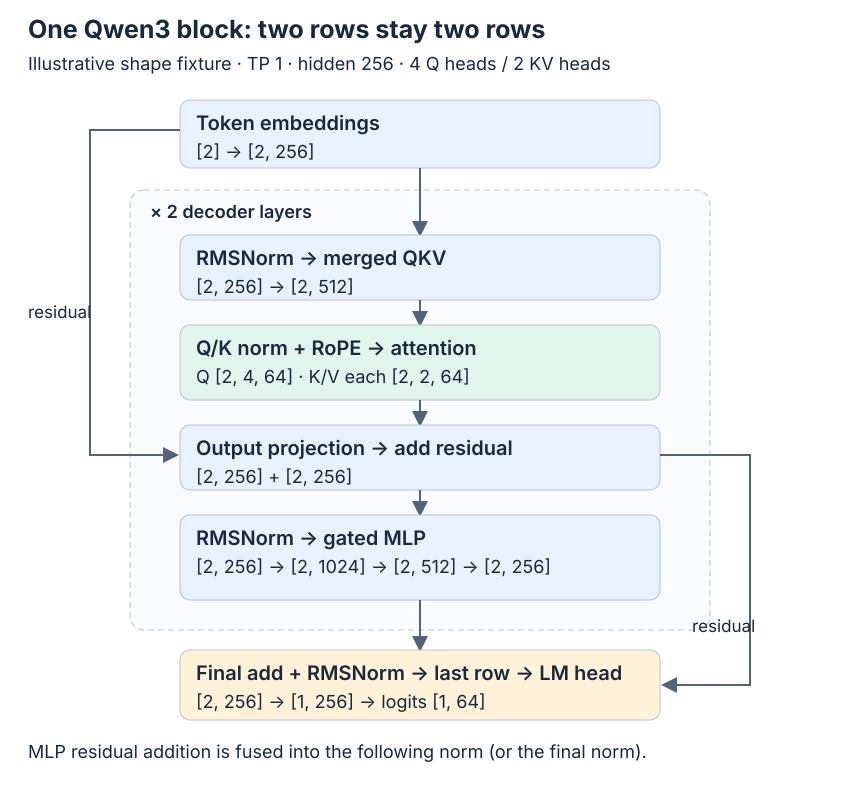
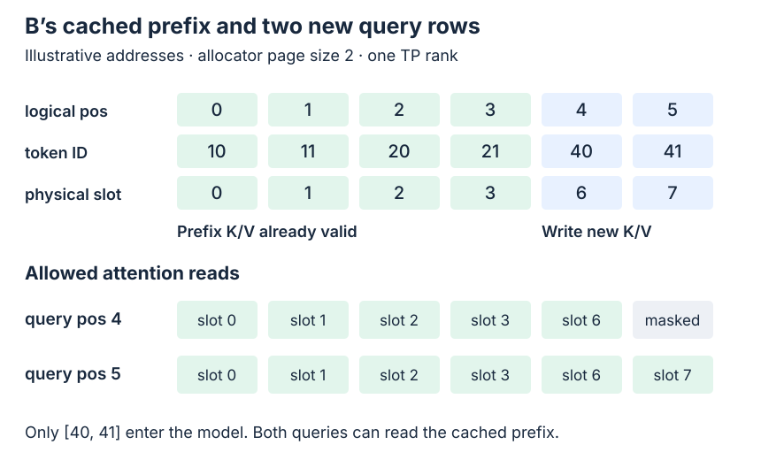
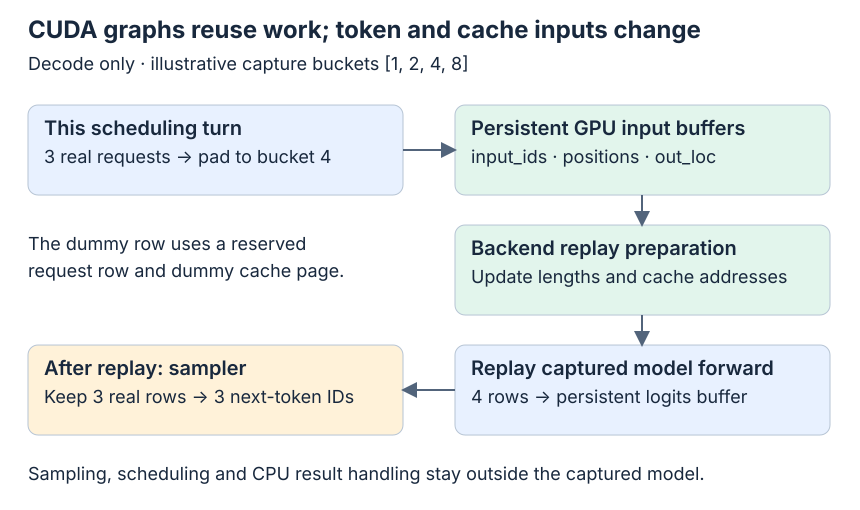

# Mini-SGLang Part 4: Inside the Engine—Attention, CUDA Graphs, and Tensor Parallelism

Series: [Part 1 — architecture](https://gozhiyuan.github.io/large-language-model/llm-inference/2026/09/12/minisglang-01.html) · [Part 2 — scheduling](https://gozhiyuan.github.io/large-language-model/llm-inference/2026/09/19/minisglang-02.html) · [Part 3 — cache management](https://gozhiyuan.github.io/large-language-model/llm-inference/2026/09/25/minisglang-03.html) · Part 4 — Engine execution

Part 3 followed a request's cache addresses. A matching prefix gave request B four already-computed token positions, and the allocator found slots for its two new prompt tokens. Those addresses tell us where computation can happen. We still need to see what actually fills them.

This final part follows the resulting batch through the Engine: token embeddings, Qwen3 layers, attention over cached K/V, the vocabulary head, and sampling. Then it examines two changes to that path: replaying a captured CUDA graph and splitting the model across tensor-parallel GPUs. We finish where the scheduler begins its next turn—with a sampled token that must become the next model input.

The question is:

> Given a prepared batch and a page table, how does Mini-SGLang compute the next token while preserving the right token positions, cache addresses, and execution order?

The useful mental model has three pieces. The scheduler selects **which token positions to compute** and assigns their physical cache locations. The model computes **new hidden states and K/V vectors**, while an attention backend reads the request's logical history through those locations. The Engine samples **one next token per real request**, and the scheduler keeps that token on the GPU for the next turn while arranging a CPU copy for the reply.

All Mini-SGLang source links refer to commit [`9a91cfa`](https://github.com/sgl-project/mini-sglang/tree/9a91cfafe754aa85daee49998176275667eb58f2), the same checkout as Parts 1–3. Paths below are relative to `python/minisgl/`. The main path is dense Qwen3 with the FlashInfer backend explicitly selected as `fi`, greedy sampling, and one GPU. Other backends and TP=2 appear where they change the explanation. This is a source walkthrough, not a measured GPU run.

## Contents

- [1. The batch at the Engine boundary](#1-the-batch-at-the-engine-boundary)
- [2. Two suffix tokens through Qwen3](#2-two-suffix-tokens-through-qwen3)
- [3. Attention connects logical history to physical K/V](#3-attention-connects-logical-history-to-physical-kv)
- [4. From hidden states to one sampled token](#4-from-hidden-states-to-one-sampled-token)
- [5. CUDA graphs: stable buffers, changing requests](#5-cuda-graphs-stable-buffers-changing-requests)
- [6. Tensor parallelism splits the model work](#6-tensor-parallelism-splits-the-model-work)
- [7. The next token takes two paths](#7-the-next-token-takes-two-paths)
- [8. What this engine teaches about full SGLang](#8-what-this-engine-teaches-about-full-sglang)
- [9. What was checked, and what still needs a GPU](#9-what-was-checked-and-what-still-needs-a-gpu)

## 1. The batch at the Engine boundary

Continue the example from Part 3. Request A previously left a reusable prefix. Request B has prompt IDs `[10, 11, 20, 21, 40, 41]`, and the first four positions match that prefix. With allocator page size two, B's six logical positions map to physical token slots `[0, 1, 2, 3, 6, 7]`.

B's prefill only needs to compute the two-token suffix. Assume it fits in one prefill batch; this is the final prompt chunk, so its sample can become B's first output token. For this post, expand the toy pool from Part 3’s four usable pages to **five**, with page bases `[0, 2, 4, 6, 8]`, and give B an output allowance of four tokens. This change matters: the Engine caps sequence length at usable token capacity, so the original eight-slot pool would clamp a six-token prompt to at most two output tokens. Ten usable slots allow the two later decode forwards shown here and satisfy B’s admission reservation after its prefix is locked.

```text
Req before prefill:
  input_ids  = [10, 11, 20, 21, 40, 41]  # CPU token history
  cached_len = 4                         # K/V already valid
  device_len = 6                         # input ends before position 6

Prepared GPU tensors:
  positions  = [4, 5]                    # absolute logical positions
  input_ids  = [40, 41]                  # tokens to compute now
  out_loc    = [6, 7]                    # physical slots to write

GPU page_table[B, :6] = [0, 1, 2, 3, 6, 7]
```

These token IDs and addresses are illustrative, as in Part 3. They are deliberately separate: token `40` is at logical position `4`, whose K/V goes into physical slot `6`. Swapping these numbers would change the meaning of the batch.

In [`Scheduler._prepare_batch()` and `_forward()`](https://github.com/sgl-project/mini-sglang/blob/9a91cfa/python/minisgl/scheduler/scheduler.py), preparation pads the request list if needed, allocates cache capacity, builds positions and index tuples, and asks the attention backend to prepare metadata. The actual token gather happens in `_forward()` on the execution path:

```python
# scheduler/scheduler.py  Scheduler._forward
def _forward(self, forward_input: ForwardInput) -> ForwardOutput:
    batch, sample_args, input_mapping, output_mapping = forward_input
    batch.input_ids = self.token_pool[input_mapping]
    forward_output = self.engine.forward_batch(batch, sample_args)
    self.token_pool[output_mapping] = forward_output.next_tokens_gpu
    self.decode_manager.filter_reqs(forward_input.batch.reqs)
    return forward_output
```

`input_mapping` indexes logical request rows and positions in `token_pool`; the corresponding gather from `page_table` produced `batch.out_loc` during preparation. `output_mapping` is another logical token-pool index, reserved for the sampled token. It does not index the K/V tensor pool.

The core distinction is between **request count** and **token count**. B alone gives `batch.size == 1`, but its prefill model input has two tokens. If several requests contribute different-length suffixes, their tokens are concatenated into a packed one-dimensional array. Metadata records where each request's segment starts and ends. The model does not need a rectangular `[requests, longest_prompt]` input padded with unrelated prompt tokens.

### The context supplies the rest of the input

[`Qwen3ForCausalLM.forward()`](https://github.com/sgl-project/mini-sglang/blob/9a91cfa/python/minisgl/models/qwen3.py) takes no explicit arguments. It reads the active batch from a process-local [`Context`](https://github.com/sgl-project/mini-sglang/blob/9a91cfa/python/minisgl/core.py). The Engine installs that batch with `with self.ctx.forward_batch(batch)`; the context also exposes the attention backend, page table, and K/V pool.

That makes the short model signature possible, but the model's effective input is larger than `input_ids`: positions determine RoPE, attention metadata defines request boundaries and visible history, and `out_loc` determines where new K/V is stored. Each TP process has its own context and rank-local tensors.

Here is the main call path. The arrows indicate calls and produced data, not timing:

```text
Scheduler._forward()                         scheduler/scheduler.py
  gather token_pool → batch.input_ids [N]
  Engine.forward_batch()                     engine/engine.py
    install batch in Context                 core.py
    model.forward() or graph replay          models/qwen3.py / engine/graph.py
      embedding → hidden states [N, D]
      decoder layers → hidden states [N, D]
        QKV projection → local Q, K, V        models/utils.py
        Q/K norm + RoPE                       layers/attention.py
        store K/V + read causal history       attention/fi.py
        output projection, residual, MLP
      last prompt rows → vocabulary logits   layers/embedding.py
    complete_one() for each real request     core.py
    sample logits → next token IDs [B]        engine/sample.py
    enqueue CPU copy + record event
  write next IDs into GPU token_pool         scheduler/scheduler.py
```

Here `N` is the number of token rows processed and `B` is the number of real requests. For B's prefill, `N=2` and `B=1`.

## 2. Two suffix tokens through Qwen3

The model transforms each new token into a hidden vector, repeatedly mixes it with its causal history, and projects the final hidden state into next-token scores. Prefix reuse saves the computation of earlier token rows at every layer; their saved K/V is still available for attention.

For readable shape arithmetic, use an **illustrative configuration**, not a claim about a shipped checkpoint:

| Symbol | Meaning | Example |
| --- | --- | --- |
| `N` | New token rows in this forward | 2 for prefill; 1 for each decode |
| `D` | Hidden width | 256 |
| `Hq` | Query heads | 4 |
| `Hkv` | Key/value heads | 2 |
| `d` | Width of each head | 64 |
| `I` | MLP intermediate width | 512 |
| `V` | Vocabulary size | 64 |
| `L` | Decoder layer count | 2 |

The head width is intentional: this checkout's [`RotaryEmbedding`](https://github.com/sgl-project/mini-sglang/blob/9a91cfa/python/minisgl/layers/rotary.py) accepts head sizes 64, 128, 256, or 512. A four-wide head would be convenient on paper but would fail that constructor's assertion. No weights were loaded for this example.



*Figure 1 — The two new prompt tokens remain two hidden-state rows throughout the decoder stack. Only the final row is selected for B's next-token logits. The diagram shows the mathematical residual path; the implementation carries a separate residual tensor and fuses additions into normalization.*

[`Qwen3Model.forward()`](https://github.com/sgl-project/mini-sglang/blob/9a91cfa/python/minisgl/models/qwen3.py) embeds the IDs, loops over decoder layers, and applies the final normalization. Each decoder layer has a compact forward:

```python
# models/qwen3.py  Qwen3DecoderLayer.forward
def forward(
    self, x: torch.Tensor, residual: torch.Tensor | None = None
) -> Tuple[torch.Tensor, torch.Tensor]:
    x, residual = self.input_layernorm.forward(x, residual)
    x = self.self_attn.forward(x)
    x, residual = self.post_attention_layernorm.forward(x, residual)
    x = self.mlp.forward(x)
    return x, residual
```

The first normalization receives no residual on the first layer. It returns normalized embeddings and retains the original embeddings as the residual stream. After attention, `post_attention_layernorm` combines the attention output with that stream and normalizes the sum for the MLP.

[`RMSNormFused.forward()`](https://github.com/sgl-project/mini-sglang/blob/9a91cfa/python/minisgl/layers/norm.py) makes the addition less obvious in Python: when a residual exists, `fused_add_rmsnorm` updates the tensors in place. The MLP output is returned separately; its addition into the residual happens at the next layer's input normalization, or at the model's final normalization for the last layer. Read the pair `(x, residual)` as two pieces of one residual computation.

### Q, K, and V are projected together

[`RopeAttn`](https://github.com/sgl-project/mini-sglang/blob/9a91cfa/python/minisgl/models/utils.py) performs a merged QKV projection, attention, and an output projection. At TP=1, the merged output width is:

```text
(Hq + 2 × Hkv) × d = (4 + 2 × 2) × 64 = 512

hidden states   [2, 256]
merged QKV      [2, 512]
Q               [2, 256] → [2, 4, 64]
K               [2, 128] → [2, 2, 64] conceptually
V               [2, 128] → [2, 2, 64] conceptually
attention out   [2, 4, 64] → [2, 256]
output proj     [2, 256]
```

The K/V projection slices remain flattened in parts of the Python path; the conceptual head shapes describe their interpretation by the cache store and backend. Grouped-query attention gives each K/V head to two query heads in this example: `Hq/Hkv = 2`.

The ordering in [`AttentionLayer.forward()`](https://github.com/sgl-project/mini-sglang/blob/9a91cfa/python/minisgl/layers/attention.py) matters:

```python
# layers/attention.py  AttentionLayer.forward
def forward(self, qkv: torch.Tensor) -> torch.Tensor:
    ctx = get_global_ctx()
    q, k, v = qkv.split([self.qo_attn_dim, self.kv_attn_dim, self.kv_attn_dim], dim=-1)
    if self.q_norm is not None:
        self.q_norm.forward_inplace(q.view(-1, self.num_qo_heads, self.head_dim))
    if self.k_norm is not None:
        self.k_norm.forward_inplace(k.view(-1, self.num_kv_heads, self.head_dim))
    q, k = self.rotary.forward(ctx.batch.positions, q, k)
    q = q.view(-1, self.num_qo_heads, self.head_dim)
    o = ctx.attn_backend.forward(q, k, v, self.layer_id, ctx.batch)
    return o.view(-1, self.qo_attn_dim)
```

Dense Qwen3 enables the optional Q/K normalization. It normalizes each head, then RoPE rotates Q and K using absolute positions `[4, 5]`. The reused prefix does not cause those positions to restart at zero. V does not pass through this rotary step. The attention backend receives the transformed Q/K together with V and the active batch.

### The MLP preserves the token rows

[`GatedMLP`](https://github.com/sgl-project/mini-sglang/blob/9a91cfa/python/minisgl/models/utils.py) merges the gate and up projections, applies the selected activation-and-multiply operation, and projects back to hidden width. For the SiLU variant:

```text
x [2, 256]
  → gate_up [2, 1024]       # two intermediate vectors of width 512
  → SiLU(gate) × up [2, 512]
  → down projection [2, 256]
```

For a scalar illustration, `gate=1` and `up=2` give `SiLU(1) × 2 ≈ 1.4621`. This is arithmetic showing the gating operation, not an activation measured from B. The implementation selects SiLU or GELU from `config.hidden_act`; this worked path uses SiLU.

## 3. Attention connects logical history to physical K/V

For each layer, attention must first make the new tokens' keys and values available, then read the allowed history for every query. That history contains both the four reused prefix positions and the newly computed suffix.

The [FlashInfer backend's `forward()`](https://github.com/sgl-project/mini-sglang/blob/9a91cfa/python/minisgl/attention/fi.py) exposes the boundary directly:

```python
# attention/fi.py  FlashInferBackend.forward
def forward(
    self, q: torch.Tensor, k: torch.Tensor, v: torch.Tensor, layer_id: int, batch: Batch
) -> torch.Tensor:
    def _flatten_cache(cache: torch.Tensor) -> torch.Tensor:  # treat page = 1
        return cache.view(-1, 1, cache.shape[2], cache.shape[3])

    metadata = batch.attn_metadata
    assert isinstance(metadata, FIMetadata)
    self._initialize_metadata_once(metadata)
    self.kvcache.store_kv(k, v, batch.out_loc, layer_id)
    kv_cache = (self.kvcache.k_cache(layer_id), self.kvcache.v_cache(layer_id))
    kv_cache = (_flatten_cache(kv_cache[0]), _flatten_cache(kv_cache[1]))
    return metadata.wrapper.run(q=q, paged_kv_cache=kv_cache)
```

`store_kv()` scatters the current layer's new K and V to `batch.out_loc`. For B, these are slots `6` and `7`. The attention wrapper then reads the current layer's cache using prepared metadata. Each layer has its own K/V storage at those same slot indices; layer 0's vectors are not substituted for layer 1's vectors.

[`MHAKVCache`](https://github.com/sgl-project/mini-sglang/blob/9a91cfa/python/minisgl/kvcache/mha_pool.py) allocates:

```text
[2, L, allocated_pages, allocator_page_size, local_KV_heads, d]
 ↑
 K and V
```

The Engine allocates one extra page for dummy graph requests. With five usable pages, page size two, two layers, two local K/V heads, and head width 64, the illustrative pool shape is `[2, 2, 6, 2, 2, 64]`. A per-layer K or V view is `[6, 2, 2, 64]`; the store flattens the page and within-page axes to `[12, 2, 64]` so a physical token slot can index it directly. For bfloat16, the five usable pages occupy `2 × 2 × 5 × 2 × 2 × 64 × 2 = 10240` bytes; the extra dummy page brings this toy pool to 12288 bytes. This excludes weights and every other buffer.

### The allocator's pages and FlashInfer's pages use different units

Part 3 used allocator pages of two token slots. FlashInfer's metadata in this implementation always reports `page_size=1`. Both statements describe the same storage at different views.

The local `_flatten_cache()` reshapes the per-layer cache from `[pages, page_size, heads, d]` into `[token_slots, 1, heads, d]`. FlashInfer then treats each physical token slot as a one-token page. Its index list contains the slot IDs themselves:

```text
B prefill metadata, before graph padding:
  query lengths         = [2]
  K/V history lengths   = [6]
  cu_seqlens_q          = [0, 2]
  cu_seqlens_k          = [0, 6]
  indices               = [0, 1, 2, 3, 6, 7]
  page_size             = 1       # FlashInfer view
  last_page_len         = [1]
  pos_encoding_mode     = "NONE"  # RoPE already applied upstream
```

The `cu_seqlens` arrays are cumulative boundaries: B's query rows occupy packed interval `[0, 2)`, while its readable K/V slot list occupies `[0, 6)`. For two requests contributing two and three query rows, the query boundary array would be `[0, 2, 5]`. This is how a flat token array can still describe separate sequences.

[`prepare_metadata()`](https://github.com/sgl-project/mini-sglang/blob/9a91cfa/python/minisgl/attention/fi.py) concatenates each request's page-table row through `device_len`. `_initialize_metadata_once()` plans the wrapper once for this batch; the layers reuse the plan while selecting their own K/V tensors. Its event wait protects the pinned host staging buffer reused by FlashInfer planning. That event is separate from the Engine's result-copy event discussed later.



*Figure 2 — New K/V is written to slots 6 and 7, but query position 4 can read only positions 0–4. Query position 5 can read all six positions. Green prefix cells represent valid K/V from the earlier request; the blue suffix cells are computed in this forward.*

### Writing both suffix tokens does not expose the future

The prefill wrapper is planned with `causal=True`. For the query at absolute position 4, logical position 5 is masked even though that position's K/V has already been written into slot 7. Physical availability and causal permission are separate conditions.

For one head, the conceptual computation is:

```text
attention(q_p) = softmax(q_p Kᵀ / sqrt(d) + mask_p) V
mask_p[j] = 0 if j ≤ p, otherwise −∞
```

With `d=64`, the score scale is `1/sqrt(64)=1/8`. As a synthetic arithmetic check, suppose a query is zero so every unmasked score is zero, and one coordinate of the six value vectors is `[1, 2, 3, 4, 5, 6]`. Position 4 assigns weight `1/5` to its five allowed values and returns `3` for that coordinate. Position 5 assigns weight `1/6` and returns `3.5`. The mask changes which values participate; the real model's Q/K scores determine their actual weights.

During decode, B contributes one new query. The history grows to seven positions, while only that one token's K/V must be computed. Prefix caching saves repeated prefix work; it does not remove prefix vectors from the attention history.

### Other attention backends preserve the batch contract

The configured default is `attention_backend="auto"`. [`_adjust_config()`](https://github.com/sgl-project/mini-sglang/blob/9a91cfa/python/minisgl/engine/engine.py) chooses `trtllm` when its SM100 capability predicate holds, otherwise `fa,fi` when the SM90 predicate holds, otherwise `fi`. This walkthrough selects `fi` explicitly so the metadata does not change halfway through the explanation.

| Selection | Source implementation | Important difference |
| --- | --- | --- |
| `fi` | [`FlashInferBackend`](https://github.com/sgl-project/mini-sglang/blob/9a91cfa/python/minisgl/attention/fi.py) | Flattens cache storage into one-token pages; uses separate prefill/decode wrappers |
| `fa` | [`FlashAttentionBackend`](https://github.com/sgl-project/mini-sglang/blob/9a91cfa/python/minisgl/attention/fa.py) | Converts token-slot rows to physical page IDs by striding and dividing by allocator page size |
| `trtllm` | [`TensorRTLLMBackend`](https://github.com/sgl-project/mini-sglang/blob/9a91cfa/python/minisgl/attention/trtllm.py) | Calls FlashInfer's TensorRT-LLM attention kernels with block tables; config adjustment enforces supported page sizes |
| `fa,fi` | [`HybridBackend`](https://github.com/sgl-project/mini-sglang/blob/9a91cfa/python/minisgl/attention/base.py) | Delegates prefill to `fa` and decode to `fi`; graph support follows the decode backend |

The `trtllm` name here selects an attention implementation inside Mini-SGLang. The surrounding Qwen3 model path is still this repository's Python model and layers.

## 4. From hidden states to one sampled token

B entered the model with two query rows, but it needs one next output token. The last prompt position supplies that prediction.

[`ParallelLMHead.forward()`](https://github.com/sgl-project/mini-sglang/blob/9a91cfa/python/minisgl/layers/embedding.py) selects the last row of each real request's packed segment before applying the vocabulary projection:

```python
# layers/embedding.py  ParallelLMHead.forward
def forward(self, x: torch.Tensor) -> torch.Tensor:
    ctx = get_global_ctx()
    batch = ctx.batch
    bs = batch.size
    if batch.is_prefill:
        indices = batch.attn_metadata.get_last_indices(bs)
        x = x[indices].contiguous()
        del indices

    module = self.tied_embedding or self
    logits = F.linear(x, module.weight, self.bias)
```

For B, `cu_seqlens_q=[0, 2]`, so `get_last_indices(1)` returns `[1]`. The final hidden tensor `[2, 256]` becomes `[1, 256]`, and the head produces logits `[1, 64]`. With query boundaries `[0, 2, 5]`, the selected rows would be `[1, 4]`. Decode already has one row per request, so that prefill-only selection is unnecessary.

The Engine's remaining work is visible in [`forward_batch()`](https://github.com/sgl-project/mini-sglang/blob/9a91cfa/python/minisgl/engine/engine.py):

```python
# engine/engine.py  Engine.forward_batch
def forward_batch(self, batch: Batch, args: BatchSamplingArgs) -> ForwardOutput:
    assert torch.cuda.current_stream() == self.stream
    with self.ctx.forward_batch(batch):
        if self.graph_runner.can_use_cuda_graph(batch):
            logits = self.graph_runner.replay(batch)
        else:
            logits = self.model.forward()

    for req in batch.reqs:
        req.complete_one()

    next_tokens_gpu = self.sampler.sample(logits[: batch.size], args).to(torch.int32)
    next_tokens_cpu = next_tokens_gpu.to("cpu", non_blocking=True)
    copy_done_event = torch.cuda.Event()
    copy_done_event.record(self.stream)
    return ForwardOutput(next_tokens_gpu, next_tokens_cpu, copy_done_event)
```

For an all-greedy batch, [`Sampler.prepare()`](https://github.com/sgl-project/mini-sglang/blob/9a91cfa/python/minisgl/engine/sample.py) leaves `temperatures=None`, and `sample()` takes `torch.argmax(logits, dim=-1)`. The other branch computes probabilities with temperature and selects the appropriate top-k/top-p sampling function. Mixed greedy/stochastic batches share that probability path, with a small positive temperature for greedy entries; the direct argmax shortcut applies when every request is greedy.

Assume B's first selected token is `50`. This is an illustrative token ID, not a model result. `Req.complete_one()` changes the counters from `(cached_len=4, device_len=6)` to `(6, 7)`: the six input positions are accounted for, and position 6 is reserved as the next input position. Its K/V will be computed on the next forward.

These counter changes happen on the host after GPU work has been submitted. GPU readiness follows stream ordering and events; the counters themselves are not a synchronization barrier.

## 5. CUDA graphs: stable buffers, changing requests

Decode repeats a similar sequence of GPU operations with one token per active request. A CUDA graph records that model execution so later turns can replay it through stable tensor addresses, reducing repeated host launch work. The graph still runs the model kernels; it does not reuse an earlier request's answer.

[`GraphRunner.can_use_cuda_graph()`](https://github.com/sgl-project/mini-sglang/blob/9a91cfa/python/minisgl/engine/graph.py) checks `batch.is_decode` and whether the real batch size fits the maximum captured bucket. Prefill uses the ordinary model path in this implementation. Oversized decode batches also use that path.

At startup, the graph runner allocates persistent buffers for token IDs, positions, output cache locations, and logits. For each configured bucket it builds a dummy decode batch, prepares backend capture metadata, warms the model, and captures the forward plus its logits-buffer write. Sampling occurs later in `Engine.forward_batch()` and stays outside that captured region.

For an illustrative bucket list `[1, 2, 4, 8]`, three real decode requests use the four-row graph. `pad_batch()` appends one dummy request. The Engine has reserved both a dummy request-table row and an extra physical cache page, so padding writes use that reserved cache area. Only the three real logit rows are returned for sampling.



*Figure 3 — Stable GPU storage makes replay possible. Token IDs, positions, write locations, and backend attention metadata are refreshed for each turn. The graph bucket is a padded execution shape, not the number of user-visible outputs.*

The replay function is short because preparation has done the important work:

```python
# engine/graph.py  GraphRunner.replay
def replay(self, batch: Batch) -> torch.Tensor:
    assert self.can_use_cuda_graph(batch)
    self.buffer.copy_from(batch)
    g = self.graph_map[batch.padded_size]
    self.attn_backend.prepare_for_replay(batch)
    g.replay()
    return self.buffer.logits[: batch.size]
```

`buffer.copy_from()` refreshes the persistent token/position/location arrays. Backend `prepare_for_replay()` refreshes attention planning or capture buffers with this batch's history lengths and cache addresses. `g.replay()` then uses those updated inputs. The vocabulary result comes from a persistent logits buffer, sliced to real request count.

The default bucket list is not simply every power of two. Without an explicit list, `_determine_cuda_graph_bs()` builds `[1, 2, 4]` followed by steps of eight through the chosen maximum. Its normal maximum is 160, or 256 when the passed free-memory value exceeds 80 GiB. These are configuration heuristics in this checkout, not measured optimal batch sizes. An explicit bucket list replaces that policy; a non-positive configured maximum disables capture.

Graph replay and prefix caching save different work. Prefix caching skips already-valid token computations. Graph replay reduces how much host work is needed to launch the remaining decode computation. Neither turns a fresh token's forward into a lookup of previously sampled logits.

## 6. Tensor parallelism splits the model work

With two tensor-parallel GPUs, both ranks process the same logical token positions. Each holds a different model-weight shard and the corresponding local K/V heads. Communication combines partial model results at specific layer boundaries.

For our illustrative dimensions, TP=2 gives each rank two query heads and one K/V head. B still contributes two prefill rows, so the local attention shapes become:

| Operation | Per-rank shape at TP=2 | Communication |
| --- | --- | --- |
| Vocabulary embedding | `[2, 256]` contribution | All-reduce produces full embeddings |
| Merged QKV projection | `[2, 256]` | None at this projection |
| Local Q | `[2, 2, 64]` | None for local attention |
| Local K and V, each | `[2, 1, 64]` | Stored in that rank's K/V pool |
| Attention output before output projection | `[2, 128]` | None yet |
| Attention output projection | `[2, 256]` partial sum | All-reduce sums contributions |
| Merged gate/up projection | `[2, 512]` | Each rank owns half of each intermediate projection |
| Gated activation | `[2, 256]` | None yet |
| MLP down projection | `[2, 256]` partial sum | All-reduce sums contributions |
| Vocabulary head for B's final row | `[1, 32]` local logits | All-gather reconstructs `[1, 64]` |

The key implementations are [`LinearQKVMerged`, `LinearOProj`, and `LinearRowParallel`](https://github.com/sgl-project/mini-sglang/blob/9a91cfa/python/minisgl/layers/linear.py), plus [`VocabParallelEmbedding` and `ParallelLMHead`](https://github.com/sgl-project/mini-sglang/blob/9a91cfa/python/minisgl/layers/embedding.py). Column-parallel projections compute different output channels. Row-parallel output projections consume different input channels and sum their partial contributions:

```python
# layers/linear.py  LinearOProj.forward
def forward(self, x: torch.Tensor) -> torch.Tensor:
    y = F.linear(x, self.weight, self.bias)
    if self._tp_size > 1:
        y = self._comm.all_reduce(y)
    return y
```

If the partial contributions to one output coordinate are `0.3` and `0.7`, the all-reduce sum gives `1.0` on both ranks. The collective follows from the sharded matrix multiplication; it is not a separate request-routing step.

[`load_weight()` and `_shard_tensor()`](https://github.com/sgl-project/mini-sglang/blob/9a91cfa/python/minisgl/models/weight.py) prepare matching weight shards and merge Q/K/V or gate/up tensors into the runtime layout. When TP size exceeds the number of K/V heads in a supported divisible arrangement, K/V heads are replicated across ranks instead of divided below one head. That case changes cache memory scaling; doubling TP does not universally halve every cache component.

After the head gathers the full vocabulary logits, each rank calls its local sampler. For the greedy path here, equal full logits give the same argmax. This Engine/sampler path contains no explicit sampled-token broadcast. The Engine seeds PyTorch with 42, but that line alone is not a verification of stochastic agreement across ranks; that requires a multi-GPU sampling check.

The collective interface in [`distributed/impl.py`](https://github.com/sgl-project/mini-sglang/blob/9a91cfa/python/minisgl/distributed/impl.py) can use PyTorch distributed or the custom PyNCCL communicator. The model calls the same all-reduce/all-gather interface in either case. Tensor parallelism changes ownership and introduces synchronization; it does not give each GPU an independent conversation.

## 7. The next token takes two paths

A sampled token serves two consumers. The next model forward needs it on the GPU; the reply and CPU request history need its host value. Mini-SGLang separates those paths so scheduling need not wait for detokenization.

On the GPU path, `_forward()` writes `next_tokens_gpu` to the logical `token_pool` position selected before the forward. After B's prefill, token `50` goes into `token_pool[B, 6]`. The K/V mapping for that position is handled when the next batch is prepared. With this post’s extra free page, that preparation assigns physical slot `8` to position 6. A’s divergent page `[4,5]` can remain cached during these two decode steps; Part 3’s smaller pool illustrated the eviction branch instead.

Here is the resulting trace, including two decode forwards. Sampled IDs are illustrative; prefix/suffix addresses follow Part 3, with the extra page `[8,9]` supplying decode capacity:

| Forward | Input IDs processed now | Absolute positions | New K/V slots written | Logical K/V history after the model work | Next token |
| --- | --- | --- | --- | --- | --- |
| B prefill | `[40, 41]` | `[4, 5]` | `[6, 7]` | positions 0–5 in slots `[0,1,2,3,6,7]` | `50` |
| B decode 1 | `[50]` | `[6]` | `[8]` | positions 0–6 in slots `[0,1,2,3,6,7,8]` | `51` |
| B decode 2 | `[51]` | `[7]` | `[9]` | positions 0–7 in slots `[0,1,2,3,6,7,8,9]` | `52` |

The first decode allocates the two-slot page `[8,9]`; the second decode uses its remaining slot. At the end of decode 2, `52` is available as the next input token, but its own K/V has not been computed. A sample predicts the next token; a later forward processes that token.

### What the CPU completion event actually protects

In `Engine.forward_batch()`, the Engine enqueues a nonblocking CPU copy of the sampled IDs and records `copy_done_event` on the Engine stream. [`Scheduler._process_last_data()`](https://github.com/sgl-project/mini-sglang/blob/9a91cfa/python/minisgl/scheduler/scheduler.py) synchronizes that event before reading the CPU tensor:

```python
# scheduler/scheduler.py  Scheduler._process_last_data
def _process_last_data(self, last_data: ForwardData | None) -> None:
    if last_data is None:
        return

    batch, (_, next_tokens_cpu, copy_done) = last_data[0].batch, last_data[1]
    copy_done.synchronize()
```

It then appends each non-chunk request's sample to CPU `Req.input_ids`, checks the output limit and EOS, creates `DetokenizeMsg`, and handles cache insertion or cleanup. Intermediate `ChunkedReq` results are skipped at this boundary; this article follows B's completed prompt prefill.

The event specifically marks the result-copy boundary. The subsequent GPU token-pool write in `_forward()` is enqueued after `Engine.forward_batch()` returns, so it is later than this event. The event should not be read as “all scheduler feedback work is complete.” The Engine stream's ordering carries the token-pool write before later model work submitted on that stream.

In overlap mode, the scheduler builds metadata on its own stream, and the Engine stream waits for that preparation before launching the next batch. Input IDs are gathered on the Engine execution path. This allows the gather to follow the preceding GPU token-pool write, even when the CPU has not yet appended that sample to the request's host token history.

Part 2 followed the loop-level overlap; here the important dependencies are:

```text
scheduler stream prepares positions, locations, metadata
  → Engine stream waits for that preparation
  → Engine gathers current token IDs
  → model forward → sampling → CPU copy → copy-done event
  → GPU token-pool write
  → later Engine-stream work can consume that token

CPU result handling waits for copy-done
  → reads sampled IDs → appends host history → sends detokenizer messages
```

The lower branch can run while a later batch's GPU work is underway. The cache itself remains in GPU memory; only IDs and metadata cross the host/device boundary on this path. No measured overlap speedup is claimed here.

## 8. What this engine teaches about full SGLang

The four parts now connect one complete serving path: frontend messages become pending requests; admission forms batches; cache management supplies addresses; the Engine computes token states; and sampled IDs return both to the client path and to the next iteration.

Mini-SGLang retains mechanisms that matter in a larger serving engine: prefix reuse, chunked prefill, packed attention metadata, distinct prefill/decode execution, tensor-parallel collectives, decode CUDA graphs, and overlapping scheduling. The value of the smaller implementation is that those mechanisms meet at a few boundaries we can inspect directly.

The boundary also makes omissions easier to see. In this selected Mini-SGLang path, a forward produces one sample per real request; prefill and decode share the local Engine/cache infrastructure; and the dense Qwen3 model consumes token IDs through its context. The codebase also registers Qwen3 MoE and several other model families, so “small” should not be read as “only one model.”

For a bounded comparison, the full SGLang checkout at [`f825d72`](https://github.com/sgl-project/sglang/tree/f825d729363136a2d4a4b330fa694d0b37a878fa) exposes additional system choices:

| Question after this series | Mini-SGLang path explained here | Where the fuller runtime adds another problem |
| --- | --- | --- |
| Can one iteration propose and verify several tokens? | One next-token sample per real request | [`Speculative-decoding configuration`](https://github.com/sgl-project/sglang/blob/f825d729363136a2d4a4b330fa694d0b37a878fa/python/sglang/srt/arg_groups/speculative_hook.py) selects draft/verification behavior |
| Can prefill and decode run on separate serving workers? | Both phases use a local Engine and local K/V pool | [`Disaggregation configuration`](https://github.com/sgl-project/sglang/blob/f825d729363136a2d4a4b330fa694d0b37a878fa/python/sglang/srt/arg_groups/pd_disaggregation_hook.py) handles phase-specific workers and K/V transfer backends |
| Does tensor parallelism describe every deployment axis? | Model channels and heads are partitioned across TP ranks | The disaggregation configuration also checks interactions with decode context parallelism and cache policy |

Those source entry points establish the extra configuration surfaces, not a complete explanation or benchmark of their implementations. They are good next reading questions once the local batch-to-token contract is clear. A speculative verifier changes how many token positions an iteration may accept; a disaggregated deployment changes who owns and transfers the K/V state. Both build on concepts this series has now made explicit.

## 9. What was checked, and what still needs a GPU

The mechanisms above were traced against the pinned source, including their callers and consumers. The numerical examples are illustrative fixtures; they are not generated Qwen3 tokens, hidden activations, or latency measurements.

CPU checks against the actual `minisgl.core` classes passed with Python 3.10.18 and PyTorch 2.7.1. They verified B's request counters `(6,7)`, `(7,8)`, and `(8,9)`, host appends of the illustrative tokens, context cleanup after normal and exceptional exits, nested-context rejection, and seven `SamplingParams.is_greedy` boundary cases. They exercise host-side contracts only; they do not execute the sampler, attention, or CUDA graphs.

The retained [CPU check script](assets/check_core.py) can be run from the Mini-SGLang repository with an existing compatible PyTorch environment:

```bash
PYTHONPATH=python python /path/to/check_core.py
```

The [execution output](assets/check_core.txt) and [source claim ledger](article.json) record the validation boundary.

The existing [`store-cache check`](https://github.com/sgl-project/mini-sglang/blob/9a91cfa/tests/kernel/test_store.py) asserts that K and V arrive at selected CUDA indices. The [`communication check`](https://github.com/sgl-project/mini-sglang/blob/9a91cfa/tests/kernel/test_comm.py) checks collective results across GPUs. The [`scheduler smoke script`](https://github.com/sgl-project/mini-sglang/blob/9a91cfa/tests/core/test_scheduler.py) launches a CUDA/model-backed request and logs generated text. These were **not run** here: they require Linux/NVIDIA CUDA and, for the scheduler script, model access. The scheduler smoke is not a numerical output assertion.

Important follow-up checks are eager-versus-graph logit agreement with padding, prefix-hit attention agreement against a cold prefill, TP=1 versus TP=2 greedy output agreement, and repeated overlap scheduling with EOS/abort cleanup. The small test collection does not by itself verify those complete contracts.

Across all four parts, the reusable reading rule is to keep three coordinates separate: **which token is being processed, where its K/V lives, and when that state is ready to consume**. B's token `50`, logical position `6`, and physical slot `8` are different facts. The scheduler, cache manager, attention backend, and stream ordering make those facts agree for the next forward.
