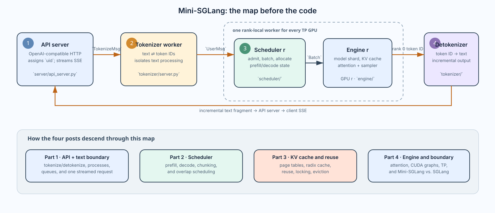
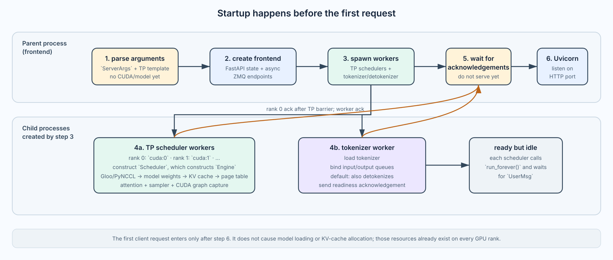
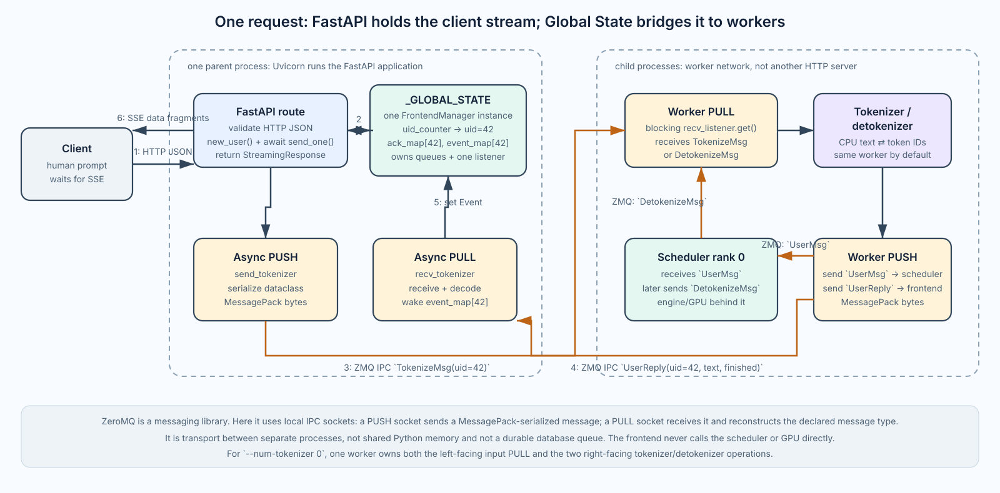
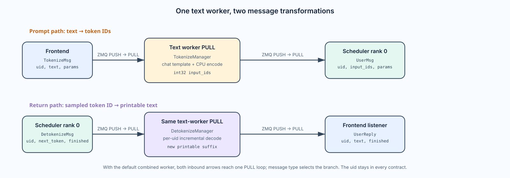
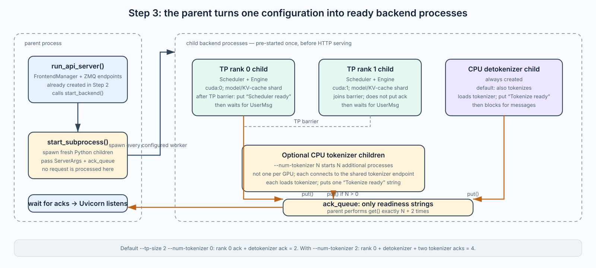
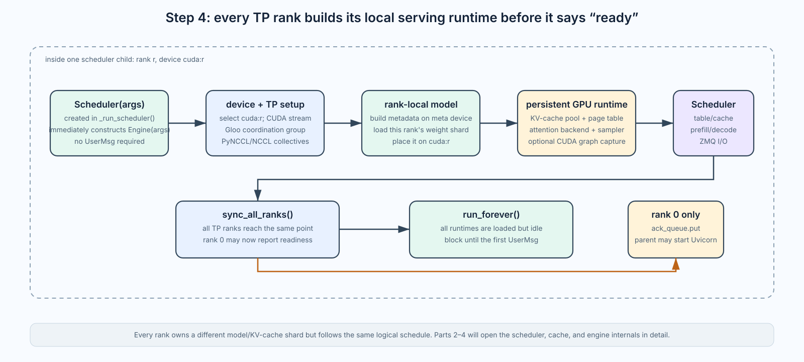
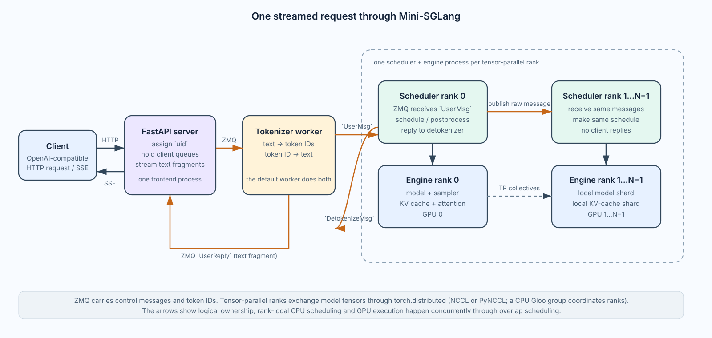
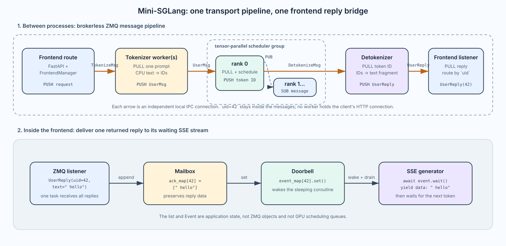
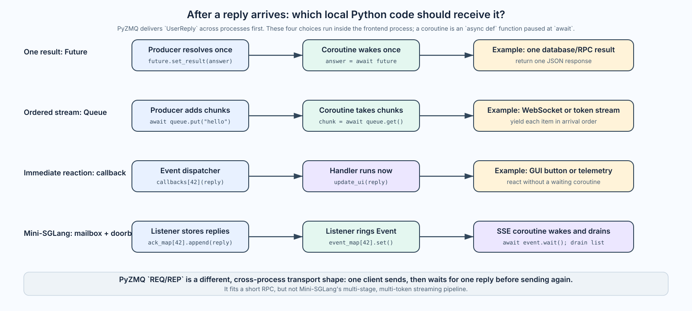
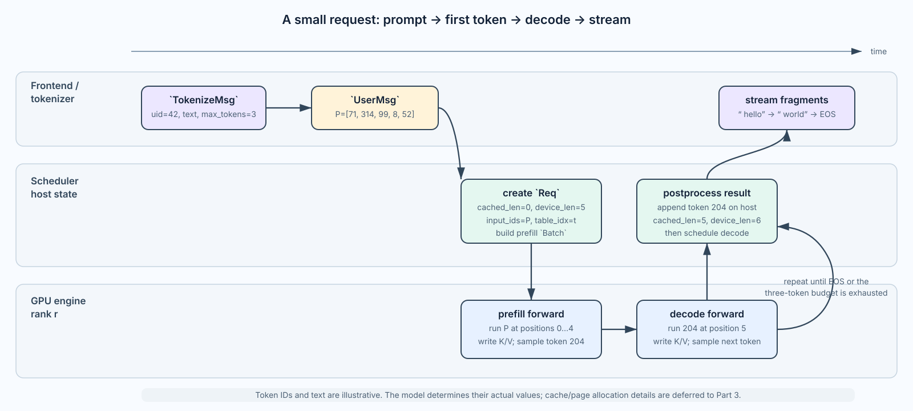

# Mini-SGLang Part 1: Architecture and One Request's Journey

The four [nano-vLLM]() posts we have just read—[scheduler](), [KV cache and block tables](), [model forward and tensor parallelism](), and [the full engine]()—made it possible to study a useful LLM *inference core* in a single process: an `LLMEngine` creates `Sequence` objects, a `Scheduler` chooses a batch, a `BlockManager` assigns KV-cache blocks, and a `ModelRunner` executes the GPU forward pass.

[Mini-SGLang](https://github.com/sgl-project/mini-sglang) starts one level higher. It is a deliberately small but real **online-serving system**. Before the GPU sees a token, an HTTP frontend assigns a request ID, a tokenizer worker produces token IDs, scheduler workers on tensor-parallel ranks receive the same request, and a primary rank eventually routes each sampled token through a detokenizer and back to the HTTP stream.

## A map before we read code

The diagram below is the whole system at the level useful for a first read. It has five runtime roles. The `Scheduler` is the control-plane owner for one GPU rank, and its `Engine` is the GPU runtime it drives; they are separate classes but live in the same worker process. When tensor parallelism has degree (N), the scheduler-and-engine worker is repeated (N) times.



*Figure 1 — The system map and the series roadmap. Part 1 covers the API and the tokenizer/detokenizer text boundary; Parts 2–4 descend into scheduling, cache reuse, and GPU execution.*

| Component | What it owns | Major techniques we will learn from it |
| --- | --- | --- |
| **API Server** | OpenAI-compatible HTTP, client request IDs, cancellation, SSE output | asynchronous request ownership, ZMQ hand-off, incremental streaming, and cancellation propagation |
| **Tokenizer / Detokenizer Workers** | chat-template/text tokenization and incremental detokenization | process isolation for CPU text work, the text-to-token boundary, and stateful token-to-text streaming |
| **Scheduler Worker** | request admission, prefill/decode batch construction, request-table and cache allocation | continuous batching, chunked prefill, prefill/decode policy, overlap scheduling, and cache-aware resource reservation |
| **Engine** inside each Scheduler Worker | model-weight shard, local KV-cache shard, attention backend, sampler, CUDA graphs | paged KV-cache execution, FlashAttention/FlashInfer backends, CUDA graph replay, token sampling, and tensor parallelism |

The four posts follow the architectural ownership that matters most for inference: API/frontend, scheduler, KV cache and prefix reuse, then engine execution. **Part 1 also covers tokenization and detokenization as its text boundary:** `TokenizeMsg` carries a prompt from the API to a CPU worker, and `UserReply` carries incremental text back to the same HTTP stream. We follow those hand-offs far enough to make the request journey whole, but the small text workers do not need a standalone post beside the scheduler, cache, and GPU runtime.

Part 3 is separate even though the engine holds the rank-local KV-cache pool: the scheduler-side managers allocate request-table rows, decide reuse, and manage radix-prefix cache lifetime, while the engine executes attention against the resulting pages. This split is exactly what makes cache behavior worth tracing as its own topic.

This first post answers one question:

> When a client sends one chat-completion request to Mini-SGLang, which process owns it at each moment, which object represents it, and how does one generated token return to the client?

The code paths below are from Mini-SGLang's `main` branch at commit `9a91cfa`. The project describes itself as a compact distillation of SGLang's high-level serving architecture—not a copy of every production feature. In particular, the code here implements tensor parallelism, radix caching, chunked prefill, and overlap scheduling; cluster-level cache-aware routing and DeepSeek MLA data-parallel attention belong to full SGLang, not this repository. [Mini-SGLang announcement](https://www.lmsys.org/blog/2025-12-17-minisgl/)

The main files for this post are [`server/launch.py`](https://github.com/sgl-project/mini-sglang/blob/main/python/minisgl/server/launch.py), [`server/api_server.py`](https://github.com/sgl-project/mini-sglang/blob/main/python/minisgl/server/api_server.py), [`tokenizer/server.py`](https://github.com/sgl-project/mini-sglang/blob/main/python/minisgl/tokenizer/server.py), [`scheduler/scheduler.py`](https://github.com/sgl-project/mini-sglang/blob/main/python/minisgl/scheduler/scheduler.py), [`scheduler/io.py`](https://github.com/sgl-project/mini-sglang/blob/main/python/minisgl/scheduler/io.py), [`engine/engine.py`](https://github.com/sgl-project/mini-sglang/blob/main/python/minisgl/engine/engine.py), and [`core.py`](https://github.com/sgl-project/mini-sglang/blob/main/python/minisgl/core.py).

## 1. Start a ready server

The command below does not merely load a model and call `generate()`:

```bash
python -m minisgl --model Qwen/Qwen3-0.6B --tp-size 2
```

> **Small source-version warning.** The README currently shows `--tp 2`, but the argument parser at the commit examined here defines `--tensor-parallel-size` and `--tp-size`; it does not define `--tp`. The commands in this post use the parser's working `--tp-size` spelling.

It reaches `launch_server()`, which starts a FastAPI frontend in the parent process and creates child processes for the serving backend. With `--tp-size 2`, there are two scheduler/engine processes—one for each tensor-parallel rank. There is also a detokenizer worker and, unless `--num-tokenizer 0` keeps tokenization shared with that worker, one or more separate tokenizer workers.

### Follow the entry point

The module entry file contains no hidden framework magic:

```python
# minisgl/__main__.py
from .server import launch_server

assert __name__ == "__main__"
launch_server()
```

The startup call graph is therefore short and worth reading before following any request:

```text
python -m minisgl --model Qwen/Qwen3-0.6B --tp-size 2
        ↓
minisgl.__main__
        ↓
launch_server()
        ↓
parse_args(sys.argv[1:]) → ServerArgs
        ↓
run_api_server(ServerArgs, start_subprocess)
        ↓
create queues → start worker processes → wait for readiness
        ↓
start Uvicorn / FastAPI and accept HTTP requests
```



*Figure 2 — A time view of startup: it explains how the components in Figure 1 are created before the first HTTP request.*

### Resolve the command

`parse_args()` uses `argparse`; it accepts `--model` as an alias for `--model-path` and `--tp-size` as an alias for `--tensor-parallel-size`. For this command it creates a frozen `ServerArgs` object with, conceptually:

```text
model_path = "Qwen/Qwen3-0.6B"
tp_info    = DistributedInfo(rank=0, size=2)  # a template, not yet each worker's rank
host:port  = 127.0.0.1:1919                   # defaults unless overridden
num_tokenizer = 0                             # tokenizer shares the detokenizer process
```

It also resolves the dtype when `--dtype auto` is used by reading the model configuration, validates the chosen attention/cache/MoE backends, and establishes defaults such as the prefill-token budget and maximum number of running requests. The CLI has only created an immutable configuration object at this point. No `Scheduler`, CUDA context, model weight, KV cache, or HTTP listener exists yet.

The initial `rank=0` in `ServerArgs` is deliberately only a placeholder. `launch_server()` later copies the configuration and substitutes `DistributedInfo(0, 2)` and `DistributedInfo(1, 2)` for the two worker processes.

## 2. Frontend: define the HTTP boundary

Mini-SGLang has one HTTP-facing process and several backend worker processes. The HTTP process owns the client connection; it never tokenizes a prompt or runs the model. This section establishes the FastAPI application, its runtime `FrontendManager`, and the shape of the HTTP hand-off. Section 4 returns to the same request for the detailed ZMQ pipeline, listener, and SSE return path.



*Figure 3 — A process-boundary view of the API and tokenizer edge: HTTP remains in the parent; ZMQ messages cross to workers.*

### Define the FastAPI application, then start it

The three names in the frontend code describe different layers, not three servers:

| Name | Created when | Job |
| --- | --- | --- |
| `app` | `api_server.py` is imported | A FastAPI route registry: which Python function handles which HTTP path. |
| `FrontendManager` | `run_api_server()` is called | The configured in-process bridge from those route functions to two ZMQ sockets. |
| `uvicorn.run(app, ...)` | Backend workers report ready | Starts the actual HTTP listener and dispatches live connections through `app`. |

**Import time defines the HTTP surface.**

`launch.py` contains this apparently narrow import:

```python
from .api_server import run_api_server
```

On a first Python import, however, the whole top level of `api_server.py` executes before Python returns the requested name. It creates the module-global FastAPI object, declares request models, and runs route decorators. A simplified version looks like this:

```python
_GLOBAL_STATE = None

app = FastAPI(
    title="MiniSGL API Server",
    version="0.0.1",
    lifespan=lifespan,
)

@app.post("/v1/chat/completions")
async def v1_completions(req: OpenAICompletionRequest, request: Request):
    ...
```

This creates no listening socket. `app` is a description of an ASGI application, rather like a table saying “a `POST` to this path should invoke this function.” `title` and `version` become OpenAPI/documentation metadata; they do not select or load a model. `lifespan` registers cleanup: when Uvicorn shuts down, Mini-SGLang calls `FrontendManager.shutdown()` to close its ZMQ sockets and contexts.

The decorators also run at import time. The annotation `req: OpenAICompletionRequest` does not validate anything yet; it tells FastAPI what to do **later**, when a client has actually posted JSON to this route. At that time FastAPI parses the body into the Pydantic model or returns an HTTP validation error without entering the handler.

The small server currently exposes this surface:

| Endpoint | Input and response | Inference behavior |
| --- | --- | --- |
| `POST /generate` | `GenerateRequest`; simple text SSE stream | Wraps `prompt` in `TokenizeMsg`. |
| `POST /v1/chat/completions` | `OpenAICompletionRequest`; OpenAI-style SSE for `stream=true`, otherwise one JSON response | Accepts `messages` or `prompt`, then sends `TokenizeMsg`. |
| `GET/POST/HEAD/OPTIONS /v1` | `{"status": "ok"}` | No inference. |
| `GET /v1/models` | One Mini-SGLang model card | No inference. |

`GenerateRequest` describes a `prompt`, `max_tokens`, and `ignore_eos`; `Message` represents one `system`, `user`, or `assistant` chat entry; and `OpenAICompletionRequest` contains a `model`, prompt/messages, sampling fields, and `stream`. The public request shape is more OpenAI-compatible than the implementation is feature-complete: this path forwards `max_tokens`, `temperature`, `top_k`, `top_p`, and `ignore_eos` to `SamplingParams`, while accepted fields including `n`, `stop`, and the frequency/presence penalties are not yet applied here.

**Runtime creates the live bridge, then starts the server.**

Only after command-line parsing has supplied real IPC addresses can the frontend be configured. `launch_server()` calls the imported function, which performs the following sequence:

```python
def run_api_server(config, start_backend, run_shell):
    global _GLOBAL_STATE
    assert _GLOBAL_STATE is None
    _GLOBAL_STATE = FrontendManager(
        config=config,
        recv_tokenizer=ZmqAsyncPullQueue(config.zmq_frontend_addr, create=True, ...),
        send_tokenizer=ZmqAsyncPushQueue(
            config.zmq_tokenizer_addr,
            create=config.frontend_create_tokenizer_link,
            ...,
        ),
    )
    start_backend()  # spawn workers and wait for their ready acknowledgements
    if not run_shell:
        uvicorn.run(app, host=config.server_host, port=config.server_port)
    else:
        asyncio.run(shell())
```

The two phases have different observable effects:

| Moment | State | Can a client connect to port 1919? |
| --- | --- | --- |
| `from .api_server import run_api_server` | `app` and its route table exist; `_GLOBAL_STATE` is still `None`. | No. |
| `run_api_server()` before its last branch | One `FrontendManager` exists; workers and their model runtimes are being started. | No. |
| `uvicorn.run(app, host, port)` | Uvicorn binds the port, runs the ASGI event loop, and calls the registered routes. | Yes. |

The `app` passed to `uvicorn.run()` is the same module-global object made during import; `launch.py` does not pass it as an argument. `_GLOBAL_STATE` is different: it is a module variable whose value becomes **one `FrontendManager` object** when `run_api_server()` runs. It is not the class itself and it is not shared with the worker processes.

Immediately after startup, it is useful to picture the state as this one object (the real socket/context values are abbreviated):

```python
_GLOBAL_STATE = FrontendManager(
    config=ServerArgs(model_path="Qwen/Qwen3-0.6B", ...),
    send_tokenizer=ZmqAsyncPushQueue(...),  # frontend → worker
    recv_tokenizer=ZmqAsyncPullQueue(...),  # worker → frontend
    uid_counter=0,
    ack_map={},
    event_map={},
)
```

The manager is not returned to `launch_server()`. Instead, every already-defined route retrieves this one configured instance:

```python
def get_global_state() -> FrontendManager:
    assert _GLOBAL_STATE is not None
    return _GLOBAL_STATE
```

In normal server mode `uvicorn.run()` blocks until shutdown, after which `run_api_server()` returns `None`. This arrangement lets static route definitions exist during import while their real ZMQ endpoints are supplied exactly once before any route can run.

### Turn one HTTP request into a frontend-owned stream

**A chat route turns HTTP JSON into one `TokenizeMsg`.**

When a client sends `POST /v1/chat/completions`, Uvicorn gives the request to FastAPI, FastAPI constructs `OpenAICompletionRequest`, and the route obtains that same manager. The central hand-off is compact:

```python
state = get_global_state()
uid = state.new_user()                         # for example, 42
await state.send_one(TokenizeMsg(uid=uid, text=prompt, sampling_params=...))

if req.stream:
    return StreamingResponse(
        state.stream_with_cancellation(state.stream_chat_completions(uid), request, uid),
        media_type="text/event-stream",
    )
```

`new_user()` gives the HTTP request a `uid`; `send_one()` hands its `TokenizeMsg` to the worker side; and the streaming branch returns a `StreamingResponse` rather than a model result. At this stage the frontend owns only the client request and the correlation ID—there is no scheduler `Req`, KV-cache allocation, or generated token yet. For `stream=false`, the route waits for completion and returns one JSON object; for `stream=true`, it returns the SSE response immediately and Uvicorn drives its generator as text becomes available.

The exact meaning of “hand off,” the two frontend ZMQ endpoints, `ack_map`/`event_map`, and the separation between the ZMQ listener and the SSE generator are the subject of Section 4. That section also distinguishes this frontend reply state from NanoVLLM-style scheduler queues.

### Receive replies and stream them back to the client

**`FrontendManager` fans incoming replies back out to many HTTP streams.**

Mini-SGLang's frontend boundary is a small composition of familiar serving primitives. FastAPI owns the HTTP application, ZeroMQ moves typed messages across process boundaries, and the repository-specific `FrontendManager` binds those two layers to Mini-SGLang's request IDs and streaming lifecycle. Its responsibilities are deliberately narrow:

| Building block | Role in this server |
| --- | --- |
| HTTP / FastAPI | Accept the client request and keep the streaming response open. |
| request ID + `asyncio.Event` | Remember which HTTP coroutine should receive each eventual reply. |
| ZMQ `PUSH` / `PULL` | Move typed messages between independent local processes. |
| worker process | Tokenize, detokenize, or execute inference without blocking the HTTP server. |

Larger serving systems also use ZeroMQ internally, including [SGLang's tokenizer manager](https://github.com/sgl-project/sglang/blob/main/python/sglang/srt/managers/tokenizer_manager.py) and [vLLM V1's engine client](https://github.com/vllm-project/vllm/blob/main/vllm/v1/engine/core_client.py). Mini-SGLang makes the idea unusually compact and visible for study; its contribution here is the simple composition, not inventing ZMQ-based HTTP-to-worker communication.

A **socket** is an endpoint through which programs exchange data. A TCP socket connects a client and a web server across a network; a Unix-domain socket connects local processes. ZeroMQ is a messaging library that creates higher-level **ZMQ socket objects** over transports such as local `ipc://` paths or `tcp://` addresses. Thus ZMQ is not itself “a socket,” although the code uses ZMQ sockets. Its `PUSH` and `PULL` socket types add message queues and a pipeline pattern on top of the underlying transport.

[ZeroMQ](https://zeromq.org/) is the local message transport used here. Mini-SGLang uses IPC paths such as `ipc:///tmp/minisgl_1.pid=<pid>`, serializing message dataclasses with MessagePack rather than making HTTP calls between its own workers.

| Manager field | ZMQ wrapper | Direction | Concrete operation |
| --- | --- | --- | --- |
| `send_tokenizer` | `ZmqAsyncPushQueue` (`PUSH`) | frontend → tokenizer worker | encode a `TokenizeMsg` or `AbortMsg`, then `await socket.send(...)` |
| `recv_tokenizer` | `ZmqAsyncPullQueue` (`PULL`) | detokenizer worker → frontend | `await socket.recv()`, decode a `UserReply`, and hand it to the listener |

`create=True` means the wrapper binds an IPC address; `create=False` means it connects to one already bound by its peer. It does not create a Python process. With default `--num-tokenizer 0`, the outgoing frontend socket connects to the combined tokenizer/detokenizer worker. The incoming frontend socket binds its return address so that worker can connect back.

For a short detour into the reusable primitives behind this code, the most useful references are PyZMQ's [asyncio send/receive API and example](https://pyzmq.readthedocs.io/en/v26.0.0/api/zmq.asyncio.html), ZeroMQ's formal [PUSH/PULL pipeline pattern](https://rfc.zeromq.org/spec/30/), and FastAPI's [StreamingResponse documentation](https://fastapi.tiangolo.com/advanced/custom-response/#streamingresponse). Return here after reading them: Mini-SGLang's essential addition is the `uid`/event bookkeeping that connects those generic primitives to one client’s SSE response.

### The backend text worker at the frontend boundary

The tokenizer/detokenizer is a **backend CPU worker**, not part of the FastAPI process: `start_subprocess()` creates it alongside the scheduler/engine children in Section 3. It is introduced here because it is the frontend's immediate neighbor—the first process to receive a prompt and the last process to return text. The implementation in [`tokenizer/server.py`](https://github.com/sgl-project/mini-sglang/blob/main/python/minisgl/tokenizer/server.py) loads the Hugging Face tokenizer once, creates a `TokenizeManager` and a `DetokenizeManager`, and then enters one synchronous PULL/dispatch loop. At the default `--num-tokenizer 0`, the one process named `minisgl-detokenizer-0` handles **both** transformations.

The two branches are easier to read as message contracts than as a long event loop:



*Figure 4 — The text worker transforms prompt text into model input on the upper path, and sampled token IDs into streamed text on the lower path. The same `uid` identifies the request in every message.*

With the default combined-worker configuration, both the frontend and scheduler rank 0 send into one PULL endpoint; message type selects the branch. `TokenizeMsg(uid, text, sampling_params)` becomes `UserMsg(uid, input_ids, sampling_params)`, where `input_ids` is a CPU `int32` tensor. `DetokenizeMsg(uid, next_token, finished)` becomes `UserReply(uid, incremental_output, finished)`. When local batching produces several outputs, the worker uses `BatchBackendMsg` or `BatchFrontendMsg`; default `local_bs=1` sends one message at a time.

The real loop has three phases. First it creates its two outbound connections and one inbound listener, then loads the tokenizer exactly once:

```python
send_backend = ZmqPushQueue(backend_addr, create=False, ...)
send_frontend = ZmqPushQueue(frontend_addr, create=False, ...)
recv_listener = ZmqPullQueue(addr, create=create, ...)

tokenizer = load_tokenizer(tokenizer_path)
tokenize_manager = TokenizeManager(tokenizer)
detokenize_manager = DetokenizeManager(tokenizer)
if ack_queue is not None:
    ack_queue.put("Tokenize server is ready")  # startup only
```

`recv_listener` is the one inbound PULL socket discussed above. `send_backend` is the worker's outbound route to scheduler rank 0; `send_frontend` is its outbound route to the frontend listener. The optional `ack_queue` is not a request route: it reports this one startup milestone to the parent process, then is never used by the serving loop.

Second, each iteration receives at least one message and opportunistically drains messages that are **already** waiting:

```python
pending_msg = _unwrap_msg(recv_listener.get())  # blocking: wait for one
while len(pending_msg) < local_bs and not recv_listener.empty():
    pending_msg.extend(_unwrap_msg(recv_listener.get()))
```

The first `get()` sleeps until a ZMQ message exists. The inner `empty()` check is non-blocking: it never waits to fill `local_bs`, so a lone prompt starts immediately. It merely lets the CPU worker process a small burst together when several messages happened to arrive before the loop ran. `local_bs=1`—the launch default—skips this draining loop entirely.

Third, the loop partitions the local batch by message type and sends each output to its next owner:

```python
detokenize_msg = [m for m in pending_msg if isinstance(m, DetokenizeMsg)]
tokenize_msg = [m for m in pending_msg if isinstance(m, TokenizeMsg)]
abort_msg = [m for m in pending_msg if isinstance(m, AbortMsg)]

if detokenize_msg:
    replies = detokenize_manager.detokenize(detokenize_msg)
    send_frontend.put(UserReply(...))       # or BatchFrontendMsg(...)
if tokenize_msg:
    tensors = tokenize_manager.tokenize(tokenize_msg)
    send_backend.put(UserMsg(...))           # or BatchBackendMsg(...)
if abort_msg:
    send_backend.put(AbortBackendMsg(...))
```

For prompts, `TokenizeManager` applies the chat template when the input is a message list, then calls Hugging Face `encode()` and converts the result to `int32`. This is CPU work; `@torch.inference_mode()` disables autograd but does not use a GPU. For generated tokens, `DetokenizeManager` retains small per-`uid` decode state so it can emit only newly printable text. A partial word may therefore produce an empty fragment until the following token completes it. `finished=True` deletes that decode state and marks the final `UserReply`. An `AbortMsg` takes the third branch: it becomes `AbortBackendMsg`, so the scheduler can discard a request that no longer has a client.

Cancellation takes the reverse control path. `stream_with_cancellation()` checks `request.is_disconnected()` before yielding a chunk. A disconnected client causes `abort_user(uid)` to remove its maps and send `AbortMsg(uid=42)`; the worker later converts it to `AbortBackendMsg`, allowing the scheduler to release a pending or decode request’s resources.

`_GLOBAL_STATE` is deliberately local to this one frontend process. The worker processes use Python's `spawn` start method, so each has a fresh interpreter and does not inherit the manager, its dictionaries, or its ZMQ socket objects. ZMQ and `torch.distributed` are the explicit boundaries between these processes.

Only after the frontend endpoints are present does `run_api_server()` invoke `start_backend()`. The next step explains how that callback starts the workers and why it waits for them before `uvicorn.run()` exposes the API.

## 3. Backend: spawn workers, build engines, then serve

Steps 1 and 2 already created configuration and frontend-side endpoints. Step 3 does **not** process a prompt or repeat the request-message loop; it turns that configuration into long-lived OS processes. Read this step with Figure 2's “spawn workers” branch in mind: the parent remains the frontend, while every child receives only a serializable configuration and its target function. Section 4 explains the detailed messages that begin flowing only after this startup work is complete.

Here, `start_backend()` is a broad launch-time name: it starts **both** CPU text workers and GPU scheduler/engine workers. The more narrowly named `zmq_backend_addr` is different—it is specifically the tokenizer → scheduler-rank-0 route.



*Figure 5 — A startup-process view: `start_subprocess()` creates every CPU/GPU child, gathers only readiness strings, and then permits Uvicorn to listen.*

For `--tp-size 2` and the default `--num-tokenizer 0`, the desired steady state is:

```text
parent: FastAPI + FrontendManager
children: minisgl-TP0-scheduler, minisgl-TP1-scheduler,
          minisgl-detokenizer-0 (also tokenizes by default)
```

The nested `start_subprocess()` function is a closure over immutable `server_args`; `run_api_server()` invokes it in the parent just before Uvicorn starts. Its first three choices create the parent/worker boundary:

```python
mp.set_start_method("spawn", force=True)
world_size = server_args.tp_info.size
ack_queue: mp.Queue[str] = mp.Queue()
```

`spawn` is especially important for a CUDA serving program. Each child starts a fresh Python interpreter, imports its modules again, and initializes its own CUDA context rather than inheriting a parent that might already have touched CUDA. This is why neither `_GLOBAL_STATE` nor the frontend's Python dictionaries appear in a child. `ack_queue` is the exception to the “ZMQ for requests” rule: it is a small Python `multiprocessing.Queue` used **only during startup** to report readiness to the parent. User requests never travel through it.

`start_subprocess()` is not an asynchronous callback that waits for a successful scheduler before it starts text workers. It is an ordinary synchronous function passed into `run_api_server()` as `start_backend`; the parent calls it once. Each `.start()` returns after asking the operating system to launch a child, so the parent launches scheduler ranks, the detokenizer, and any extra tokenizers in sequence **without waiting for any of them to become ready**. Those children initialize concurrently in separate Python interpreters. Only after all `.start()` calls does the parent block on `ack_queue.get()`.

The scheduler loop creates one copied configuration per TP rank:

```python
for i in range(world_size):
    new_args = replace(server_args, tp_info=DistributedInfo(i, world_size))
    mp.Process(
        target=_run_scheduler,
        args=(new_args, ack_queue),
        daemon=False,
        name=f"minisgl-TP{i}-scheduler",
    ).start()
```

For `--tp-size 2`, this means two independent Python interpreters. They receive equal configuration except for `rank`, select `cuda:0` and `cuda:1` respectively, and later participate in the same tensor-parallel collectives. `daemon=False` makes them ordinary service processes rather than children that Python silently terminates when their parent happens to exit.

Still in that same parent startup call, the code then starts one `tokenize_worker()` with `addr=zmq_detokenizer_addr`. The name assigned to this process is `minisgl-detokenizer-0`, but with the default `num_tokenizers=0` it handles all three input message classes—`TokenizeMsg`, `DetokenizeMsg`, and `AbortMsg`. The following `for range(num_tokenizers)` loop starts *additional* tokenization-only workers only when the user explicitly asks for them.

The resulting process set is:

| Process | Count for `--tp-size 2` and default `--num-tokenizer 0` | Initial responsibility |
| --- | ---: | --- |
| `minisgl-TP0-scheduler` | 1 | Run scheduler rank 0 and its engine on `cuda:0`. |
| `minisgl-TP1-scheduler` | 1 | Run scheduler rank 1 and its engine on `cuda:1`. |
| `minisgl-detokenizer-0` | 1 | Handle both tokenization and detokenization by default. |
| additional tokenizer workers | 0 | Appear only after `--num-tokenizer N` with `N > 0`. |

The name `minisgl-detokenizer-0` is slightly misleading in the default case: its `tokenize_worker()` event loop accepts *both* `TokenizeMsg` and `DetokenizeMsg`. With `--num-tokenizer 2`, it remains the dedicated detokenizer and two additional tokenization workers are started.

The final loop is the readiness barrier—not an inference queue:

```python
for _ in range(num_tokenizers + 2):
    logger.info(ack_queue.get())
```

The loop counter is the readiness condition. `num_tokenizers + 2` means one report from the always-created detokenizer, one report from scheduler rank 0, and one report from each *additional* tokenizer. For example, `--num-tokenizer 0` expects `0 + 2 = 2` strings; `--num-tokenizer 2` expects `2 + 2 = 4`. Each `get()` blocks until one child has put a readiness string, then removes that string from the queue.

For the default two-GPU example, it waits twice: once for the tokenizer/detokenizer worker after it loads the tokenizer and opens its queues, and once for scheduler rank 0. Rank 0 sends its acknowledgement only after `scheduler.sync_all_ranks()`. Since that is a Gloo barrier containing rank 1, rank 0's single acknowledgement proves both scheduler processes finished their own `Scheduler`/`Engine` construction. The parent cannot reach `uvicorn.run()` earlier.

With `--num-tokenizer 2`, the parent waits four times: one readiness string from each of the two tokenizer children, one from the dedicated detokenizer, and one from rank 0 after the two scheduler ranks synchronize. These messages are only startup status; user requests and token results use the ZMQ routes instead.

Each `ack_queue.get()` removes one string from the multiprocessing queue. In this compact implementation the parent calls `logger.info(ack_queue.get())`: it logs the text but does not parse its content or verify which worker sent it. Readiness is established by the expected count—`num_tokenizers + 2`—plus rank 0's TP barrier, not by a structured health-check protocol. The acknowledgement means “this process finished initialization and reached its ready point,” not “it will remain healthy forever.”

### Every scheduler constructs an `Engine` before requests are admitted

Step 4 answers the startup question left open by Step 3: *what does each scheduler child build before it can truthfully announce “ready”?* The answer is one complete, rank-local GPU serving runtime. It does not wait for the first `UserMsg` to load weights or allocate the KV cache.

At a high level, each child contains two cooperating objects:

```text
Scheduler r   control plane: receive messages, own request state, choose/prepare batches
    ↓ Batch
Engine r      GPU runtime: model-weight shard, KV-cache shard, attention, sampling, CUDA graphs
```

All TP ranks keep the same logical request/batch decisions, but each `Engine` owns a different model and KV-cache shard on its local GPU. Part 1 only needs the startup consequence: every rank has both layers ready before any client can connect.



*Figure 6 — A rank-local startup view: each scheduler child builds its engine, synchronizes with the other TP ranks, then waits idle for `UserMsg`.*

Each scheduler child begins in `_run_scheduler()`:

```python
with torch.inference_mode():
    scheduler = Scheduler(args)
    scheduler.sync_all_ranks()
    if args.tp_info.is_primary():
        ack_queue.put("Scheduler is ready")
    scheduler.run_forever()
```

Constructing `Scheduler(args)` immediately constructs `Engine(args)`. The following is the startup inventory:

For rank `r`, `Engine.__init__()` does the following in order:

1. Records the TP world `(rank=r, size=2)`, selects `cuda:r`, and creates its CUDA stream and global inference `Context`.
2. Initializes distributed communication at `tcp://127.0.0.1:1920`—the configured HTTP port plus one. The code uses a CPU Gloo group for coordination and uses PyNCCL by default for GPU collectives; it can instead use an NCCL process group.
3. Builds the model on PyTorch's `meta` device, loads this rank's weights, and puts the shard on its GPU.
4. Measures memory consistently across ranks, derives the number of KV-cache pages from `--memory-ratio` (or `--num-pages`), and allocates the persistent rank-local KV-cache pool.
5. Allocates the GPU page table, initializes the selected attention backend and sampler, then captures decode CUDA graphs if graph capture is enabled.
6. Returns to `Scheduler.__init__()`, which creates `TableManager`, `CacheManager`, `PrefillManager`, `DecodeManager`, and its ZMQ I/O mixin.

The two GPU ranks therefore finish startup with the same logical scheduler state and different local shards of model weights and KV cache. They are ready but idle: both request queues are empty, so `Scheduler.run_forever()` blocks waiting for the first message. Figure 7, introduced just below, is the steady-state process snapshot after this point.

The later posts reopen these initialized objects from different angles: Part 2 follows `PrefillManager` and `DecodeManager` as they choose work; Part 3 follows `TableManager`, `CacheManager`, page tables, and prefix reuse; Part 4 enters `Engine`, attention, CUDA graphs, sampling, and tensor-parallel execution. Keeping those decisions out of this startup section lets the reader first see what must already exist before the server is allowed to listen.

**What happens to `UserMsg(42)` and `UserMsg(43)` on the GPU side.**

When a `UserMsg` arrives, rank 0's PULL socket receives it, publishes the raw backend message to rank 1, and uses a small Gloo coordination step so every TP rank sees the same number of incoming messages. Both scheduler ranks then make the same host-side admission/batching decision, and both `Engine` instances run their local model shard in the same tensor-parallel forward pass.

Rank 0 is the only client-facing representative of this GPU pair. After sampling a token, it PUSHes `DetokenizeMsg(uid, next_token, ...)` to the detokenizer. Rank 1 executes its shard and maintains matching local request/cache state, but deliberately sends no duplicate client reply. The detokenizer later turns the ID into text and emits `UserReply`; the frontend listener uses `uid` to wake the correct SSE stream. Section 4 traces this forward-and-return loop, while Section 5 follows one request through scheduler state.

### Only then does Uvicorn listen for clients

Once the expected acknowledgements arrive, `start_subprocess()` returns to `run_api_server()`. At that instant all three startup conditions are satisfied: frontend endpoints exist, the CPU tokenizer/detokenizer worker is listening, and every TP rank has constructed its engine. Only then does the parent log readiness and call `uvicorn.run(app, host, port)`. This is the moment at which `POST /v1/chat/completions` can be accepted.

Figure 7 is the **post-start snapshot**: all boxes were created by Steps 3 and 4; its arrows are used only after an HTTP request arrives. In particular, the first `TokenizeMsg` arrow does **not** trigger model loading—the engines and their cache pools are already resident on the GPUs.



*Figure 7 — A topology view after startup: the processes created in Figure 2 are now idle, connected, and ready to receive work.*

## 4. The messaging design: transport pipeline and reply bridge

Sections 2 and 3 established the two endpoints of the design: the frontend owns HTTP, while the backend creates long-lived worker processes. This section now follows the detailed connection between them. Independent processes pass typed messages through a local ZMQ pipeline; the frontend then delivers each returned text fragment to the one HTTP stream that owns its `uid`. Figure 8 places both mechanisms in one view.



*Figure 8 — The upper lane is the four **logical** process-to-process message flows. The lower lane is frontend-only reply routing. `ack_map` and `event_map` are application state beside ZMQ, not ZMQ queues and not scheduler queues.*

At the default `--num-tokenizer 0`, those four logical arrows use only **three ZMQ IPC addresses** because the single combined text worker receives both `TokenizeMsg` from the frontend and `DetokenizeMsg` from scheduler rank 0 through its one PULL endpoint:

```text
1. frontend     PUSH TokenizeMsg    → combined text worker PULL  (zmq_detokenizer_addr)
2. text worker  PUSH UserMsg        → scheduler-rank-0 PULL      (zmq_backend_addr)
3. rank 0       PUSH DetokenizeMsg  → combined text worker PULL  (zmq_detokenizer_addr again)
4. text worker  PUSH UserReply      → frontend listener PULL     (zmq_frontend_addr)
```

With `--num-tokenizer 2`, Mini-SGLang starts two tokenizer-only workers and leaves the original worker dedicated to detokenization. Flow 1 then uses a separate `zmq_tokenizer_addr`, while flow 3 continues to use `zmq_detokenizer_addr`: four logical flows and four distinct endpoints. The `tokenize_worker()` function owns three wrappers because either kind of text worker may need to receive one inbound message, send a `UserMsg`/`AbortBackendMsg` toward the scheduler, or send a `UserReply` toward the frontend; the active message type determines which send path it uses.

The startup `ack_queue` is separate from all of these. It is Python's `multiprocessing.Queue[str]`, created only by the parent during launch. Each worker puts one small “ready” string after it has initialized; the parent calls `ack_queue.get()` the expected number of times before starting Uvicorn. No prompt, token, streamed text, or cancellation travels through `ack_queue`.

Consider the first returned fragment for `uid=42`, `UserReply(uid=42, incremental_output=" hello", finished=False)`. It begins when the FastAPI route PUSHes `TokenizeMsg(42, ...)` to a tokenizer PULL worker. That worker applies the chat template and PUSHes `UserMsg(42, input_ids=...)` to scheduler rank 0. Rank 0 gives the same backend message to every tensor-parallel peer through its internal PUB/SUB connection, so all ranks make the same scheduling decision and run their model shards together. Only rank 0 sends `DetokenizeMsg(42, next_token=...)` onward. The detokenizer converts the ID to the printable fragment `" hello"` and PUSHes `UserReply(42, ...)` to the frontend listener.

The listener's final hand-off happens entirely inside the parent Python process. The listener itself **is** a background ZMQ-receiving coroutine: `listen()` waits at `await self.recv_tokenizer.get()`, where `recv_tokenizer` is the frontend's `ZmqAsyncPullQueue`. When a detokenizer PUSHes `UserReply(42, ...)`, that one listener receives it, appends it to `ack_map[42]`, and calls `event_map[42].set()`.

The SSE generator is a separate HTTP-side async generator, not a ZMQ socket. Uvicorn runs `stream_chat_completions(42)` after the route returns `StreamingResponse`. Its `wait_for_ack(42)` loop sleeps at `await event_map[42].wait()`; once the listener sets the Event, it drains `ack_map[42]` and yields a textual HTTP chunk such as `data: {"choices": [...]}`. Uvicorn writes those yielded bytes to the already-open client connection. A reply for `uid=43` follows exactly the same listener path but lands in `ack_map[43]` and wakes only that client's generator. No tokenizer, scheduler, or GPU worker ever owns an HTTP connection.

```text
detokenizer PUSH UserReply(42)
  → FrontendManager.listen(): ZMQ PULL receives it
  → ack_map[42].append(reply); event_map[42].set()
  → stream_chat_completions(42): Event wakes; drain list
  → Uvicorn writes an SSE `data: ...` chunk to client 42
```

`ack_map` and `event_map` contain **only active frontend requests**. On a normal final reply, `wait_for_ack()` deletes both entries after it observes `finished=True`. If the browser disconnects, `stream_with_cancellation()` schedules `abort_user(42)`, which removes both entries and sends an `AbortMsg` to the workers. Thus the dictionaries do not normally grow with the total number of completed requests; `uid_counter` is the only monotonically increasing value. This compact implementation has no per-request application timeout in `FrontendManager`: a lost terminal reply from a failed backend would leave state until cancellation or shutdown, and a production deployment must also account for client, proxy, and server timeouts.

The main request path uses **PUSH/PULL** because each hop is a one-way pipeline: a sender can hand work to an available receiver without waiting for an application reply. Multiple tokenizer PULL workers can share prompt work. The small **PUB/SUB** link has a different job: rank 0 broadcasts a backend message to *all* tensor-parallel scheduler peers, rather than distributing it to only one. The list-and-Event pair in the lower lane is not a ZMQ pattern at all; it is the frontend's local reply bridge.

**Other ways to build the reply bridge.**

There are **two layers**, and they use different tools. Do not read this as a choice between ZMQ *or* an `asyncio.Queue`:

```text
detokenizer process ── PyZMQ / IPC ──> FrontendManager.listen()
                                         |
                                         | same frontend Python process
                                         v
                              Future, Queue, callback, or list + Event
                                         |
                                         v
                                 the matching SSE coroutine
```

**The first layer crosses a process boundary.** Mini-SGLang uses the third-party [`pyzmq`](https://pyzmq.readthedocs.io/) package—the Python bindings for ZeroMQ—and operating-system IPC sockets. The detokenizer and frontend do not share ordinary Python memory, so a `UserReply` must first travel over ZMQ. This is the PUSH/PULL path already shown in Figure 8.

**The second layer stays inside the frontend process.** Once `listen()` has received `UserReply(uid=42, text=" hello")`, it must wake the one HTTP stream for 42. The candidates in Figure 9 are local Python delivery choices: `asyncio.Future`, `asyncio.Queue`, and `asyncio.Event` are in Python's standard library; `dict` and `list` are built-in types; a callback is simply a normal Python function saved for later. They do not require ZMQ, a broker, or another process.

An **async coroutine** is a function written with `async def`. At `await`, it gives the one frontend thread back to Python's event loop instead of blocking it. For example, while `stream_chat_completions(42)` sleeps at `await event_map[42].wait()`, the same thread can run the route or stream for `uid=43`. A coroutine is the waiting activity for an HTTP client—not an OS thread, queue, or GPU request.

The right local primitive depends on the shape of the reply:

- A **Future** holds one eventual value. A short non-streaming endpoint might create one, a listener calls `future.set_result({"answer": "hello"})`, and its coroutine resumes from `answer = await future`. Database and RPC libraries commonly expose this one-result shape. It is awkward for token streaming because the next token needs another result slot.

- An **`asyncio.Queue`** holds an ordered series of values. A WebSocket chat implementation might have the listener run `await replies[42].put("hello")`, then `await replies[42].put(" world")`; its stream coroutine loops over `await replies[42].get()` and emits each chunk. This is a natural choice when a producer and consumer exchange many items one at a time.

- A **callback** is immediate push-style code: `callbacks[42](reply)`. A browser GUI might register `update_chat_bubble` as that function; a metrics program might register `record_token_latency`. It fits code that reacts immediately, but is less natural when an HTTP generator should suspend and resume with `await`.

- Mini-SGLang uses a **list plus `asyncio.Event`**. For two replies arriving close together, the listener performs `ack_map[42].append("hello")`, `ack_map[42].append(" world")`, then `event_map[42].set()`. The Event is only a doorbell; `wait_for_ack()` wakes once and drains both pieces from the list. This avoids making the SSE coroutine wake separately for every currently queued fragment.

Figure 9 compares these local choices using the same reply. The first three are viable designs; Mini-SGLang's choice is compact and works well with one background listener feeding many streaming HTTP responses.



*Figure 9 — The four rows are **local Python** reply-delivery designs, used only after the frontend's PyZMQ listener receives a `UserReply`. Future/Queue/Event come from `asyncio`; callback and list are ordinary Python. The lower note is a different, cross-process transport shape.*

This is a small-code choice, not a claim that list + Event is universally better than `asyncio.Queue`. A per-request Queue would also fit streaming correctly. Mini-SGLang's pair makes two useful properties visible in a compact teaching implementation: one background listener receives every reply, and one wake-up can release several accumulated fragments for the corresponding SSE generator. It is not a ZMQ requirement and not a GPU scheduling queue; the process-to-process PUSH/PULL pipeline remains unchanged whichever local reply bridge is chosen. Section 6 compares the scheduler-side request objects with NanoVLLM's waiting/running model; Part 2 then examines the real prefill/decode scheduling state.

**Local IPC rather than a durable message broker.**

Mini-SGLang uses ZeroMQ as a lightweight, brokerless messaging library over local IPC sockets. The processes connect directly; ZMQ keeps short-lived in-memory send/receive buffers and does not provide a durable queue that survives a process crash. It can implement queue-like delivery patterns such as PUSH/PULL, but it is not a central broker process like RabbitMQ or Kafka.

These systems can all move work from a producer to a consumer, but “queue” hides important differences:

| System | Primary abstraction | Where messages live | Typical use |
| --- | --- | --- | --- |
| ZeroMQ in Mini-SGLang | Direct socket-based messaging patterns | In-memory buffers on directly connected processes | Low-overhead local pipeline between frontend, text workers, and GPU workers |
| RabbitMQ | Message broker and routed queues | A separate broker; queues may be durable | Independently deployed services, acknowledgements, retries, routing keys |
| Apache Kafka | Durable, retained append-only log | Kafka brokers; consumers track their own offset | Event streams, replay, analytics, many independent consumers |
| AWS SQS | Managed remote queue service | AWS-managed durable service | Decoupled cloud services and retriable background work |
| Redis | In-memory data store with optional list, stream, and Pub/Sub primitives | Redis server memory, optionally persisted | Cache plus simple queues/streams; Pub/Sub notifications are transient |
| Celery | Python distributed-task framework, not the queue itself | Uses a broker such as Redis or RabbitMQ, plus result storage if configured | Background jobs: email, image processing, retries, schedules, worker pools |

For example, a web application might use Celery with Redis or RabbitMQ to enqueue “send this email” and retry it after a worker failure. An analytics system could write events to Kafka so a new consumer can replay last week's traffic. Mini-SGLang does neither: it is passing the next prompt or token to a child process that is already alive on the same machine. A lost worker requires restarting the serving system or retrying at the client/API layer; the message transport is intentionally not a durable job system.

“Lightweight” therefore means fewer services and less persistence—not stronger delivery guarantees. This is appropriate on the token path, where a central broker and durable write for every generated token would add overhead without helping the normal in-process inference workflow.

## 5. One request: five prompt tokens and three output tokens

Figure 8 already established the request's complete cross-process route. This section follows that same `uid=42` request at the next zoom level: the message becomes a scheduler request, acquires cache state, runs prefill, and produces three output tokens. Figure 10 is the one diagram needed for that state trace.

Suppose a client sends:

```json
{
  "model": "Qwen/Qwen3-0.6B",
  "messages": [{"role": "user", "content": "Say hello."}],
  "max_tokens": 3,
  "stream": true
}
```

For illustration, suppose tokenization produces the five-token prompt

```text
P = [71, 314, 99, 8, 52]
```

The numeric IDs and decoded strings below are invented; only the state transitions are real.



*Figure 10 — A state view inside the scheduler/engine segment of the message loop: request lengths, cache state, and generated tokens.*

### From HTTP text to `UserMsg`

Section 2 described the frontend implementation; this trace now uses it. The chat-completions route calls `new_user()`, creating `ack_map[42] = []` and an event for this client, then sends a `TokenizeMsg` whose `text` field is the user-facing chat message. The API server has still not created a model, KV cache, or `Req`: it owns only HTTP request lifetime and the mapping from `uid=42` to an eventual SSE response.

The tokenizer worker converts that message to a CPU `int32` tensor and sends:

```python
UserMsg(
    uid=42,
    input_ids=tensor([71, 314, 99, 8, 52], dtype=torch.int32),
    sampling_params=SamplingParams(max_tokens=3, ...),
)
```

This distinction is useful when debugging a serving system. `TokenizeMsg` carries user-facing text; `UserMsg` is the scheduler-facing contract. The model never needs to know whether the original request was `/generate`, a chat-completion request, or an interactive shell turn.

### Scheduler and engine: prefill and the first token

Rank 0 receives `UserMsg(42, P, ...)` through ZMQ, publishes it to its tensor-parallel peers, and every scheduler rank handles the same logical request. From here, the two responsibilities stay distinct:

```text
Scheduler: admit the request and prepare a batch
                 ↓
Engine:    run that batch on this rank's GPU/model shard and sample a token
```

For this five-token prompt, the first batch is a **prefill** batch: the model reads all five prompt tokens together, establishes the prompt's attention state, and samples the first output token. Suppose the sampled ID is `204`, which will eventually appear as `" hello"`.

Part 1 deliberately stops at that boundary. It does not yet need the exact `PendingReq` → `Req` transition, the prefill-versus-decode policy, request-table indices, page allocations, attention metadata, or CUDA copy/event sequence. Those mechanisms are the subject of [Part 2]() (scheduler decisions), Part 3 (KV-cache and prefix state), and Part 4 (engine execution).

### Return text and prepare the next decode

Rank 0 turns the sampled ID into `DetokenizeMsg(uid=42, next_token=204, finished=False)` and sends it to the detokenizer. The detokenizer returns `UserReply`, and the frontend writes the incremental text fragment to the client's SSE stream.

The request then enters the repeating **decode** phase: each subsequent small model batch extends the generation, samples another token, and sends it through the same detokenize → frontend path. At EOS or the three-token limit, the final reply marks the stream finished and the scheduler releases the request's active resources.

One useful mental model for later posts is that a token can be shown to the user as soon as it is sampled, while its K/V attention state is established by the next decode computation. Figure 10 previews that timeline; the cache and engine sections will make the implementation precise.

## 6. The NanoVLLM mapping—and the important non-mapping

Mini-SGLang has familiar concepts, but it places them at different boundaries.

| nano-vLLM object | Mini-SGLang object(s) | What changes |
| --- | --- | --- |
| `LLMEngine` | API server + `Scheduler` + `Engine` | Mini-SGLang has no one object that owns both HTTP serving and GPU execution. |
| `Sequence` | `PendingReq`, then `Req` | A `Req` has a request-table row and separately tracks host tokens, cached tokens, and device-visible length. |
| `Scheduler` | `Scheduler`, `PrefillManager`, `DecodeManager` | Admission, prefill construction, and decode membership are separate managers. |
| `BlockManager` | `TableManager` + `CacheManager` + `RadixPrefixCache` | Request slots, physical-page allocation, and content-addressed prefix reuse are different responsibilities. |
| `ModelRunner` | `Engine` | In addition to the model call, it owns the KV pool, attention backend, sampler, CUDA graphs, and TP initialization. |

The split `BlockManager` row deserves emphasis. Mini-SGLang's three objects answer three different questions:

```text
TableManager:       Which row in the shared request tables belongs to this request?
CacheManager:       Which physical KV-cache pages can that row use?
RadixPrefixCache:   Which token prefix and physical locations can a new request reuse?
```

The scheduler keeps a `Req.table_idx`; that index selects one row of both `token_pool` and `page_table`. The page table will eventually map the request's logical token positions to locations in the GPU KV-cache pool. We will trace those mappings—and the radix tree's locking and eviction rules—in Part 3.

## 7. Where this series goes next

Part 1 has deliberately followed a single request across processes without fully unpacking the scheduling and memory decisions inside the GPU worker.

| Next post | Question |
| --- | --- |
| [Part 2]() | How does Mini-SGLang choose and prepare prefill/decode batches, split a long prompt, and overlap CPU scheduling with GPU execution? |
| Part 3 | How do `table_idx`, page tables, the KV-cache pool, and the radix tree implement prefix reuse safely? |
| Part 4 | How do the `Engine`, attention backends, CUDA graphs, and tensor-parallel layers execute the model—and where does compact Mini-SGLang stop compared with full SGLang? |

The architecture is already enough to see the project's central design choice: the API server owns the client, the scheduler owns *which* request and tokens run, and the engine owns *how* the GPU runs them. Mini-SGLang is not merely a smaller model runner; it preserves the boundaries of an online serving system, then makes each boundary small enough to read.
