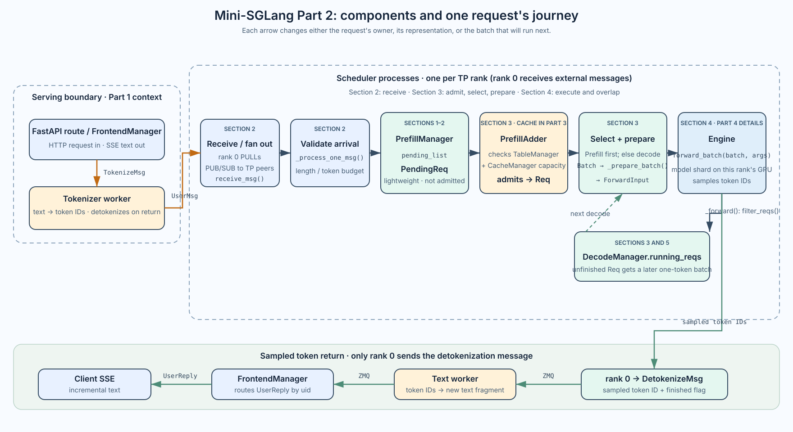
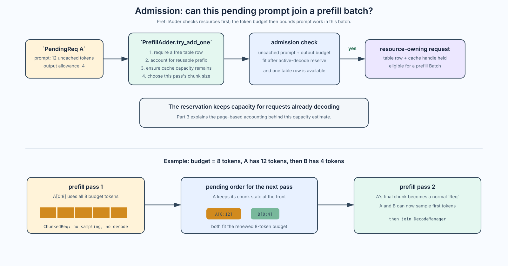
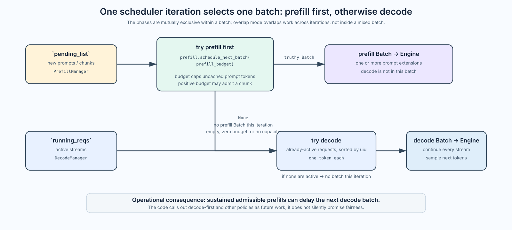
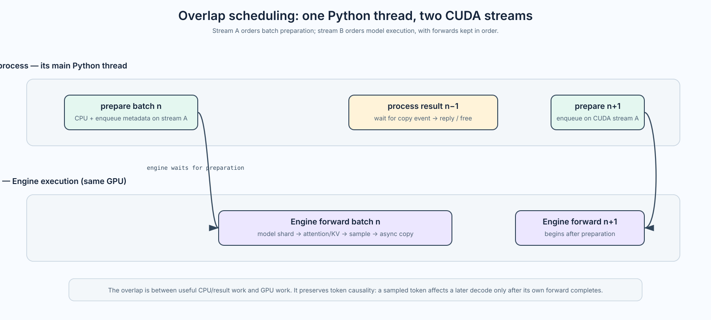

# Mini-SGLang Part 2: The Scheduler—Admission, Prefill, Decode, and Overlap

[Part 1]() followed an HTTP request across Mini-SGLang's processes. The tokenizer changed text into a `UserMsg`; rank 0 sent that message to every tensor-parallel scheduler rank; an `Engine` sampled tokens; and the reply took the reverse route to the browser.

That leaves the question at the heart of an online inference server:

> Given many tokenized requests, which tokens should this GPU run *next* without exceeding request-table or KV-cache capacity?

In nano-vLLM, Part 1's [`Scheduler`]() had `waiting` and `running` queues. Mini-SGLang keeps the same fundamental lifecycle, but makes more of the serving decisions explicit: a `PrefillManager` owns not-yet-admitted work, a `DecodeManager` owns active generations, and a short `Scheduler` loop chooses a batch for one rank-local `Engine`.

This post explains those control-plane decisions. It deliberately treats the radix cache/page allocator as a capacity and prefix-reuse service; Part 3 will trace its page tables, handles, locking, reuse, and eviction. It also treats `Engine.forward_batch()` as a GPU boundary; Part 4 will descend into attention, sampling, CUDA graphs, and tensor parallelism.

The primary files are [`scheduler/scheduler.py`](https://github.com/sgl-project/mini-sglang/blob/main/python/minisgl/scheduler/scheduler.py), [`scheduler/prefill.py`](https://github.com/sgl-project/mini-sglang/blob/main/python/minisgl/scheduler/prefill.py), [`scheduler/decode.py`](https://github.com/sgl-project/mini-sglang/blob/main/python/minisgl/scheduler/decode.py), [`scheduler/io.py`](https://github.com/sgl-project/mini-sglang/blob/main/python/minisgl/scheduler/io.py), and [`core.py`](https://github.com/sgl-project/mini-sglang/blob/main/python/minisgl/core.py). The code references use Mini-SGLang's `main` branch at commit `9a91cfa`, the version examined in Part 1.

Part 1 followed the request across Mini-SGLang's processes. Figure 1 zooms into the scheduler-side components this post studies and shows where each request object moves next.



*Figure 1 — The section labels follow the article's current structure: Sections 1–2 introduce the scheduler and receive path; Section 3 covers admission, batch choice, and preparation; Section 4 follows the execution/overlap loop; Section 5 traces requests A and B. The lower return path shows detokenization, and the loop back to `DecodeManager` shows how unfinished requests get later decode batches.*

Read the top path as a series of ownership changes, not as one giant function call:

1. **Receive and create pending state (Sections 1–2).** The tokenizer turns prompt text into `UserMsg`. Rank 0 pulls it from the tokenizer and broadcasts it to TP peers; each scheduler rank runs `_process_one_msg()`, which validates the message and has `PrefillManager` store it as a lightweight `PendingReq`.
2. **Admit and select work (Section 3).** `PrefillAdder` decides whether a pending prompt can become a resource-owning `Req`; the scheduler prefers a prefill batch, falling back to decode work when no prefill batch is available. It then prepares the batch for execution.
3. **Execute the batch (Section 4).** The rank-local `Engine` runs the prepared batch on the GPU. In the default loop, some host work can overlap GPU execution.
4. **Return tokens and repeat (Sections 4–5).** Rank 0 sends sampled IDs for detokenization and streams the returned text to the client. An unfinished `Req` can enter a later decode batch, as the two-request trace shows.

Section 2 follows the receive and message-processing path in code. Section 3 connects admission to phase choice and batch preparation; Section 4 explains the scheduler loop and its overlap mode; Section 5 traces two requests. Part 3 will open the cache components used during admission; Part 4 will open the `Engine` box.

## 1. The scheduler is the control plane for one GPU rank

There is one `Scheduler` process per tensor-parallel (TP) GPU rank. It constructs a rank-local `Engine`, then constructs the CPU-side managers that decide what that engine will run:

```python
# minisgl/scheduler/scheduler.py (abridged)
self.engine = Engine(config)

self.table_manager = TableManager(config.max_running_req, self.engine.page_table)
self.cache_manager = CacheManager(
    self.engine.num_pages, config.page_size, self.engine.page_table, config.cache_type
)
self.decode_manager = DecodeManager(config.page_size)
self.prefill_manager = PrefillManager(
    self.cache_manager, self.table_manager, self.decode_manager
)
self.prefill_budget = config.max_extend_tokens
```

The names matter. The `Scheduler` does not own model weights or execute a transformer layer; its `Engine` does. Conversely, the engine does not decide whether a new request is safe to admit; the scheduler and its managers do.

### A request changes representation as it enters the scheduler

One request has a short-lived wire representation and two longer-lived scheduler representations. `UserMsg` crosses the tokenizer-to-scheduler process boundary through ZMQ. `PendingReq` waits for prefill admission inside a scheduler process. `Req` owns the resources needed to participate in prefill and decode batches. Their relationship is:

```text
tokenizer worker
  └─ ZMQ `UserMsg(uid, input_ids, sampling_params)`
       └─ Scheduler._process_one_msg()
            └─ PrefillManager.pending_list: `PendingReq`
                 └─ PrefillAdder.try_add_one() admits it
                      └─ `Req` in a prefill Batch
                           └─ successful non-chunk prefill
                                └─ DecodeManager.running_reqs: `Req`
```

This gives a direct correspondence with nano-vLLM's scheduler: `PrefillManager.pending_list` is the waiting collection, and `DecodeManager.running_reqs` is the running collection. The ZMQ `UserMsg` exists only during the process-to-process hand-off; the two manager collections hold the request lifecycle state in Python memory on every scheduler rank.

The scheduler input uses tagged `BaseBackendMsg` records. `UserMsg` carries a new tokenized request, `AbortBackendMsg` carries a cancellation, and `BatchBackendMsg` wraps several records for transport. The reverse scheduler link carries `DetokenizeMsg` to the detokenizer. These message types describe arrivals and departures at the process boundary; `pending_list` and `running_reqs` describe the state of work already resident in the scheduler.

The current source stores the following fields in each representation:

| Object | Stored fields | Transition |
| --- | --- | --- |
| `UserMsg` | `uid`, CPU 1-D `int32` `input_ids`, `sampling_params` | The tokenizer sends it over ZMQ; `_process_one_msg()` validates its length and creates a `PendingReq`. |
| `PendingReq` | `uid`, CPU `input_ids`, `sampling_params`, `chunked_req` | `PrefillManager.add_one_req()` appends it to `pending_list`. `chunked_req` is normally `None` and retains an incomplete prompt chunk when chunked prefill is active. |
| `Req` | `input_ids`, `table_idx`, `cached_len`, `output_len`, `uid`, `sampling_params`, `cache_handle`; initialization also sets `device_len` and `max_device_len` | `PrefillAdder` creates it after reserving a table row and cache handle. It enters a prefill `Batch`; an unfinished non-chunk request then joins `DecodeManager.running_reqs`. |

## 2. Worker startup and the scheduler's receive loop

### The scheduler worker starts once and stays in its loop

The scheduler does not appear on demand when a prompt arrives. It is a long-lived child process, initialized by the server startup callback. The key sequence in `server/launch.py` is:

```python
def _run_scheduler(args, ack_queue):
    with torch.inference_mode():
        scheduler = Scheduler(args)       # Engine + managers + ZMQ I/O
        scheduler.sync_all_ranks()        # all TP ranks finish initialization
        if args.tp_info.is_primary():
            ack_queue.put("Scheduler is ready")
        scheduler.run_forever()           # persistent receive/schedule/execute loop
```

`Scheduler(args)` constructs `Engine(config)` first, so this is where each scheduler rank initializes its model shard and GPU-side runtime. It then creates the table/cache managers, `PrefillManager`, `DecodeManager`, and ZMQ I/O mixin. The parent process uses the startup acknowledgment only to know initialization has completed; the scheduler does not put inference requests on that multiprocessing queue. Once every expected worker has acknowledged readiness, the parent starts Uvicorn and can accept HTTP traffic.

`_run_scheduler()` wraps the worker in `torch.inference_mode()`, and `run_forever()` is also decorated with it. The outer context covers initialization and the service call; inference mode disables autograd, while ZMQ receive and scheduling remain ordinary Python control flow.

`run_forever()` is the scheduler's service loop, not a one-time request handler. It selects between two loop implementations:

```python
if ENV.DISABLE_OVERLAP_SCHEDULING:
    with self.engine_stream_ctx:
        self.engine.stream.wait_stream(self.stream)
        while True:
            self.normal_loop()
else:
    assert torch.cuda.current_stream() == self.stream
    data = None
    while True:
        data = self.overlap_loop(data)
```

By default, `overlap_loop()` runs repeatedly; setting `MINISGL_DISABLE_OVERLAP_SCHEDULING=1` selects `normal_loop()`. Both loops receive ZMQ messages, schedule batches, call the same Engine, and handle sampled tokens. Section 4 compares how they order that work. A simplified view of the default loop is:

```python
last_data = None
while True:
    blocking = not (last_data is not None or prefill_runnable or decode_runnable)
    for msg in receive_msg(blocking=blocking):
        _process_one_msg(msg)

    ongoing_data = None
    forward_input = _schedule_next_batch()
    if forward_input is not None:
        ongoing_data = (forward_input, _forward(forward_input))

    _process_last_data(last_data)  # consume the previous iteration's result
    last_data = ongoing_data
```

`launch.py` creates each worker with `multiprocessing.Process(target=...)`. This starts a child process and runs the target function on the child's main Python thread; it does not create a thread for each request or automatically make the worker asynchronous. Mini-SGLang's own `while True` keeps the scheduler alive, and that loop calls `receive_msg()`, `_process_one_msg()`, the scheduling methods, and `_forward()` synchronously on the same main thread. Libraries may have their own helper threads, but the scheduler's Python control path is not dispatched to them.

The scheduler is one process per TP rank, associated with that rank's GPU. When the rank has no work to run, the loop passes `blocking=True` to its ZMQ receive. This is not a timer or a busy-poll: the receive waits for a message, and the operating system parks the calling thread until one arrives. The process remains alive but does not burn a CPU core while it waits. If work is already runnable or there is a prior forward result to handle, the loop receives without blocking, drains messages already waiting, and continues scheduling.

Blocking pauses this scheduler thread, not the whole server. FastAPI/Uvicorn runs in the parent server process, and tokenizer workers run in their own processes; the operating system can schedule them while the scheduler waits. With tensor parallelism, each rank also has its own scheduler process, and those ranks coordinate to execute each distributed batch together. The Python thread performs control and preparation on the CPU; `Engine.forward_batch()` submits model work to the rank's GPU. In overlap mode, the GPU can execute on its CUDA stream while the scheduler thread handles some CPU-side work—this is GPU/CPU stream overlap, not a second scheduler thread.

```text
Parent server process: FastAPI / Uvicorn + FrontendManager

Tokenizer worker process: receive → tokenize on CPU → PUSH UserMsg
                                                       │
                                                       ▼
Scheduler child process for TP rank 0:
  main Python thread: run_forever()
    ├─ idle: wait in ZMQ receive
    ├─ _process_one_msg()       # CPU-side Python
    ├─ schedule + prepare       # CPU-side work
    ├─ Engine.forward_batch() ── submit GPU work ──→ GPU rank 0
    └─ handle sampled result; loop again

Idle means the scheduler thread is asleep in receive; it does not
mean that multiprocessing created another thread to handle requests.
```

### Rank 0 receives from the tokenizer and fans messages out to TP peers

The broadcast is implemented in [`SchedulerIOMixin`](https://github.com/sgl-project/mini-sglang/blob/9a91cfa/python/minisgl/scheduler/io.py), not in `run_forever()` itself. During mixin initialization, it [binds `self.receive_msg` by rank](https://github.com/sgl-project/mini-sglang/blob/9a91cfa/python/minisgl/scheduler/io.py#L47-L65): rank 0 gets `_recv_msg_multi_rank0()`, while peers get `_recv_msg_multi_rank1()` and a ZMQ SUB socket. The common scheduler loop later calls `self.receive_msg(...)` in every process.

The hand-off from I/O to scheduler logic is this two-line loop in `overlap_loop()` (and the equivalent in `normal_loop()`):

```python
for msg in self.receive_msg(blocking=blocking):
    self._process_one_msg(msg)
```

`receive_msg()` returns a list. On rank 0, its selected method pulls backend messages from the tokenizer and publishes each raw message to the TP peers. The peer method returns the corresponding messages received from its SUB socket. Thus the same loop body runs once in every scheduler process; each process gets its own decoded copy of each arrival.

The essential part of the rank-0 path is:

```python
# _recv_msg_multi_rank0(), simplified
if blocking:
    raw = self._recv_from_tokenizer.get_raw()
    self._send_into_ranks.put_raw(raw)   # ZMQ PUB: forward payload to TP peers
    pending_msgs.append(self._recv_from_tokenizer.decode(raw))
...
src_tensor = torch.tensor(len(pending_raw_msgs))
self.tp_cpu_group.broadcast(src_tensor, root=0).wait()  # Gloo: share extra-message count
for raw in pending_raw_msgs:
    self._send_into_ranks.put_raw(raw)
    pending_msgs.append(self._recv_from_tokenizer.decode(raw))
```

Each peer uses `_recv_msg_multi_rank1()`: it receives the first message from its SUB socket when blocking, participates in the same Gloo count broadcast, then receives that many additional PUB/SUB messages. The PUB/SUB sockets carry the actual serialized backend messages; the Gloo collective carries only the number of additional messages to drain. Rank 0 returns its decoded messages, and each peer returns its received messages to the same `for msg in self.receive_msg(...)` loop. That is how every rank reaches `_process_one_msg()` with the same ordered arrivals and builds the same logical scheduler state.

The peer-side receive makes the pairing explicit:

```python
# _recv_msg_multi_rank1(), simplified
if blocking:
    pending_msgs.append(self._recv_from_rank0.get())
dst_tensor = torch.tensor(-1)
self.tp_cpu_group.broadcast(dst_tensor, root=0).wait()
for _ in range(int(dst_tensor.item())):
    pending_msgs.append(self._recv_from_rank0.get())
```

The full implementations are [`_recv_msg_multi_rank0()` and `_recv_msg_multi_rank1()`](https://github.com/sgl-project/mini-sglang/blob/9a91cfa/python/minisgl/scheduler/io.py#L88-L122). The corresponding shared `receive_msg()` call is in [`overlap_loop()`](https://github.com/sgl-project/mini-sglang/blob/9a91cfa/python/minisgl/scheduler/scheduler.py#L83-L106) and `normal_loop()`.

```text
tokenizer
    │ UserMsg(uid=42, input_ids=[...])
    ▼
rank 0 Scheduler ── PUB/SUB raw message ──► rank 1 Scheduler ──► ...
    │                                           │
    └── each rank: _process_one_msg(UserMsg) ───┘
                         │
                         ▼
                  PrefillManager.pending_list
```

Only rank 0 owns the external ZMQ input and sends `DetokenizeMsg` replies. All TP ranks need the same request order and batch shape because they execute shards of one logical forward pass together.

### `_process_one_msg()` validates a `UserMsg` and creates `PendingReq`

After the rank-specific receive method returns, the `for` loop passes each message to `_process_one_msg()`. For a `UserMsg`, that method checks that the prompt fits the model's maximum sequence length, caps the requested output length if necessary, and hands the valid message to `PrefillManager`:

```text
ZMQ receive / TP fan-out
  → receive_msg() returns UserMsg(uid, input_ids, sampling_params)
  → _process_one_msg(UserMsg)
  → PrefillManager.add_one_req(UserMsg)
  → pending_list.append(PendingReq(...))
```

The code path is intentionally short:

```python
def _process_one_msg(self, msg):
    if isinstance(msg, UserMsg):
        input_len = len(msg.input_ids)
        max_output_len = self.engine.max_seq_len - input_len
        if max_output_len <= 0:
            return  # drop an overlong prompt
        if msg.sampling_params.max_tokens > max_output_len:
            msg.sampling_params.max_tokens = max_output_len
        self.prefill_manager.add_one_req(msg)
```

`add_one_req()` does not allocate a page or call the GPU. It performs only:

```python
self.pending_list.append(PendingReq(msg.uid, msg.input_ids, msg.sampling_params))
```

This is the scheduler's pending queue, not yet the GPU batch and not yet an admitted `Req`. Admission comes later, when `PrefillAdder` checks whether a table row and KV-cache capacity can be reserved (Section 3). Until then, the `PendingReq` is lightweight CPU-side state in `PrefillManager.pending_list`.

An `AbortBackendMsg(uid)` follows the inverse path. The scheduler first tries to remove that ID from `pending_list`; if it has already become active, it asks `DecodeManager` instead, then frees its active resources. The frontend's client-disconnect handling from Part 1 therefore reaches the real scheduler lifecycle rather than merely stopping the HTTP stream.

For a normal `UserMsg`, appending the `PendingReq` is not the end of the scheduler iteration. After processing the messages returned by `receive_msg()`, the same loop proceeds to `_schedule_next_batch()`:

```python
for msg in self.receive_msg(blocking=blocking):
    self._process_one_msg(msg)       # appends PendingReq

forward_input = self._schedule_next_batch()
```

There is no process or thread hand-off here: the same scheduler loop immediately calls [`Scheduler._schedule_next_batch()`](https://github.com/sgl-project/mini-sglang/blob/9a91cfa/python/minisgl/scheduler/scheduler.py#L219-L225). Section 3 picks up at that call and follows the pending request through admission, phase choice, and batch preparation.

## 3. From pending request to prepared batch

Section 2 ended with a `PendingReq` in `PrefillManager.pending_list`. The same scheduler loop now asks whether pending prompt work can safely join a prefill batch. Admission and phase choice are adjacent steps inside `_schedule_next_batch()`: `PrefillManager` tries to build prefill work, then `DecodeManager` supplies decode work only if no prefill batch was formed.

### Admission: what `PrefillAdder` needs to create a `Req`

`PrefillManager.schedule_next_batch()` constructs a `PrefillAdder` with the prefill-token budget, the decode manager's in-flight reservation, and references to `TableManager` and `CacheManager`. It calls `PrefillAdder.try_add_one()` for pending requests in order. For a new pending request to become a `Req`, the adder needs:

- **Some prefill token budget left.** `prefill_budget` is the maximum number of uncached prompt tokens the scheduler may extend in this prefill batch—not a number of requests, the prompt's total length limit, or an output-token budget. A reused prefix does not count; its uncached suffix does. If the budget is exhausted, this pass cannot extend more prompt tokens. For example, with a budget of 8, a 5-token uncached prompt and then a 6-token uncached prompt can contribute 5 + 3 tokens to this batch; the second request becomes a `ChunkedReq` and its remaining 3 prompt tokens continue in a later prefill batch.
- **A free request-table row.** `TableManager` must have a row for the request's token and page-table entries.
- **A cache-prefix match handle.** It may represent a reusable prefix or an empty prefix. The matched prefix determines how many prompt tokens are already reusable and how many still need extending.
- **Enough KV-cache capacity for the uncached prompt suffix and requested output.** The estimate must also preserve capacity reserved for active decode requests. After locking the matched handle, the adder checks capacity again so an eviction/allocation race cannot invalidate the decision.

The `PendingReq` already carries the request ID, CPU `input_ids`, and sampling parameters; admission does not tokenize it again. If a resource check fails, `try_add_one()` returns `None`; the FIFO admission pass stops, leaving that request and later pending work for another iteration. If checks pass, it locks the handle, allocates the row, copies the relevant token IDs into the table manager's device-side token pool, and `_add_one_req()` constructs a `Req` or a `ChunkedReq` for an incomplete prompt.

A resumed `ChunkedReq` is the exception to the “new request” checklist: it already owns its table row and cache handle, so the next pass reuses them rather than matching and allocating again. It still needs a positive token budget to extend the next prompt chunk.

```text
PendingReq in pending_list
  → PrefillManager.schedule_next_batch()
  → PrefillAdder.try_add_one(PendingReq)
      ├─ cannot reserve resources → leave request pending
      └─ can reserve resources → create Req
  → Batch(reqs=[Req, ...], phase="prefill")
```

[`PrefillManager.schedule_next_batch()`](https://github.com/sgl-project/mini-sglang/blob/9a91cfa/python/minisgl/scheduler/prefill.py#L126-L151) returns a prefill `Batch` if at least one request was admitted; if it cannot admit any, it returns `None`. This is scheduler-side Python control flow, not a separate GPU worker.



*Figure 2 — `PrefillAdder` has two outcomes: admit a resource-owning `Req` into a prefill batch, or leave the request pending. The per-batch token budget can also split a long prompt into chunks; an incomplete chunk is not sampled or sent to decode.*

The `--max-prefill-length` / `--max-extend-length` option becomes `config.max_extend_tokens`, called `prefill_budget` in the scheduler (default 8192). It limits the combined uncached prompt tokens extended in one prefill batch; it is not a maximum prompt length. A chunked request keeps its table row and cache handle while its remaining prompt is extended in later passes. Only its final prompt chunk can produce the first sampled token.

### Phase choice: prefill first, then decode

At the end of every scheduler-loop turn, `_schedule_next_batch()` makes one choice. It does not inspect a request and label it “prefill” or “decode”; it asks the two managers in order:

```python
batch = (
    self.prefill_manager.schedule_next_batch(self.prefill_budget)
    or self.decode_manager.schedule_next_batch()
)
```

`PrefillManager.schedule_next_batch()` returns a prefill `Batch` if it admits at least one pending prompt or prompt chunk. Python's `or` then short-circuits: `DecodeManager.schedule_next_batch()` is not called on that turn. If prefill returns `None`, Python calls the decode manager instead.

| State when the scheduler asks for work | What happens | Selected work |
| --- | --- | --- |
| At least one pending prompt/chunk is admitted | Prefill returns a `Batch`; `or` short-circuits | Prefill batch; active decode requests wait for a later turn |
| Prefill returns `None`, and `running_reqs` is non-empty | Decode manager returns a batch of those active requests | Decode batch, one token per request |
| Prefill returns `None`, and `running_reqs` is empty | Decode manager also returns `None` | No GPU batch this turn |

Prefill can return `None` because there is no pending prompt, the configured prefill budget is zero, or the first pending request cannot reserve resources. If the budget runs out only after one or more prompts have already been admitted, their prefill `Batch` is still selected. A pending prompt that could not be admitted stays pending; it is never reclassified as decode work. Decode applies only to requests already in `DecodeManager.running_reqs`.

For example, if prompt A is admitted, that turn selects A's prefill batch and does not also select active request B for decode. On a later turn, if no prefill batch can be formed, the scheduler may select B (and any other active requests) for decode. The selected batch then passes through `_prepare_batch()` and becomes the single `ForwardInput` for that turn.



*Figure 3 — One `_schedule_next_batch()` call returns a prefill batch if admission succeeds; otherwise it tries a decode batch from active requests. The two phases are never combined in that batch. Overlap mode can run the previous forward on the GPU while the scheduler prepares the next iteration's batch, as Figure 4 shows.*

### What the selected batch contains

`Req.extend_len` is the number of token positions this request contributes to the current forward: `device_len - cached_len`. A prefill may extend by many prompt tokens; a decode extends by one. These labels are therefore scheduling phases, not merely kernel names:

| Phase | Batch contains | Per-request `extend_len` | Scheduler purpose |
| --- | --- | --- | --- |
| **Prefill** | newly admitted prompts or unfinished prompt chunks | one or many uncached prompt tokens | establish prompt attention state, then sample a first output for completed prompts |
| **Decode** | every eligible request in `DecodeManager.running_reqs` | exactly one generated token | extend each active stream by one token and sample the next one |

`DecodeManager.schedule_next_batch()` sorts active requests by `uid` before forming the batch. That gives every currently running request one decode token per decode iteration; it is the small-system form of continuous batching. When a prefill completes, `Scheduler._forward()` calls `filter_reqs()`, which unions decodable requests into this set. When a request reaches EOS, its `max_tokens` limit, or an abort, the scheduler removes it and releases its table/cache resources.

After one manager returns a `Batch`, `_schedule_next_batch()` passes it to `_prepare_batch()`. This step prepares the selected work; it does not run the model. It allocates the required KV pages, builds token positions and request mappings, and prepares attention metadata and sampling arguments. The result is one `ForwardInput` for one phase—prefill or decode.

The scheduler loop passes that `ForwardInput` to `_forward()`, which calls `Engine.forward_batch()` on this rank's GPU. If neither manager returns a batch, there is no `ForwardInput` and no model forward this turn. Part 3 explains the cache allocation and page-table work inside preparation; Part 4 follows `ForwardInput` into the Engine.

The prefill-first policy has a latency trade-off: when pending prompts continue to be admitted, decode batches wait, which can increase the time between tokens for active requests. The scheduler marks other choices, such as decode-first, as future work:

```python
# TODO: support other policies: e.g. DECODE first
```

The phase choice is separate from overlap scheduling. Each turn still selects at most one batch, but in the default overlap loop the GPU may be executing the previous turn's forward while the scheduler prepares the next turn's `ForwardInput`. Figure 4 traces that timing. It is not a mixed prefill/decode batch, and it does not require a second scheduler thread.

Part 3 will open the `CacheManager` mechanisms used during admission and preparation—prefix matching, page locations, handles, locking, reuse, and eviction. Part 4 will follow the prepared input through attention, sampling, and the Engine's GPU execution.

## 4. The scheduling loop hides some CPU work behind GPU work

Each TP rank has one scheduler process, whose main Python thread runs `overlap_loop()`. The loop's decisions—receiving messages, choosing a batch, and updating request state—are ordinary Python work. Batch preparation also launches GPU operations, so the scheduler gives that preparation its own CUDA stream.

`_prepare_batch()` illustrates why. It creates position and request-mapping tensors, transfers them to the device, indexes the GPU page table to find KV write locations, and prepares attention metadata and sampler inputs:

```python
batch.positions = _make_positions(batch, self.device)
input_mapping = _make_input_tuple(batch, self.device)
batch.out_loc = self.engine.page_table[input_mapping]
self.engine.attn_backend.prepare_metadata(batch)
```

The position and mapping helpers use non-blocking host-to-device copies. These and the other device-side preparation operations are ordered on the current CUDA stream. The scheduler's preparation stream lets work for a later batch proceed while the Engine's stream executes an earlier model forward.

The Engine and Scheduler create distinct streams on the same rank-local GPU:

```python
# Engine.__init__: model execution stream
self.stream = torch.cuda.Stream()

# Scheduler.__init__: batch-preparation stream
self.stream = torch.cuda.Stream(device=self.device)
self.engine_stream_ctx = torch.cuda.stream(self.engine.stream)
torch.cuda.set_stream(self.stream)
```

`torch.cuda.set_stream(self.stream)` makes the Scheduler's preparation stream current for subsequent tensor operations. The names refer to different objects: `self.engine.stream` is the Engine's stream; `self.stream` is the Scheduler's. A CUDA stream is an ordered queue of GPU operations. The scheduler's one Python thread enqueues operations on the appropriate stream, and the GPU executes them.

The key part of `overlap_loop()` is:

```python
forward_input = self._schedule_next_batch()  # prepare on self.stream
ongoing_data = None
if forward_input is not None:
    with self.engine_stream_ctx:             # switch current CUDA stream
        self.engine.stream.wait_stream(self.stream)
        ongoing_data = (forward_input, self._forward(forward_input))

self._process_last_data(last_data)           # consume prior turn's result
return ongoing_data
```

`wait_stream(self.stream)` establishes the dependency between preparation and execution: the Engine stream waits for preparation operations already submitted on the Scheduler stream before using their metadata. It orders GPU work without making the Python thread wait for the full preparation to finish. `Engine.forward_batch()` submits the current model work to the Engine stream and returns a sampled-token copy plus a CUDA event. `ongoing_data` carries that batch and output to the next call as `last_data`; `_process_last_data()` waits for the copy event before appending token IDs and sending detokenization messages.

That dependency enables the overlap: after submitting forward A, the scheduler thread can begin preparing batch B on `self.stream` while the GPU is still executing A on `self.engine.stream`. The next Engine forward waits for B's preparation, and forwards remain ordered on the Engine stream. Thus the overlap is preparation of B alongside execution of A—not two model forwards running concurrently and not a second scheduler thread. Each turn still selects and submits at most one batch, as Figure 3 showed.

```text
One scheduler thread:  prepare A → submit A → prepare B → submit B → …
GPU Engine stream:                  execute A ─────────→ execute B ─────→ …
                                    (ordered forwards; B waits for its prep)
```

With overlap disabled, `run_forever()` enters the Engine stream context and repeatedly calls `normal_loop()`. In this steady-state path, batch preparation and model execution are ordered on the Engine stream, and `normal_loop()` handles that batch's sampled-token result before moving to the next one. A single stream is sufficient for this sequential execution. Mini-SGLang still constructs the Scheduler stream in `Scheduler.__init__`; before entering the normal loop, the Engine stream waits for any setup work already queued there. The stream is not used to overlap preparation of each next batch with the current forward.

With overlap enabled, result handling trails the launch by one turn, allowing some preparation/result work to sit beside the next GPU forward. This can reduce idle gaps when host preparation or result handling would otherwise leave the GPU waiting, but it is not guaranteed to make every workload faster: synchronization, launch overhead, or a workload already limited by GPU compute can leave little to hide. With no batch in flight and no runnable work, either mode can block on ZMQ until a message arrives.

Part 2 follows the scheduler-loop and stream hand-off at this level. Part 4 will trace what the Engine does after `forward_batch()` receives a batch: attention, KV writes, sampling, CUDA graphs, and tensor-parallel execution.



*Figure 4 — One scheduler thread prepares and submits batches while the Engine stream executes them in order. Result handling for batch *n−1* can overlap execution of batch *n*; the figure does not represent two scheduler processes or simultaneous prefill and decode batches.*

## 5. A request trace: two prompts, then one more arrives

Consider two requests arriving at rank 0 after tokenization:

```text
A: uid=42, prompt length 5, max_tokens=3
B: uid=43, prompt length 4, max_tokens=2
```

Assume both can be admitted, no prefix is reusable, the prefill budget is large enough for nine prompt tokens, and neither request encounters EOS before reaching its token limit. The scheduler history is:

```text
turn 1 — prefill
  receive A and B → _process_one_msg() adds PendingReqs to pending_list
  PrefillManager admits both → prefill Batch [A(5), B(4)]
  _prepare_batch() builds one ForwardInput → Engine runs the prompt positions
  first sampled IDs A1 and B1 make both requests eligible for decode

turn 2 — decode
  no new pending prompts → PrefillManager returns None
  DecodeManager returns Batch [A, B]
  Engine consumes A1 and B1, then samples A2 and B2
  B reaches its two-token limit → release B

turn 3 — decode
  no new pending prompts → PrefillManager returns None
  DecodeManager returns Batch [A]
  Engine consumes A2, samples A3, and reaches A's three-token limit
  release A
```

Here, *turn* means one pass through the scheduler loop, not a fixed time interval. The labels condense the pipeline from Sections 2–4: receive and append pending requests; attempt prefill, then fall back to decode if no prefill `Batch` was formed; prepare the selected batch; submit it to the Engine. In overlap mode, the GPU may still be executing the previous turn's forward while the scheduler starts the next turn, as Figure 4 shows.

### If request C arrives while A and B are decoding

Continue the trace with the same configured `prefill_budget=9`. Suppose C arrives as a `UserMsg` just before turn 2, has six uncached prompt tokens, and requests two output tokens. Assume a free table row and enough KV capacity for C after preserving A and B's decode reservation. At the beginning of turn 2, the scheduler drains messages already waiting on its ZMQ input and `_process_one_msg()` appends C's `PendingReq`. The budget is available again for this new batch, so all six of C's prompt tokens fit:

<figure>
  <video controls autoplay muted loop playsinline preload="metadata" poster="/assets/videos/minisglang/scheduler-trace-poster.jpg?v=4" aria-label="Mini-SGLang scheduler trace showing request state and synchronized CPU scheduler and GPU CUDA-stream work in each turn" style="display:block;width:100%;max-width:720px;height:auto;margin:0 auto">
    <source src="/assets/videos/minisglang/scheduler-trace.mp4?v=4" type="video/mp4">
    Your browser does not support embedded video. <a href="/assets/videos/minisglang/scheduler-trace.mp4?v=4">Open the scheduler trace video.</a>
  </video>
  <figcaption>The opening frames show ZMQ delivery and actual `PendingReq` entries before admission drains the list. Each turn updates the selected batch, sampled IDs, active requests, and prefill budget. The aligned activity lanes show the scheduler's CPU thread, its CUDA preparation stream, and the Engine's CUDA execution stream during that same turn; C's admitted prefill postpones A and B's decode by one turn. Lane widths are illustrative, not measured durations.</figcaption>
</figure>

```text
receive C → pending_list = [C]
prefill_budget = 9 → PrefillManager admits C → prefill Batch [C: 6 prompt tokens]
                    → select C's prefill; A and B wait this turn
```

The budget resets on each scheduling pass; it is not consumed permanently by turn 1. With a smaller configured budget, say 4, and the same six-token prompt, C can still be admitted as a `ChunkedReq`: the first prefill batch extends four tokens, and the following turn extends the remaining two. Each non-empty chunk is a prefill `Batch`, so A and B wait during both turns; C's first token is sampled only after the final prompt chunk. After that final chunk's prefill, the next turn can select decode if no other prefill batch is formed. If the configured budget is zero, or C fails the table/cache resource checks, prefill returns `None`; C stays pending and the scheduler can select A and B for decode. If C arrives just after the scheduler drains input for turn 2, it is considered on the next turn instead, so A and B can decode now. The budget therefore limits each prefill batch, while admission resources decide whether any prefill batch can be formed.

The sampled token IDs travel to the detokenizer through rank 0 after each completed forward, so clients see incremental text while requests remain active. Exact token positions, page-table entries, and prefix-cache state are left out here: they explain *where* the scheduled tokens live and belong to Part 3.

## 6. The NanoVLLM mapping—and where it stops

The useful mental translation is:

| nano-vLLM | Mini-SGLang | Key difference |
| --- | --- | --- |
| scheduler `waiting` queue | `PrefillManager.pending_list` | Mini-SGLang exposes a lightweight `PendingReq` before resource admission. |
| scheduler `running` queue | `DecodeManager.running_reqs` | A set of active `Req` objects receives one token per decode batch. |
| `Sequence` | `PendingReq` then `Req` | The latter carries a request-table row/cache handle and explicit cached/device lengths. |
| `Scheduler.schedule()` | `PrefillManager` + `DecodeManager` + `Scheduler._schedule_next_batch()` | Admission, prefill chunking, decode membership, and GPU preparation are separated. |
| simple single-process loop | rank-0 input broadcast plus identical per-TP-rank schedulers | All ranks must take the same logical scheduling decisions before parallel model execution. |

The important non-mapping is `BlockManager`. In nano-vLLM, one class combines allocation, reference tracking, and block-table work. Mini-SGLang separates request-table slots, cache matching/allocation, and radix-prefix lifetime. The scheduler calls those services during admission, but their data structures deserve the next post on their own.

## 7. What to read next

Part 2 established the rule for **which work becomes a batch**:

```text
UserMsg → PendingReq → admission/reservation → prefill or decode Batch → Engine
```

Part 3 will follow a `Req` through `TableManager`, `CacheManager`, and the radix prefix cache: how a logical request gets a table row, how page-aligned capacity is allocated and locked, why only a reusable prefix is retained, and what happens when capacity is tight.

Part 4 will then take a prepared `Batch` into `Engine.forward_batch()`: page-table lookup, attention metadata, K/V writes, sampling, CUDA graphs, host/device copies, and the tensor-parallel model forward. The final section of that post will compare what Mini-SGLang keeps from full SGLang—and what its intentionally small design leaves out.
