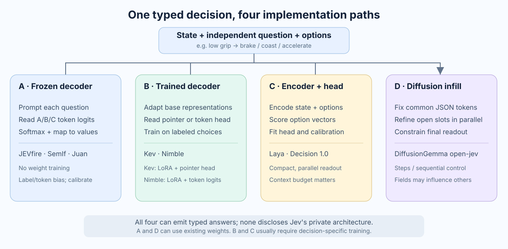
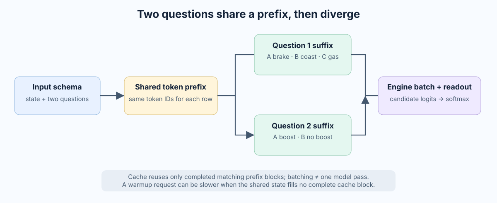
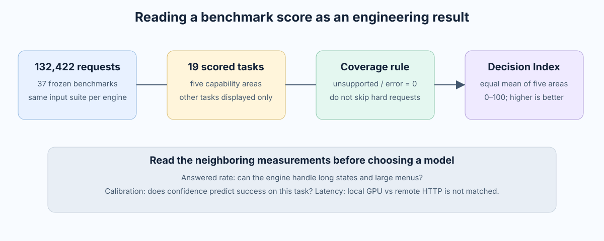
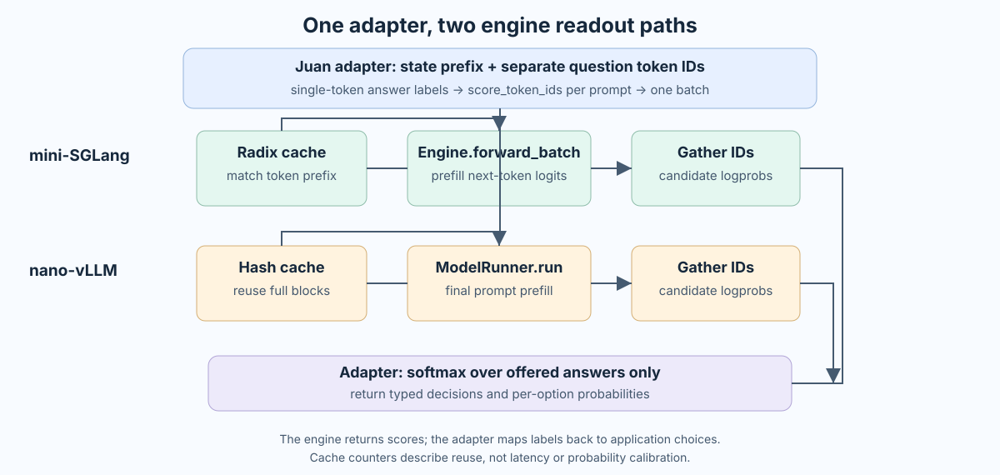

# Jev Decision Models: Four Open Paths, One Benchmark, and a Serving Prototype

I have been reading [nano-vLLM]() and serving-engine internals, so Jev's launch made me ask a fairly specific question: **what has to happen between a model forward pass and a typed decision?** Could I put a small wrapper around vLLM or SGLang, or would I need to change the engine and train a new model?

The answer depends on the goal. An off-the-shelf language model can already score a finite set of choices without generating JSON. [JEVfire](https://github.com/kikoncuo/jevfire) demonstrates that path with vLLM. [Kev](https://github.com/jaredpalmer/kev) takes a different path: it trains a LoRA and a pointer head to read decisions from hidden states. Neither implementation reveals TypeSafe's unpublished Jev weights or its RLCD recipe. They reproduce useful *behaviors and interfaces*, not Jev itself.

This post follows one concrete request through both open implementations, groups the other approaches into four implementation paths, compares checkpoints on the [Decision Index](https://huggingface.co/spaces/multimodalart/jev-decision-index), develops a testable hypothesis about [Reinforcement Learning for Calibrated Decisions (RLCD)](https://typesafe.ai/blog/introducing-system-one-models-and-jev), and shows how I would serve and train a small decision model. **All example probabilities in the worked request are invented to explain the computation; benchmark numbers later in the post are explicitly labeled with their source and date.** The landscape is changing quickly; this is a snapshot as of September 23, 2026.

## 1. The actual task: one state, several small decisions

Imagine a racing game whose physics engine reports:

```text
Tight bend ahead. Low grip. Lane clear. Boost charged.
```

We want two outputs:

| Question | Allowed answers |
| --- | --- |
| Maneuver? | `brake`, `coast`, `accelerate` |
| Use boost? | `true`, `false` |

We could ask a chat model to generate `{"maneuver":"brake","boost":false}`. That works, but the model must emit punctuation, field names, and values one token at a time. A decision interface instead asks for a probability distribution over the declared answers to each question. Application code then builds the object and enforces game rules. It cannot return an undeclared field, although it can still pick a **wrong allowed action**.

TypeSafe calls these question shapes [Choice, Score, and Noul](https://docs.typesafe.ai/introduction): an unordered choice, a rating on a rubric, and a yes/no probability. The questions are evaluated independently against the same state. This is a particularly good fit for routing, tagging, and short agent gates. It is a poor substitute for writing arbitrary text or for a move that requires long search. A probability of `0.90` is useful as a correctness estimate only if calibration has been established on comparable data.



The four paths below are *engineering categories*, inspired by the [AGI Hunt article's route A–D overview](https://mp.weixin.qq.com/s?__biz=MzA4NzgzMjA4MQ==&mid=2453487686&idx=1&sn=8946b2518bdc030d3fbd6a0a1ca5c21b), not a claim about Jev's unpublished architecture. A single project can combine ideas across columns: Nimble trains a decoder adapter but still reads option-token logits.

## 2. JEVfire: score next-token labels on stock weights

[JEVfire's API](https://github.com/kikoncuo/jevfire/blob/main/README.md) accepts a text `context` and a flat schema of finite fields. Its FastAPI process is a **sidecar** in front of an already running vLLM server; it does not load a second model. Its [core.py](https://github.com/kikoncuo/jevfire/blob/main/jevfire/core.py) constructs prompts, asks for selected token log probabilities, normalizes them, and assembles the response.

Here is the request in the shape used by its racing example:

```json
{
  "context": "Tight bend ahead. Low grip. Lane clear. Boost charged.",
  "schema": {
    "maneuver": {
      "type": "enum",
      "description": "Brake for a tight bend with low grip.",
      "choices": ["brake", "coast", "accelerate"]
    },
    "boost": {
      "type": "boolean",
      "description": "Boost only on a clear straight with good grip."
    }
  }
}
```

**Step 1: turn answer values into single-token handles.** JEVfire checks its model's tokenizer at startup and keeps labels such as `A`, `B`, and `C` only if each is one distinct, round-tripping, non-special token. For `maneuver`, `A → brake`, `B → coast`, `C → accelerate`. In a *separate* prompt for `boost`, `A → true`, `B → false`. The labels are internal handles, not the values sent to the application. Checking the actual tokenizer matters: a seemingly short string need not be one token.

**Step 2: make one prompt per field.** The system instructions and race context are shared. Each prompt appends only its own field definition and label map. The boost question does not see the maneuver answer, or even the maneuver options. Both prompts stop exactly where the assistant would begin answering:

```text
[shared instructions and race context]
Selected field: maneuver. A=brake, B=coast, C=accelerate.
Assistant: [score the next token here]

[shared instructions and race context]
Selected field: boost. A=true, B=false.
Assistant: [score the next token here]
```

Those lines show the logic, not the repository's literal chat-template serialization. The real prompts include field descriptions and are converted to token IDs before the API call.

**Step 3: ask vLLM for one next-token position.** The interesting part of JEVfire's `_score_chunk` is its `/v1/completions` request:

```python
payload = {
    "model": self.model,
    "prompt": prompts,                # one token-ID prompt per field
    "max_tokens": 1,
    "temperature": 0,
    "logprobs": 0,
    "logprob_token_ids": token_ids,   # IDs for A, B, C
    "return_tokens_as_token_ids": True,
    "add_special_tokens": False,
}
```

For each field prompt, the model computes next-token logits over its vocabulary. vLLM returns the requested label-token log probabilities. The sampled output token is discarded. **Three options within a field are not three independent model requests.** One prompt has one readout position with three candidate logits. The two *fields* are separate prompts, submitted together so the engine can batch them. A single HTTP call does not imply a single GPU kernel launch or one forward pass for the entire request.

Suppose the returned log probabilities are:

| Field | `A` | `B` | `C` |
| --- | ---: | ---: | ---: |
| maneuver | -0.2 | -1.5 | -2.1 |
| boost | -1.8 | -0.4 | — |

**Step 4: normalize only over the allowed options.** JEVfire applies `softmax(score / T)` over the labels of each field. With `T=1`, the maneuver probabilities are approximately `0.70, 0.19, 0.11`; boost becomes `0.20, 0.80`. Python maps `A` back to `brake` and `B` back to `false` and constructs the JSON. The model never writes the JSON keys.

These numbers are **conditional on the offered menu**, not a demonstrated 70% chance that braking is objectively correct. If the prompt encourages an answer outside `A/B/C`, even a poor candidate can win after renormalization. JEVfire exposes candidate probability mass separately; a confidence threshold or an `unknown` option still needs evaluation on the actual workload. Its decoder treats a missing or non-finite requested score as an error rather than silently selecting a default. If a menu exceeds stock vLLM's 128 requested-token limit, JEVfire scores chunks of the *same full prompt* and merges the raw log probabilities before normalizing; its optional patch raises the cap. See its [implementation](https://github.com/kikoncuo/jevfire/blob/main/jevfire/core.py) and [vLLM's sampling parameters](https://docs.vllm.ai/en/latest/api/vllm/sampling_params/).

**Step 5: reuse shared context when possible.** The two prompts have an identical instruction/state prefix. vLLM's prefix cache can reuse completed matching cache blocks. JEVfire offers plain batching and variants that prefill one question first or align the shared prefix with a cache-block boundary. This is an engine optimization with workload-specific tradeoffs: alignment adds tokens and can even alter answers. It does not magically make two different question suffixes the same computation.



JEVfire reports a **496.9 ms median** for a synthetic 28-field fresh-prefix fixture versus **5,113.1 ms** for generating equivalent grammar-constrained JSON with the same 27B weights and thinking setting on its measured machine. That is a useful demonstration of avoiding sequential output tokens, not a general speed guarantee; the author provides the [methodology and raw results](https://github.com/kikoncuo/jevfire). Its browser Mario example is another implementation path with local WebLLM and a physics guard, not this CUDA/vLLM server.

## 3. Kev: train a model to read options from hidden states

The racing request could also be encoded as a state plus two typed questions in [Kev](https://github.com/jaredpalmer/kev). But the computation changes. A Kev checkpoint is a Qwen base **plus a trained LoRA adapter and a trained pointer head**. It reads internal hidden states instead of asking the language-model vocabulary head for the logit of the letter `A`.

In the attention-only Qwen3 implementation, the input is conceptually packed like this:

```text
<state> tight bend, low grip, lane clear, boost charged
<q> choose maneuver <opt> brake </opt> <opt> coast </opt>
    <opt> accelerate </opt> <decide>
<q> use boost? <opt> true </opt> <opt> false </opt> <decide>
```

Kev's branch attention mask lets each question see the shared state and *its own* options, but not another question. The pointer head projects the hidden state at each option's `</opt>` into a **key** and the hidden state at that question's `<decide>` into a **query**. Scaled dot products produce one score per option; softmax converts them to a distribution. In shorthand:

$$
s_i = \frac{(W_q h_{\mathrm{decide}})^\top(W_k h_{\mathrm{option},i})}{\sqrt{d}},\qquad p_i = \operatorname{softmax}(s)_i.
$$

This scores an option as a span represented at its boundary, so `accelerate`, a long department name, or a chess move need not be a single vocabulary token. The LoRA adapts the backbone's representations and the head learns the readout together; keeping only the head on an untouched base is a different model. Kev trains those parameters with cross-entropy on labeled decisions and can fit a separate temperature to a development set. Its [README](https://github.com/jaredpalmer/kev#how-it-works) and [model code](https://github.com/jaredpalmer/kev/blob/main/kev/model.py) document the details.

There is a version detail worth getting right. On attention-only Qwen3 bases, Kev can pack isolated questions into one block-causal sequence. The current Qwen3.5 models have recurrent Gated DeltaNet layers that do not obey the same attention mask, so Kev runs one state-plus-question row per question and reuses the state cache. Both designs keep questions isolated. Its earliest Qwen2.5-0.5B checkpoint and current Qwen3.5-0.8B/4B/9B family should not be described as the same exact execution path. Kev's published results include strong in-distribution numbers and explicit out-of-domain limitations; a calibrated development set is not proof of calibration on arbitrary new decisions.

## 4. Four implementation paths, with a matched benchmark

I found the A–D taxonomy in the [AGI Hunt article](https://mp.weixin.qq.com/s?__biz=MzA4NzgzMjA4MQ==&mid=2453487686&idx=1&sn=8946b2518bdc030d3fbd6a0a1ca5c21b) useful, but the implementation boundary is more informative than the name of a project. The paths differ in **where the option scores come from**, whether the backbone is trained, and whether separate questions can affect one another:

| Path | Representative projects | Model readout and training | What I would measure first |
| --- | --- | --- | --- |
| **A. Frozen decoder, direct logit readout** | [JEVfire](https://github.com/kikoncuo/jevfire), [SemIf](https://github.com/TheoLeeCJ/SemIf-OpenJev), Juan | Keep weights; prompt each question and softmax logits for candidate label tokens. Engine prefix cache may reuse state blocks. | Option-order/label sensitivity, menu mass, accuracy, calibration, and end-to-end cost. |
| **B. Trained decoder adaptation** | [Kev](https://github.com/jaredpalmer/kev), [Bespoke Nimble](https://github.com/bespokelabsai/nimble), [Decider](https://github.com/Mapika/decider) | Kev learns LoRA + pointer readout from option hidden states. Nimble trains LoRA but still scores single-token option labels. Decider fine-tunes a decoder. | Gain over the *same* frozen backbone, transfer to new tasks, context length, and labeled-data cost. |
| **C. Encoder plus decision head** | [Laya](https://github.com/NandhaKishorM/laya), [Decision 1.0 Kai/Lex](https://huggingface.co/llm-semantic-router) | Bidirectional encoder jointly reads a state and its options, then a decision head produces scores; training and temperature fitting determine behavior. | Small-model speed against long-document coverage, option count, and confidence after domain shift. |
| **D. Diffusion infill** | [JoshuaSP/open-jev](https://github.com/JoshuaSP/open-jev), [razorback16/openjev](https://github.com/razorback16/openjev) | DiffusionGemma refines a canvas with constrained answer positions; read allowed alternatives at the end. Control steps and sequential readout independently. | Quality versus denoising steps, constrained-read latency, cross-field independence, and calibration. |

**Path A: what exactly is zero training?** SemIf's frozen Qwen3.5-4B measured 20.03 decisions/s with parallel suffixes on its *own* 37-state × 21-criterion fixture, versus 2.33 decisions/s with fresh direct scoring. Its compact generated array took 5.21 times as long as direct readout on another 21-decision fixture. Those are [SemIf's workload-specific measurements](https://github.com/TheoLeeCJ/SemIf-OpenJev#speed), not a Jev-to-SemIf speed ratio. Shared-prefix execution changed 5–6 of 777 argmax results versus fresh BF16 scoring in that fixture, so I would regression-test the cache path as well as benchmark it. Even a frozen model can win a broad benchmark by supplying strong pretrained knowledge; no training is required to make an option distribution, but that distribution may still be miscalibrated.

**Path B: a trained head and a fine-tuned logit scorer are different mechanisms.** Kev's LoRA and pointer can score a multi-token option span without inventing a one-token code. Nimble's Qwen3.5-9B LoRA still uses one-token codes with softmax, and its [published training set](https://github.com/bespokelabsai/nimble) has 2,676 curated examples. On Nimble's own 324-example holdout, the base scored 66.36%, Nimble 90.12%, and hosted Jev 93.21%; that is **one curated holdout**, not the Decision Index. Kev's older Qwen3 8B model card reports 86.9% in distribution and 77.4% out of domain versus Jev's 84.5% and 85.7% on that suite. The current Qwen3.5 family uses different bases and results; even the Kev author [reports a long-context failure mode](https://github.com/jaredpalmer/kev/issues/48) beyond its short-state training data. The training-data distribution is part of the model.

**Path C: a fast encoder still has a finite input budget.** Laya's English checkpoint uses ModernBERT-large (421M parameters) plus a decision head. Its [README](https://github.com/NandhaKishorM/laya) says the shipped checkpoint is near chance zero-shot on a typed-decisions benchmark and reaches 0.766 *after training on that benchmark's split*. Its reported ECE improvement from 0.466 to 0.081 requires refitting temperatures on held-out data by question type and option count; it is not a universal out-of-box ECE. At the default 512-token limit, a long document or 77-option menu can overflow or truncate the useful context. A tiny specialized form scorer can beat a general model on forms while losing the general-purpose evaluation entirely.

**Path D: parallel positions are not automatically independent decisions.** [JoshuaSP/open-jev](https://github.com/JoshuaSP/open-jev#how-it-works) fixes JSON tokens shared by all legal outputs, fills variable positions in a DiffusionGemma canvas, and chooses allowed tokens at the final read. Its `steps` parameter controls refinement; later constrained choices can be resolved `sequentially` from that readout. The repository explicitly says grouped fields share attention, unlike Jev's advertised isolation, and its restricted-softmax scores are uncalibrated. [razorback16/openjev](https://github.com/razorback16/openjev) instead uses a one-read path built on a [vLLM structured-read PR](https://github.com/vllm-project/vllm/pull/57250); that PR was **open, not merged** at this snapshot. A [separately reported 67.6%](https://github.com/fstandhartinger/jevbench/blob/main/RESULTS-v1.2.md) on JevBench's hard tier does not belong in a Decision Index score column: the tasks and metric are different.

### Read the same benchmark, not four unrelated project charts

The independent [Decision Index reproduction kit](https://github.com/apolinario/decision-index) specifies **132,422 frozen requests over 37 benchmarks**. Nineteen static benchmarks feed five equal-weight areas into the 0–100 headline score. Unsupported, errored, or unanswered requests contribute zero; six interactive environments are displayed separately rather than included in this index. The [Space's frozen data](https://huggingface.co/spaces/multimodalart/jev-decision-index/blob/eec4fe1b0a8f55eb150ae537715ff35cf211f47b/data/index.json) below was generated **September 22, 2026**, and contains 31 open model entries. It is a benchmark snapshot, not an endorsement of any product. Model size below is **total served parameters**, not trainable adapter parameters or active MoE parameters: a small adapter still needs its full backbone at inference.



| Family / evaluated configuration | Served params | Decision Index ↑ | Answered requests | ECE ↓ |
| --- | ---: | ---: | ---: | ---: |
| Jev 1.13.0 · hosted reference | undisclosed | **59.51** | reference run | 0.065 |
| A · JEVfire, Qwen3.8-27B-FP8 | 27.8B | 55.74 | 99.8% | 0.063 |
| D · JoshuaSP, DiffusionGemma 26B-A4B | 25.8B | 55.56 | 99.8% | 0.239 |
| B · Decider 35B-A3B | 36.0B | 54.34 | 100.0% | 0.031 |
| D · razorback16, DiffusionGemma NVFP4 | 25.8B | 51.52 | 94.3% | 0.220 |
| B · Kev 9B (Qwen3.5) | 9.7B | 50.48 | 100.0% | 0.164 |
| B · Kev 4B (Qwen3.5) | 4.7B | 47.43 | 100.0% | 0.200 |
| A · SemIf, Qwen3.5-4B-Base | 4.7B | 44.77 | 86.0% | 0.119 |
| B · Bespoke Nimble 9B | 9.7B | 34.21 | 69.4% | 0.208 |
| C · Laya 421M | 0.42B | 16.39 | 49.5% | 0.131 |

The top frozen-logit baseline is only 3.77 index points below the hosted Jev reference in this panel, which is an excellent reason to start with Path A. It **does not** establish equal reliability on a new workflow: model sizes differ, the panel covers particular tasks, and the per-model ECE is aggregated over a different set of answered responses when coverage differs. A low ECE with low coverage is especially easy to misread. The Laya and Nimble index results show how context limits or unsupported schemas can dominate a coverage-adjusted ranking even when each performs well on a narrower task. The index reports one RTX PRO 6000 for the local reproductions; Jev's latency includes a hosted HTTP round trip. Do not interpret their milliseconds as a controlled head-to-head speed test. For our own application I would compare **the same model weights before and after task training**, on the same held-out states and GPU, then report answered rate, accuracy, Brier/ECE, p50/p95 latency, throughput under concurrency, and cost per accepted decision separately.

## 5. Does vLLM or SGLang already implement this?

**They expose the necessary scoring operations.** vLLM has an official [`/generative_scoring` endpoint](https://docs.vllm.ai/en/latest/serving/online_serving/generative_scoring/) for a causal model. It appends each item to a query, reads specified next-token label probabilities, and optionally softmaxes over those labels. Its response returns the **first label's score for each item**, so a multi-field Jev-shaped API still needs an adapter to construct one prompt per question, handle all option distributions, types, failure modes, and output assembly. JEVfire instead calls `/v1/completions` with `logprob_token_ids` to get the individual requested scores. vLLM's unrelated `/classify` and `/score` endpoints serve different model/task interfaces; endpoint names alone do not make them Jev.

SGLang's documented [`/generate` inputs](https://github.com/sgl-project/sglang/blob/main/docs/docs/basic_usage/sampling_params.mdx) likewise support batched `input_ids`, `return_logprob`, and `token_ids_logprob`. An external adapter can build per-field prompts, request those scores, normalize the appropriate subset, and return the decision schema. I did **not** find a first-party, Jev-compatible `/v1/systemone` implementation in either project; the official support here is for the lower-level scoring primitives.

For a **JEVfire-style scorer**, my first implementation would therefore be a wrapper, without rewriting the scheduler, attention kernel, or model forward pass. Confirm token-ID logprob behavior on the exact pinned engine version and model before relying on it. A custom engine path becomes useful when the requirement changes: return raw logits without even sampling a throwaway token, hold reusable state handles across requests, fuse several question readouts, serve Kev's trained pointer head, support nonstandard branch attention, or optimize batching and cache lifetime. Those are distinct improvements and need measurements before becoming engine patches.

## 6. Why Jev attracted attention if ordinary models already work

JEVfire's result is instructive: **much of the immediate speedup is an interface and inference trick**, available with already trained weights. Even small fine-tunes can do well on their own distributions. That does not establish that a frozen model has Jev's claimed combination of broad task accuracy, honest probabilities, low latency, and low serving cost on new workloads.

Three product decisions also matter. First, a typed API turns uncertain model judgments into explicit program branches without asking an LLM to serialize the same decision as prose. Second, treating several *independent* questions over one state as a first-class workload creates opportunities for prefix reuse and parallel execution. Third, calibration can change what an application safely automates: a threshold of `p > 0.9` is valuable only if events scored around 0.9 really succeed around nine times out of ten on the target population. Format-valid output alone does not provide that property.

TypeSafe [states](https://typesafe.ai/blog/introducing-system-one-models-and-jev) that Jev uses a new model architecture, a parallel sampler, and RLCD. Its public docs describe isolated Choice/Score/Noul questions and probabilities, but **neither the weights, detailed architecture, nor the RLCD objective and training data are published**. I would treat the speed and calibration claims as hypotheses to test on my own workload, and the open projects as useful baselines rather than assume the proprietary advantage must or must not exist.

## 7. A bounded hypothesis about RLCD

What could “reinforcement learning for calibrated decisions” mean technically? The following is **my inference, not a description of Jev's internal training**.

Start with a policy $p_\theta(a\mid s,q,\mathcal A)$ over allowed actions for state $s$, question $q$, and menu $\mathcal A$. A pretrained model or a supervised decision fine-tune supplies semantic knowledge. Then train the decision readout on a mixture of tasks, including ambiguous and out-of-distribution cases, with feedback that rewards both correct choices and honest uncertainty. When the full correct label is available, one can directly optimize cross-entropy or a proper scoring rule such as the Brier score, and temperature-scale on held-out data. **There is no special need for RL merely because the output is a probability.**

RL becomes interesting if the system observes only the outcome of the action it actually took. If a support agent routes a ticket to Billing and later learns whether that route succeeded, it may never learn what would have happened under Infrastructure or Security. One possible bandit update samples $a\sim p_\theta$, observes correctness $c\in\{0,1\}$, and applies a policy-gradient estimator with a confidence-sensitive reward. The independent [eve-rlcd experiment](https://github.com/anthony-maio/eve-rlcd) uses $r=c-p_\theta(a)$ with REINFORCE and a group baseline; its author relates the expected gradient to the Brier objective under the stated feedback setup. That demonstrates **one plausible open mechanism**, not TypeSafe's recipe. Other possibilities include an outcome reward shaped by log score, ordinal scoring for Score questions, or a supervised-plus-RL mixture. None is confirmed for Jev.

The training signal determines whether the word “RL” adds anything. If the correct answer for **every** choice is known, the full-vector Brier loss $\sum_i(p_i-y_i)^2$ or log loss $-\log p_y$ gives a direct differentiable objective. If only the sampled action's outcome is observed, computing that full-vector target is impossible without extra assumptions; a policy-gradient or propensity-weighted estimator becomes useful, but variance and behavior-policy coverage matter. A separately published [Laya training notebook](https://github.com/NandhaKishorM/laya) uses proper-scoring-rule rewards and a GRPO-style update, followed by temperature fitting. That is evidence of **an open implementation of an RLCD-like idea**, not evidence that TypeSafe uses its architecture, dataset, or reward. Nimble and Kev also fit temperatures after training, which can change confidence without changing the ranking of choices.

| Feedback available | Plausible optimization | What a good number would establish |
| --- | --- | --- |
| Gold answer for every training question | Supervised cross-entropy, Brier, or a task loss; fit temperature on disjoint data | Learned task discrimination and *in-domain* confidence if held-out reliability improves. |
| Only the selected action's delayed success/failure | Bandit or policy-gradient update with logged propensities and a baseline | Learning under partial feedback, subject to exploration and shift; not proof of broad calibration. |
| No additional labels or outcomes | Frozen logit readout plus calibration on a separate labeled validation sample | A strong serving baseline; no new knowledge from the wrapper alone. |

The decisive experiments are empirical: reliability diagrams and ECE/Brier/log loss on held-out *new* task families; accuracy-versus-coverage when abstaining; option-order and wording sensitivity; distribution shift; and matched throughput/latency under concurrent requests. A softmax that sums to one is a probability distribution over offered options. It is not, by itself, calibrated knowledge of whether a selected answer is correct.

## 8. Juan: implementing both mini-SGLang and nano-vLLM

I put the prototype in **Juan**. It implements the same one-token label idea with **both** [mini-SGLang](https://github.com/sgl-project/mini-sglang) and [nano-vLLM](https://github.com/GeeeekExplorer/nano-vllm), pinned to upstream commits with small patch files rather than copying either engine into the repository. It runs a shared `POST /decide` API and `POST /decide-batch`, which sends several questions about one state through a single engine batch. The browser game at `/chess` follows [Kev's chess demo](https://github.com/jaredpalmer/kev/blob/main/playground/src/lib/chess.ts) at the level of gameplay: legal moves are a Choice question, five levels of position advantage form a second question, and the board and move history are their shared state. You can play White or Black, step through model self-play, sample from its move distribution, undo, and retain games locally. `python-chess` validates every move; the UI displays move and evaluation probabilities. `/games/rps` remains a smaller example. Juan's five-level expectation is **not** Kev's trained Score head, and a legal move does not imply good chess play.

There is a meaningful difference from the full engines discussed above. At the pinned revisions, **mini-SGLang registers Qwen3 and Qwen3-MoE, but not Qwen3.5**, and **nano-vLLM's model runner explicitly builds `Qwen3ForCausalLM`**. The scoring patches can also read logits from a supported architecture, but cannot supply a missing backbone: mini-SGLang has a Qwen3-MoE model class, while the pinned nano-vLLM runner supports Qwen3 dense only. Qwen3.5-MoE requires both the hybrid layers and expert routing. The upstream [mini-SGLang Qwen3.5 PR](https://github.com/sgl-project/mini-sglang/pull/133) and [nano-vLLM tracking issue](https://github.com/GeeeekExplorer/nano-vllm/issues/206) document ongoing support work. Qwen3.5's recurrent/hybrid backbone needs more than a newer tokenizer or a renamed model path. Consequently the common, honest baseline here is **Qwen3-0.6B**, with instructions to use the same model directory for either backend. There is no Transformers-based substitute silently standing in for an engine.

Neither pinned mini engine exposed a public request field for arbitrary candidate-token log probabilities. So here **a wrapper alone would lose the crucial scoring primitive**. The mini-SGLang patch adds `score_token_ids` to sampling parameters, gathers requested next-token scores from the prefill logits in `Engine.forward_batch`, and sends them through the scheduler result to the offline `LLM.generate` caller. The nano-vLLM patch does the corresponding gather inside `ModelRunner.run` and returns the scores through `LLMEngine.generate`. Both still sample one throwaway token because their schedulers expect a completion; neither modifies weights or claims the trained Kev/Jev architecture. The batch endpoint batches question prompts within one call, but a lock around each offline engine call means the HTTP API does not batch simultaneous callers. On full vLLM/SGLang the selected-logprob interfaces already exist and a request/decode wrapper is enough for this JEVfire-style baseline.



Here is the exact boundary between the shared Python code and the engine modifications:

| Stage | mini-SGLang | nano-vLLM |
| --- | --- | --- |
| Input | `LLM.generate(prompt_ids, SamplingParams(max_tokens=1, score_token_ids=ids))` | The same pattern through nano-vLLM's offline `LLM.generate` |
| Candidate scores | On the prefill step, `Engine.forward_batch` computes `log_softmax` on the **next-token vocabulary logits**, then gathers the requested IDs | On the final prompt prefill step, rank-zero `ModelRunner.run` gathers requested IDs from `log_softmax(logits)`; the last-step check also covers a chunked prefill |
| Results | `ForwardOutput` → scheduler's `DetokenizeMsg` → `LLM.generate` result | `ModelRunner.run` → `LLMEngine.step` → `LLMEngine.generate` result |
| Existing cache | Radix cache matches token prefixes; the patch counts `cache_handle.cached_len` | Hash cache reuses complete prefix blocks; the patch counts `num_cached_blocks × block_size` |

The shared code in `juan/decision.py` maps each option to a **distinct, verified single-token label** (`A`, `B`, etc.), tokenizes the common state prefix once, concatenates each question's suffix **as token IDs**, then calls `score_many` once with one list of candidate IDs per prompt. Each engine adapter in `juan/engines.py` returns `candidate_logprobs` in option order. For the example with labels `A/B/C`, the application converts them to conditional option probabilities using $p_i=\exp(\ell_i)/\sum_{j\in\{A,B,C\}}\exp(\ell_j)$ and maps the winning label back to `brake/coast/accelerate`. It must also reject non-finite scores, duplicate option names and missing one-token labels. A full-vocabulary `log_softmax` followed by gathering three entries is simple, though an optimized serving path could use `logsumexp` plus a direct gather or compute only candidate-relative logits if unconditional log probabilities are unnecessary.

**What about shared-state caching?** Both mini engines already implement a KV prefix cache: mini-SGLang has a radix tree similar in spirit to [SGLang's RadixAttention](https://www.lmsys.org/blog/2024-01-17-sglang/), while nano-vLLM hashes complete prefix blocks like [vLLM's automatic prefix cache](https://docs.vllm.ai/en/latest/design/prefix_caching/). Juan adds counters where each scheduler attaches cached pages or blocks. In `cache_mode="warm"`, it tokenizes the shared state prefix **once**, performs a one-token prefill of exactly those IDs, then batches the question suffixes with that identical ID prefix. This forces a chance for both questions to reuse completed KV in the existing cache without manually copying KV tensors or changing eviction. `"auto"` skips that warmup. Nano-vLLM's pinned 256-token block granularity means a short chess state may reuse **zero full blocks**; warming can add latency rather than save it. The returned `cache.question_reused_tokens` makes this inspectable, not a speed claim.

```bash
bash setup-engines.sh     # pin upstream revisions and apply the patches
# install ONE upstream engine and requirements in its own CUDA environment
python -m juan --backend mini-sglang --model models/Qwen3-0.6B
# or, with the other engine installed in another environment:
python -m juan --backend nano-vllm --model models/Qwen3-0.6B
```

The Juan README contains installation and curl examples. For a controlled comparison, run both engines and full-engine wrappers on the same weights and GPU, with held-out decisions and chess puzzles. Measure quality, Brier/ECE, cache reuse, throughput and p50/p95 latency separately. The implementation illustrates the architectural boundary: a pretrained Qwen3 plus a candidate-logit scorer is a useful baseline; domain training and honest probability estimates are further questions.

## 9. If I fine-tune: which data and which model?

The first step is to turn the *actual decision request* into a labeled example. For example, one support ticket can supply three labels while all three questions independently read the same `state`:

```json
{"state":"Order 5521 arrived late and my card was charged twice.",
 "questions":{
   "team":{"type":"choice","instructions":"Who handles this first?",
           "criteria":{"shipping":"Delivery issues","billing":"Charges and refunds"},
           "label":"billing"},
   "escalate":{"type":"noul","instructions":"Urgent human attention?","label":false},
   "severity":{"type":"score","instructions":"How severe?",
               "criteria":["low","medium","high"],"label":1}}}
```

This is an abbreviated version of [Kev's documented JSONL format](https://github.com/jaredpalmer/kev/blob/main/skills/kev-finetune/references/data-format.md): one record per line, question IDs and production wording preserved, `choice` labeled with an option name, `noul` with a boolean, and `score` with a zero-based level. Kev also accepts an optional *soft target* over the options, for example a deliberately unanswerable two-way case labeled 0.5/0.5. Keep examples where the answer depends on subtle evidence, counterexamples where the obvious keyword is misleading, reordered option menus, and cases with insufficient evidence. Never use the same customer or near-duplicate state across train and evaluation sets.

For broad public supervision, [Kev's `decision-v7` manifest](https://github.com/jaredpalmer/kev/blob/main/evals/v7/decision-v7/manifest.json) gives a concrete starting point: **10,000** training records from ten public datasets (AG News, Amazon Reviews, Banking77, BoolQ, DBpedia, IMDb, MultiNLI, SST-5, TREC, Yelp), **896** generated policy cases, and **1,680** compositional cases generated from **60** rule structures. These are transformed into typed questions; they are not a single off-the-shelf Jev dataset. The manifest pins source revisions and records separate calibration, development and test files. Its evaluation-only sources include MMLU, Emotion, offensive tweets, QNLI, PAWS and SciQ, plus held-out policy and composition cases. Inspect each upstream dataset's terms and permitted use before redistributing a derivative. For a specific application, begin with real labeled decisions and reserve task families, entities and dates that genuinely test transfer. Kev's [data guide](https://github.com/jaredpalmer/kev/blob/main/skills/kev-finetune/references/data-format.md) suggests a 70/15/15 training/calibration/development split for the working data; set aside an untouched final test set *before* making that split if comparing recipes repeatedly.

The training implementation depends on the readout:

| Training route | Target and deployment consequence |
| --- | --- |
| **Juan-style label-token LoRA** | Keep the `state + question + labeled options + Answer:` prompt. Optimize the correct *one-token* label: ordinary next-token cross-entropy over the vocabulary is the simplest baseline; candidate-normalized cross-entropy trains directly on the offered menu. Randomize which label names each answer and balance options, otherwise the model may learn `A` rather than the criterion. Save the adapter, load it into a compatible mini engine, and use the **same `score_token_ids` patch** to serve its new logits. No pointer-head inference code is needed. |
| **Kev-style LoRA + pointer head** | Train on option spans with a learned query/key readout from hidden states, using the decision labels and Kev's training/serialization path. A Kev checkpoint's pointer weights **cannot** be served by Juan's candidate-token patch: neither mini engine currently returns the `<decide>`/`</opt>` hidden states or performs Kev's branch readout. Use Kev's own server or extend an engine with hidden-state extraction, head weights, question isolation and the matching cache semantics. |

Kev's [released Qwen3.5 recipe](https://github.com/jaredpalmer/kev#training) uses a rank-16 LoRA plus a pointer head, two epochs and cross-entropy; that is evidence for a *data and training strategy*, not a drop-in checkpoint for Qwen3-0.6B in the mini engines. Its [domain fine-tuning example](https://github.com/jaredpalmer/kev#fine-tuning-on-your-own-data) starts from a matching Kev checkpoint with `--init_from`, so both the LoRA and pointer are preserved. If I want Qwen3.5 or MoE for the Juan-style route, I must first add the corresponding backbone support to each pinned engine; the score gather alone cannot load those architectures.

Finally, fit a temperature on a **disjoint calibration split** and check log loss, Brier score, reliability bins and confident errors on held-out domains. Training on correct labels improves discrimination, but a high softmax value is not automatically a trustworthy probability. A small game makes the loop tangible: chess positions and engine-evaluated legal moves can generate `state → question → labeled answer` examples, while positions from different games and time controls form the evaluation split. Stockfish labels for a position are a proxy for search quality, not a guarantee that one-ply decision probabilities reflect winning chances. This is why the frozen scorer, a label-token fine-tune, and a Kev-style learned head belong in the same experiment, with their data and serving paths stated separately.
