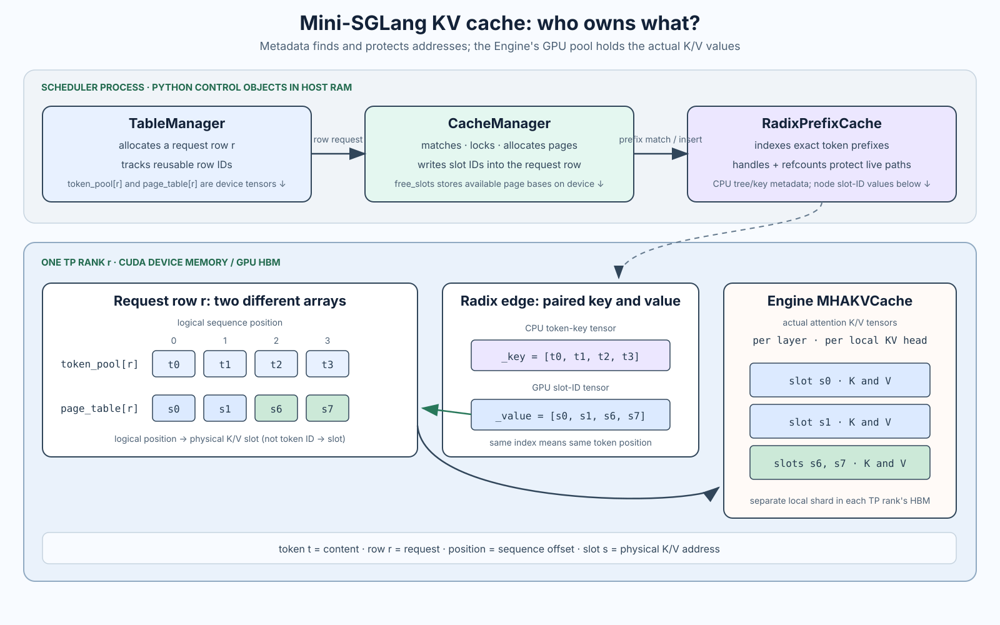
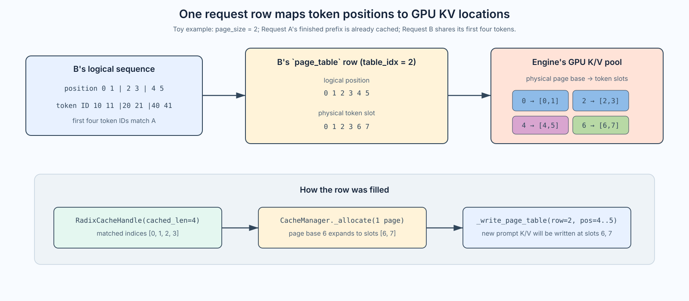
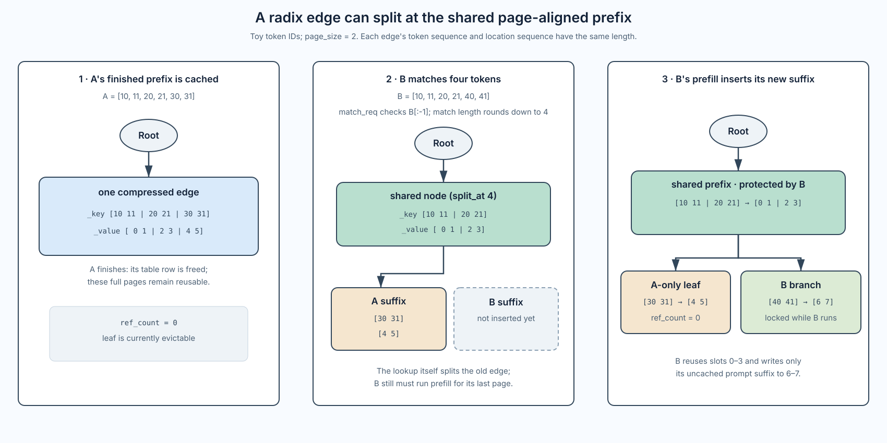
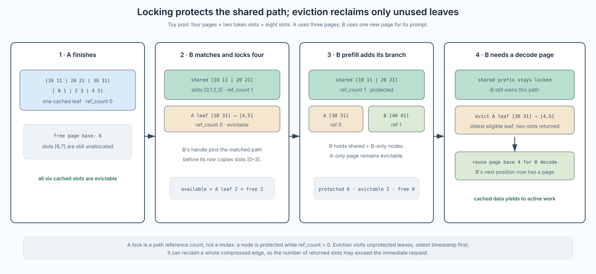

# Mini-SGLang Part 3: KV Cache Pages and Radix Prefix Reuse

[Part 2]() stopped at the admission question: can a pending prompt reserve a request-table row and enough KV-cache capacity to enter prefill? This post first defines the cache objects and address vocabulary, then traces two requests through that machinery: A leaves a reusable prefix, and B reuses it before continuing into decode.

The question is:

> Once a request is admitted, how do its logical token positions find K/V memory, when can an earlier prompt's K/V be reused, and how does Mini-SGLang keep those locations safe until the request is done?

The short answer is that four pieces have different jobs: `TableManager` gives the request a row; `CacheManager` assigns page-aligned physical locations and fills the row's page table; `RadixPrefixCache` remembers which token prefixes map to which locations; and the Engine owns the actual K/V tensors. The cache manager does not copy K/V values into the radix tree. It stores references to locations in the Engine's pool.

Here is the scheduler-side call chain this post follows. Admission and batch preparation happen before the model call; cache insertion happens after a forward has made K/V valid:

```text
Scheduler._process_one_msg(UserMsg) → PrefillManager.add_one_req() → PendingReq
  → Scheduler._schedule_next_batch()
  → PrefillManager.schedule_next_batch()
  → PrefillAdder.try_add_one()
      → check prefill token budget, table capacity, and cache reservation
      → match and lock any reusable prefix; allocate a request-table row
      → _add_one_req() converts PendingReq into Req
  → Scheduler._prepare_batch() → CacheManager.allocate_paged()
  → Scheduler._forward() → Engine.forward_batch() writes K/V and samples a token
  → Scheduler._process_last_data() → cache_req() indexes valid prefix K/V
  → later: DecodeManager forms a one-token decode Batch → Engine.forward_batch()
  → on completion: _free_req_resources() → cache_req(finished=True)
```

The Engine allocates the rank-local K/V tensor pool during startup. Admission does not create that tensor pool: it decides whether the request can reserve a row and enough cache capacity, and creates a `Req`. `_prepare_batch()` then allocates page slots and writes their addresses into the page table. The GPU forward writes the actual K/V values into those slots. A decode forward repeats that last part for the previously sampled token.

The code references below use Mini-SGLang's `main` branch at commit `9a91cfa`, as in Parts 1 and 2. The cache is local to each scheduler/Engine rank. This post follows one rank's bookkeeping; tensor-parallel ranks maintain corresponding local state for their own K/V shards.

The main implementation is in [`scheduler/table.py`](https://github.com/sgl-project/mini-sglang/blob/9a91cfa/python/minisgl/scheduler/table.py), [`scheduler/cache.py`](https://github.com/sgl-project/mini-sglang/blob/9a91cfa/python/minisgl/scheduler/cache.py), [`kvcache/base.py`](https://github.com/sgl-project/mini-sglang/blob/9a91cfa/python/minisgl/kvcache/base.py), [`kvcache/radix_cache.py`](https://github.com/sgl-project/mini-sglang/blob/9a91cfa/python/minisgl/kvcache/radix_cache.py), and [`kvcache/mha_pool.py`](https://github.com/sgl-project/mini-sglang/blob/9a91cfa/python/minisgl/kvcache/mha_pool.py). The scheduler calls these pieces from [`scheduler/prefill.py`](https://github.com/sgl-project/mini-sglang/blob/9a91cfa/python/minisgl/scheduler/prefill.py) and [`scheduler/scheduler.py`](https://github.com/sgl-project/mini-sglang/blob/9a91cfa/python/minisgl/scheduler/scheduler.py).

## 1. Cache vocabulary: owners, addresses, and the radix index

Before following a request, separate two meanings of “KV cache.” The **K/V values** are the keys and values produced by attention and stored in GPU memory. The other objects are **metadata and address maps**: they say which request uses which logical row, which physical slots contain a prefix, and which slots are available for allocation. Mini-SGLang does not keep four copies of K/V; each structure has a different role in finding and protecting the one rank-local K/V pool.

| Component | What it owns | Where the important state lives |
| --- | --- | --- |
| `TableManager` | Reusable request-row IDs and the `token_pool` / `page_table` tensors indexed by row | Python free-row bookkeeping on CPU; row tensors on the rank's GPU |
| `CacheManager` | Prefix-match coordination, page allocation, page-table updates, insertion and freeing | Python control logic; `free_slots` is a device tensor of page bases |
| `RadixPrefixCache` | Exact token-prefix index, handles, reference counts, and eviction candidates | Python tree/control objects and CPU token keys; node `_value` slot-ID tensors are on the device |
| Engine `MHAKVCache` | Actual per-layer K and V vectors used by attention | Rank-local GPU HBM; each TP rank has its own shard |

`Req` is the per-request link between these systems: it carries a `table_idx`, lengths, and a cache handle. It does not own the K/V tensor pool. The managers and radix nodes also do not contain copies of the K/V values; they contain or refer to addresses into the Engine's pool.

### Two address maps, not one

Attention reasons in **logical positions**—0, 1, 2, …—but physical cache pages can be scattered through memory. For a generic request row `r`, Mini-SGLang keeps token IDs and physical K/V locations separately:

```text
logical position       0    1    2    3
token_pool[r, :]      t0   t1   t2   t3       # which token is at each position?
page_table[r, :]      s0   s1   s6   s7       # where is that position's K/V?
```

Here `t0…t3` are token IDs and `s0…s7` are physical K/V slot IDs. `page_table` means **logical position → physical slot**, not token ID → slot. A request can therefore keep contiguous logical history even when its pages are non-contiguous in the pool. With page size two, page base `s6` represents the pair of token slots `[s6, s7]`.

`TableManager` manages the row; `CacheManager` decides which physical pages to use and writes their slot IDs into that row. It knows what is free from its `free_slots` allocator. When a reusable prefix matches, it gets those existing slot IDs from the radix-cache handle; for the uncached positions, it takes free page bases and expands each base into token slots. If it needs pages and none are free, it can ask the radix cache to evict an unprotected prefix and return those pages to the allocator. During batch preparation, the scheduler reads the completed page-table row to produce physical write locations for attention. The Engine then uses those locations to write K/V values into its pool.

The concrete allocation happens in Section 2: with an empty cache, A receives three free pages. Section 3 shows B reusing A's matched slots and receiving a free page for its different suffix; Section 4 shows eviction supplying a page when B later needs one for decode.

### The radix tree is a prefix-to-address index

The radix cache answers a different question: *does this exact token prefix already have valid K/V slots?* It stores compressed runs of token IDs and the corresponding physical slot IDs. A generic edge can be read as a pair:

```text
RadixTreeNode._key   = [t0, t1, t2, t3]   # token IDs used for exact prefix matching
RadixTreeNode._value = [s0, s1, s6, s7]   # slots holding those tokens' K/V
```

The two arrays are positionally paired: `_key[i]` has its K/V at `_value[i]`. A **compressed edge** stores several consecutive tokens in one node rather than allocating one node per token. If a new prompt matches only part of an edge, the cache can split the edge at the common prefix and attach the old and new suffixes as branches. Section 3 will draw that split with A and B's actual example.

`RadixCacheHandle` is a lightweight reference to a matched tree location plus its matched length. Locking a handle protects the path's slot IDs from eviction while a live request uses them. Once no live request protects an entry, it can become an eviction candidate; its K/V values remain in the Engine pool until those slots are reused or the worker shuts down.

### Host objects and GPU memory

The top and bottom of Figure 1 distinguish Python control structures from the device tensors they coordinate. The radix tree's links, handles, reference counts, timestamps, and token keys are Python/CPU state. Its `_value` tensors are GPU slot IDs, as are the `TableManager`'s `token_pool` and `page_table` tensors and `CacheManager.free_slots`. The diagram therefore crosses the host/device boundary with metadata: the tree matches a token prefix, its slot IDs populate a request's page-table row, and that row tells attention which locations to access.

The actual K/V vectors live in the Engine's `MHAKVCache`, allocated in that TP rank's GPU HBM when the Engine starts. Attention reads and writes K/V at the locations identified by the page table; cache lookup and page assignment manipulate addresses, not the K/V vectors themselves. Request token IDs and indexing metadata may be staged between CPU and GPU, but the K/V pool stays in GPU memory. This post follows Mini-SGLang's `MHAKVCache` path; Part 4 will trace how attention uses the locations, and this is not the separate MLA-specific cache path.

Figure 1 is the structural map; the next section begins the chronological trace. Section 2 follows A's cold admission, prefill, and completion. Section 3 follows B's prefix match, radix split, and prefill. Sections 4–5 cover handle protection, eviction, decode-page allocation, insertion, and cleanup; Section 6 recaps the complete trace.



*Figure 1 — The general cache map, before introducing A and B. Read the lower row from left to right: `token_pool[r]` records the token at each logical position; `page_table[r]` maps that position to a physical slot; the paired radix `_key`/`_value` arrays let a matching prefix reuse those slots; and `MHAKVCache` stores the K/V vectors at each slot. The green arrow shows matched slot IDs being written into the page-table row; the dark arrow shows attention following a slot address to K/V storage. Each TP rank has its own Engine pool and corresponding address state.*

## 2. A cold prefill: from an empty cache to A's reusable prefix

The trace uses two prompts to make prefix reuse visible. A has token IDs `[10, 11, 20, 21, 30, 31]` and an output limit of one token, so its request finishes after its first sample. B later has `[10, 11, 20, 21, 40, 41]`: its first four token IDs match A, but its suffix differs. A shows a cold allocation; B shows how an exact shared prefix can be reused.

Follow A first; B enters in Section 3. The token IDs are illustrative. Assume `page_size = 2`, four pages are available, and A's uncached prompt fits the configured prefill-token budget. Before A arrives, `free_slots` contains page bases `[0, 2, 4, 6]`, and the radix tree contains only its root. The four page bases represent eight token slots; page allocation is on demand, so A will use only the first three pages.

The code path to follow is [`Scheduler._process_one_msg()` and `_prepare_batch()` in `scheduler/scheduler.py`](https://github.com/sgl-project/mini-sglang/blob/9a91cfa/python/minisgl/scheduler/scheduler.py) → [`PrefillManager` / `PrefillAdder` in `scheduler/prefill.py`](https://github.com/sgl-project/mini-sglang/blob/9a91cfa/python/minisgl/scheduler/prefill.py) → [`CacheManager` in `scheduler/cache.py`](https://github.com/sgl-project/mini-sglang/blob/9a91cfa/python/minisgl/scheduler/cache.py) → [`RadixPrefixCache` in `kvcache/radix_cache.py`](https://github.com/sgl-project/mini-sglang/blob/9a91cfa/python/minisgl/kvcache/radix_cache.py). For the GPU write boundary, follow `batch.out_loc` to [`MHAKVCache.store_kv()` in `kvcache/mha_pool.py`](https://github.com/sgl-project/mini-sglang/blob/9a91cfa/python/minisgl/kvcache/mha_pool.py).

**1. Admission creates a request row, not K/V pages.** The scheduler receives A's `UserMsg`, and `PrefillManager.add_one_req()` puts a `PendingReq` on its pending list. On the scheduling turn, `PrefillManager.schedule_next_batch()` uses `PrefillAdder.try_add_one()`. The adder checks the token budget and row capacity, then `CacheManager.match_req()` asks the empty radix tree for a matching prefix. The returned handle has `cached_len = 0`. After the capacity check, the adder allocates a `table_idx`; `_add_one_req()` copies A's token IDs into `token_pool` and creates `Req(cached_len=0)`. At this point the request has a row and token IDs, but its `page_table` row does not yet map prompt positions to K/V slots.

The copy is a host-to-device staging step in [`PrefillAdder._add_one_req()`](https://github.com/sgl-project/mini-sglang/blob/9a91cfa/python/minisgl/scheduler/prefill.py):

```python
_slice = slice(cached_len, cached_len + chunk_size)
device_ids = self.table_manager.token_pool[table_idx, _slice]
device_ids.copy_(pending_req.input_ids[_slice].pin_memory(), non_blocking=True)
```

Prefill stages the admitted request's input IDs in `TableManager.token_pool`, where the GPU can use them to build a batch. The two variables in the copy identify its endpoints: `pending_req.input_ids[_slice]` is the source slice in the CPU prompt tensor, while `device_ids` is the destination slice in the GPU token pool. Despite its name, `device_ids` is not a separate set of IDs; it is a view into the destination tensor. PyTorch's [`pin_memory()`](https://docs.pytorch.org/docs/stable/tensors#torch.Tensor.pin_memory) prepares the CPU source for transfer, and [`copy_()`](https://docs.pytorch.org/docs/stable/tensors#torch.Tensor.copy_) copies it into that GPU slice. `non_blocking=True` allows the host to continue without waiting for the transfer to finish when CUDA can perform it asynchronously. This token-ID staging is separate from the K/V pool, whose slots are assigned later through the page table.

Under this example's assumptions—one cold, non-chunked prefill—the six prompt IDs are copied once. Chunked prefill copies each prompt chunk as it is admitted. Decode does not copy the whole prompt again: the sampled next-token ID is written into the GPU token pool for the next decode step.

For A, `cached_len = 0` and `chunk_size = 6`, so after this step the state is conceptually:

```text
CPU source:       pending_req.input_ids[_slice] = [10, 11, 20, 21, 30, 31]
GPU destination:  device_ids = token_pool[table_idx, 0:6]
After copy:       token_pool[table_idx, 0:6]     = [10, 11, 20, 21, 30, 31]
Req:              cached_len = 0, device_len = 6
page_table row:   not yet mapped to physical K/V slots
```

At this boundary, the CPU `PendingReq` still has the source tensor, the GPU `token_pool` has its copy, and `Req` records `cached_len = 0` and `device_len = 6`. No K/V pages have been assigned. `page_table` already exists, but its row is not yet a valid mapping for A's prompt positions. Next, `_prepare_batch()` calls `CacheManager.allocate_paged()` to choose physical K/V pages and fill in that mapping.

**2. Batch preparation assigns pages dynamically.** The scheduler puts A into a prefill `Batch`; `_prepare_batch()` calls `CacheManager.allocate_paged()`. It computes the page interval needed beyond the cached prefix:

```python
first_page = div_ceil(req.cached_len, page_size)
last_page = div_ceil(req.device_len, page_size)
needed_pages = last_page - first_page
```

For A, `cached_len = 0`, `device_len = 6`, and `page_size = 2`, so the allocator needs three pages. `_allocate(3)` takes page bases `[0, 2, 4]` from `free_slots`. These bases are indices into the K/V pool's flattened token-slot dimension; they are not prompt token IDs and not byte addresses. `_page_to_token()` expands each page base into `page_size` consecutive slot indices, then `_write_page_table()` stores those indices in A's page-table row:

```text
logical prompt position:  0  1 | 2  3 | 4  5
page assigned:           [base 0] [base 2] [base 4]
K/V slot index:             0  1 | 2  3 | 4  5

page_table[A's row, logical positions 0..5] = [0, 1, 2, 3, 4, 5]
```

The page table is a GPU-resident PyTorch `int32` tensor, allocated with the Engine on its CUDA device. Each request has a row, and each column represents a logical position in that request. Its entry gives the **K/V slot index** used for that position. For A, logical position 2 holds token ID `20`, and the page-table entry at that position is slot index `2`:

```text
page_table[A, logical position 2] = K/V slot index 2
```

Attention uses slot index `2` to store and later read the K/V vectors for logical position 2. It is a tensor index, not a raw pointer or byte address: CUDA uses it to address the corresponding entry in the Engine's K/V tensor in GPU memory.

Here, a “page” is Mini-SGLang's cache-allocation unit. With `page_size = 2`, one page base of `2` represents slot indices `[2, 3]`. These are consecutive indices in the K/V tensor, not a statement about physical HBM byte addresses.

Paged allocation lets a request use nonadjacent free regions. For example, if free pages have bases `[0, 4]`, a four-token request can use slots `[0, 1, 4, 5]`; it does not need one contiguous four-slot region. This avoids **external fragmentation**: the allocator does not reject a request just because free space is split into separated regions. The page table hides that layout:

```text
logical positions:  0  1  2  3
K/V slot indices:  0  1  4  5
```

The trade-off is internal slack: with two slots per page, a five-token request reserves six slots, leaving one slot unused in its last page.

**3. Batch preparation turns the mapping into K/V write locations.** `_prepare_batch()` asks `CacheManager.allocate_paged()` to assign pages to the batch's requests. That allocator calls `_write_page_table()` to record the assigned slot indices. Control then returns to `_prepare_batch()`, which gathers the slot indices needed by this forward:

```text
Scheduler._prepare_batch(batch)
  └─ CacheManager.allocate_paged(batch.reqs)
       └─ _write_page_table(...)  # records allocated slot indices in page_table
  └─ input_mapping = _make_input_tuple(...)
  └─ batch.out_loc = engine.page_table[input_mapping]
```

The scheduler's `_prepare_batch()` sequence is:

```python
self.engine.graph_runner.pad_batch(batch)
self.cache_manager.allocate_paged(batch.reqs)
batch.positions = _make_positions(batch, self.device)
input_mapping = _make_input_tuple(batch, self.device)
write_mapping = _make_write_tuple(batch, self.device)
batch.out_loc = self.engine.page_table[input_mapping]
self.engine.attn_backend.prepare_metadata(batch)
return ForwardInput(
    batch=batch,
    sample_args=self.engine.sampler.prepare(batch),
    input_tuple=input_mapping,
    write_tuple=write_mapping,
)
```

Padding makes the batch shape suitable for the selected graph path. Page allocation must happen before `batch.out_loc` is gathered, because the table needs valid slot indices first. The position and mapping helpers describe which logical tokens this batch reads and where its sampled outputs will go. Attention metadata prepares the backend for this batch; the returned `ForwardInput` packages the prepared batch and sampling/indexing data for `_forward()`.

Inside `CacheManager.allocate_paged()`, the allocator chooses free page bases, expands them to slot indices, and calls `_write_page_table()`. That helper writes the mapping with indexed assignment:

```python
page_table[table_idxs, offsets] = allocated
```

After allocation returns, `_prepare_batch()` creates `input_mapping`, which identifies the request rows and logical positions being processed in this forward. Indexing `page_table` with it gathers the corresponding slot indices into `batch.out_loc`. For A's full prefill, `batch.out_loc` is `[0, 1, 2, 3, 4, 5]`.

The Engine passes these destinations to attention. At each model layer, attention computes K and V vectors for the input tokens, and `MHAKVCache.store_kv()` writes them at the supplied indices in that rank's GPU-resident K/V tensors. The pool is allocated when the Engine starts; `CacheManager` assigns slots, while the model forward fills them with valid K/V values. Thus `_prepare_batch()` establishes where this forward will write, and the attention forward performs the actual K/V writes.

**4. Completion turns A's prompt into a radix entry.** The forward samples one output token. Because A's output limit is one, the request then finishes. That sampled token is not part of the valid K/V prefix: no later forward has processed it. `cache_req(finished=True)` inserts only `req.input_ids[:req.cached_len]`, which is A's six prompt tokens, paired with their page-table locations. The row is returned to `TableManager`; the complete prompt pages can remain in the radix cache as an evictable entry:

```text
Root ── _key [10, 11, 20, 21, 30, 31]
        _value [0, 1, 2, 3, 4, 5]
```

Section 5 follows the exact `cache_req()` → `insert_prefix()` code. For the current trace, the result is enough: A's row is free for another request, while its page-aligned prompt K/V remains addressable. Section 3 now gives B the same kind of page-table row and shows how its shared prefix points to A's slots.

## 3. B reuses A's prefix: match token IDs and split the compressed edge

Now request B arrives with a prompt that shares A's first four token IDs and then branches:

```text
B input_ids = [10, 11, 20, 21, 40, 41]
```

Assume B's first generated token is not EOS and B still has output budget. Figure 2 depicts B after its prompt prefill and first sample, but before its first decode forward: its six prompt positions have K/V, while the sampled output token does not yet. The decode forward will create K/V for that output token.

Figure 2 shows the mapping produced by B's prompt prefill. Its first four positions point to A's cached slots; the last two use one newly allocated page. The steps below show how `match_req()`, the radix tree, and `allocate_paged()` produce this mapping.



*Figure 2 — B's page-table mapping after prefix reuse and suffix allocation. Its first four logical positions point to A's cached slots `[0,1,2,3]`; its new suffix uses page base `6`, expanded to `[6,7]`. These numbers identify K/V locations, not K/V copies.*

The cache matches token IDs, not raw text or semantic similarity. These IDs might have come from the same prompt prefix and chat template, but the radix cache only sees the resulting exact token sequence.

B follows the same admission call path as A. The scheduler first holds B as a `PendingReq`; when `PrefillManager.schedule_next_batch()` asks `PrefillAdder.try_add_one()` to admit it, the adder checks the remaining prefill budget and table capacity, then calls `CacheManager.match_req()`. With the four-token match below, B needs to extend only two prompt positions. Its cache estimate is those two positions plus its output reservation, with `DecodeManager.inflight_tokens` reserved for active requests. If no table row, no prefill tokens, or insufficient cache capacity is available, B remains pending. If some—but not all—of the prompt extension fits the token budget, Mini-SGLang can instead admit a `ChunkedReq` and prefill it over multiple batches; this example assumes both new prompt tokens fit together. Once the checks pass, the adder locks the matched prefix, allocates B's request row, and `_add_one_req()` creates `Req(cached_len=4)`. The page for B's uncached suffix is assigned later by `CacheManager.allocate_paged()` during `_prepare_batch()`.

For admission, `CacheManager.match_req()` passes all but the final input ID to the prefix cache:

```python
return self.prefix_cache.match_prefix(req.input_ids[: input_len - 1])
```

Keeping the final prompt token out of the match leaves a token for the current prefill forward to process and produce the first next-token logits. The prefix cache stores K/V state; it does not store the logits needed to sample the response.

`RadixPrefixCache.match_prefix()` wraps the tree-walk result in a handle. `_tree_walk()` uses the first page of the remaining query to find a child edge, compares token IDs within that compressed edge, and rounds the match down to a full page. The loop setup is omitted here to focus on the decisions:

```python
child = node.children.get(self.key_fn(input_ids[prefix_len:]))
if child is None:
    return node, prefix_len

match_len = child.get_match_len(input_ids[prefix_len:])
match_len = align_down(match_len, self.page_size)
prefix_len += match_len
if match_len != child.length:
    child = child.split_at(match_len)
    return child, prefix_len
```

With page size two, `_get_key_fn()` groups tokens in pairs for child lookup, and `align_down()` prevents a match from ending in the middle of a page. B's lookup sequence is `[10, 11, 20, 21, 40]`; the first four IDs match A's cached edge, while the fifth is different. The tree splits the edge at that four-token boundary:

```text
before B:
Root ── [10,11 | 20,21 | 30,31] → [0,1 | 2,3 | 4,5]

after B's lookup:
Root ── [10,11 | 20,21] → [0,1 | 2,3]
          └─ [30,31]      → [4,5]      # A-only suffix
```

The common node is the matched prefix; the handle returned for B has `cached_len = 4`. The lookup itself can split a node: `_tree_walk()` calls `split_at()` when the requested tokens match only part of a compressed edge. The split keeps the common token IDs paired with their existing physical locations, and leaves A's suffix as a child edge.

`RadixTreeNode.split_at()` performs that operation by slicing the node's paired key/value tensors and reparenting the old suffix under a new common-prefix node:

```python
new_node.set_key_value(self._key[:pos], self._value[:pos])
new_node.set_parent(parent)
new_node.ref_count = self.ref_count

self.set_key_value(self._key[pos:], self._value[pos:])
self.set_parent(new_node)
```

The split changes only the radix index structure. `_key` slices identify the two token runs; the corresponding `_value` slices keep their original GPU slot IDs. No K/V vectors are copied or recomputed by the split.



*Figure 3 — A's six-token edge is split at B's four-token, page-aligned match. The middle view shows the tree immediately after lookup; B's branch appears only after B's prefill computes those K/V values.*

The handle must be locked before its matched locations are copied into B's request row. `RadixCacheHandle.get_matched_indices()` walks from its node toward the root, gathers each node's `_value`, and returns the physical locations in prefix order. For B, it returns `[0, 1, 2, 3]`. The handoff is: `CacheManager.match_req()` → `RadixPrefixCache.match_prefix()` → `RadixCacheHandle`; then `PrefillAdder` locks that handle and copies its indices into B's `page_table` row:

```python
page_entry = self.table_manager.page_table[table_idx][:cached_len]
page_entry.copy_(handle.get_matched_indices())
```

This fills only the matched prefix. `_add_one_req()` copies B's remaining prompt token IDs into `token_pool`; as with A, it does not allocate the new K/V page. During the later `_prepare_batch()`, `allocate_paged()` sees `cached_len = 4` and `device_len = 6`: with `page_size = 2`, `first_page = 2` and `last_page = 3`, so it requests exactly one new page. A used bases `0`, `2`, and `4`, leaving base `6` in `free_slots`; `_allocate(1)` takes `6`, and `_page_to_token()` expands it to `[6, 7]`.

`PrefillAdder._try_allocate_one()` does the lock before copying those locations. Then the scheduler prepares B's batch. It needs one new page for B's uncached two-token suffix:

```text
B page_table row, logical positions 0..5 = [0, 1, 2, 3, 6, 7]
```

`CacheManager._page_to_token()` expands page base `6` to token slots `[6, 7]`; `_write_page_table()` writes those locations into B's row at positions 4 and 5. The Engine prefill reads K/V for B's shared prefix from `[0..3]` and writes the new suffix at `[6,7]`.

After the forward, `cache_req()` inserts the six valid processed token IDs and their physical slots. The radix tree already has the four-token shared edge, so it adds B's new suffix:

```text
Root ── [10,11 | 20,21] → [0,1 | 2,3]
          ├─ [30,31]     → [4,5]   # A-only page, currently evictable
          └─ [40,41]     → [6,7]   # B's active prefix
```

Because B is still decoding, `CacheManager.cache_req(finished=False)` updates B's handle to the longer prefix and locks it. The four shared tokens and B's two-token branch are protected while the request uses them. A's divergent suffix has no active handle, so its page can be reclaimed under memory pressure.

## 4. Handles protect live prefixes; eviction reclaims eligible leaves

A `RadixCacheHandle` contains two things: `cached_len`, inherited from `BaseCacheHandle`, and a reference to a `RadixTreeNode`. `get_matched_indices()` follows parent links from that node to the root, gathers each node's `_value` slot IDs, reverses that list into prefix order, and concatenates it. Thus the handle carries no prompt copy or K/V data; it identifies the matched tree path and can recover the physical addresses for that path.

```python
@dataclass(frozen=True)
class RadixCacheHandle(BaseCacheHandle):
    node: RadixTreeNode
```

For B, the handle points at the common-prefix node and reports `cached_len = 4`; asking it for matched indices returns `[0, 1, 2, 3]`. `PrefillAdder` copies those indices into B's page-table row, then `CacheManager.allocate_paged()` fills the uncached suffix positions from a newly allocated page.

Locking a handle walks from its node toward the root and increments `ref_count` on every node in the path. If a node changes from zero references to one, its length moves from `evictable_size` to `protected_size`. Unlocking walks the same path in reverse effect: once a node's reference count reaches zero, its length becomes evictable again.

The implementation updates those counters only when a node crosses between zero and nonzero references:

```python
if node.ref_count == 0:  # locking the first request using this node
    self.evictable_size -= node.length
    self.protected_size += node.length
node.ref_count += 1
node = node.parent
```

Unlocking decrements each node's count; when it reaches zero, the same `node.length` moves back from `protected_size` to `evictable_size`:

```python
node.ref_count -= 1
if node.ref_count == 0:
    self.evictable_size += node.length
    self.protected_size -= node.length
node = node.parent
```

A shared ancestor can have `ref_count > 1`, so finishing one request does not expose a prefix still used by another.

This is reference counting for cache lifetime, not a thread mutex. Its job is to prevent a physical prefix from being evicted between “match these locations” and “use these locations.” Two handles that share an ancestor both contribute to that ancestor's count, so one request finishing does not make another request's prefix unsafe.

Part 2 showed the prefill capacity estimate. The important cache detail is why `PrefillAdder` checks it both before and after locking the matched handle. `CacheManager.available_size` is:

```python
prefix_cache.size_info.evictable_size + len(free_slots) * page_size
```

Locked prefix pages are not available for eviction, so locking can reduce the available amount. The second check ensures that the uncached suffix plus output reservation still fits after the matched prefix has been protected. If the second check fails, `PrefillAdder` unlocks the handle and leaves the `PendingReq` waiting.

For the B example, suppose the pool has exactly four pages. A occupies three cached pages and one page remains free. Locking B's four-token match protects the shared two pages; A's two-token divergent page remains evictable, while the one free page supplies B's two-token prompt suffix. After B's prefill, all four pages are occupied: the shared prefix and B's branch are protected by B's handle, while A's divergent suffix is an unprotected leaf. Figure 4 shows which prefix can be reclaimed if B's next decode step needs another page.



*Figure 4 — B's handle protects the common path and B-only branch. A's unused branch remains evictable; when B needs a decode page and no page is free, the cache returns A's page to the allocator.*

`RadixPrefixCache.evict(size)` considers only leaves whose `ref_count` is zero. It puts candidates in a heap ordered by `RadixTreeNode.timestamp`; tree walks refresh timestamps, so the oldest eligible leaf is chosen first. If deleting a leaf makes its parent an unreferenced leaf, the parent can join the candidate heap too. Eviction may therefore reclaim a whole compressed edge and return more slots than the exact request. The root is always protected.

The removal step changes tree metadata and returns the node's slot IDs to `CacheManager`; it does not touch the K/V tensor pool:

```python
node = heapq.heappop(leave_nodes)
evicted_indices.append(node.value)
parent = node.parent
del parent.children[self.key_fn(node._key)]
if parent.is_leaf() and parent.ref_count == 0:
    heapq.heappush(leave_nodes, parent)

return torch.cat(evicted_indices)
```

Eviction does not deallocate the GPU tensor or copy K/V values somewhere else. It removes the tree entry and returns the physical locations to `CacheManager.free_slots`, where a later request can allocate them. The Engine's K/V pool remains allocated for the lifetime of the worker.

This is the transition from B's prefill result to its first decode. `Scheduler._forward()` has already passed the prefill `Batch` to `Engine.forward_batch()`, which wrote B's two uncached prompt K/V entries and sampled B's first output token. `_process_last_data()` appends that token to B's host-side `input_ids`; because B is still active, it calls `cache_req(finished=False)` to insert the now-valid six-token prompt prefix and update/lock B's handle. `DecodeManager` tracks B as a running request, but the sampled output token itself is still waiting to be processed.

On the next scheduling turn, `_schedule_next_batch()` asks `PrefillManager` first. If it forms no prefill batch, the scheduler asks `DecodeManager.schedule_next_batch()` for B's one-token decode batch. `_prepare_batch()` calls `allocate_paged()` for the next logical position; in this four-page example there is no free page, so `_allocate(1)` asks the radix cache for one page's worth of evictable slots:

```python
evicted = self.prefix_cache.evict(
    (needed_pages - len(self.free_slots)) * self.page_size
)
self.free_slots = torch.cat([self.free_slots, evicted[:: self.page_size]])
allocated = self.free_slots[:needed_pages]
```

The unprotected A-only leaf returns slots `[4, 5]`; the stride selects page base `4`, which becomes free. That page expands to slots `[4, 5]`: B's next logical position, 6, maps to slot `4`, and slot `5` is the rest of the allocated page. The physical GPU tensor is not freed or moved—only its cache-tree entry is removed, and the allocator is allowed to reuse those addresses. `Engine.forward_batch()` now consumes B's sampled token and writes its K/V at the assigned location, then samples the following token. `Req.complete_one()` advances the valid cached length for the token just processed. If B continues, it keeps its table row and request-owned page mappings; Mini-SGLang does not call `cache_req()` after every non-final decode. On normal completion, `_free_req_resources()` releases the row and calls `cache_req(finished=True)`, which indexes the valid prefix, unlocks the handle, and returns any uncacheable partial tail to the free-page pool.

## 5. Cache insertion is also deduplication and cleanup

The main lifecycle method in `CacheManager` is `cache_req(req, finished=...)`. It passes valid token IDs and the corresponding page-table locations to `insert_prefix()`. The radix implementation rounds the inserted length down to a page boundary, so a partial last page is not retained as a reusable prefix.

The data passed from `CacheManager` to the radix tree is deliberately just a pair of aligned arrays: the valid CPU token prefix and the GPU slot IDs from that request's page-table row:

```python
insert_ids = req.input_ids[:req.cached_len]
page_indices = self.page_table[req.table_idx, :req.cached_len]
cached_len, new_handle = self.prefix_cache.insert_prefix(insert_ids, page_indices)
```

Inside `RadixPrefixCache.insert_prefix()`, the cache trims both arrays to complete pages, walks the existing tree, and creates a new compressed edge for any suffix not already present:

```python
insert_len = align_down(len(input_ids), self.page_size)
input_ids, indices = input_ids[:insert_len], indices[:insert_len]
node, prefix_len = self._tree_walk(input_ids)
if prefix_len != insert_len:
    new_node = RadixTreeNode(self.key_fn)
    new_node.set_key_value(input_ids[prefix_len:], indices[prefix_len:].clone())
    new_node.set_parent(node)
    node = new_node
return InsertResult(prefix_len, RadixCacheHandle(insert_len, node))
```

So the radix tree records which slot IDs correspond to each token key; it never copies the K/V vectors. For A, the inserted pair is A's six prompt IDs and slots `[0,1,2,3,4,5]`. For B, the common four-token edge already exists, so insertion adds only B's suffix `[40,41] → [6,7]` and returns a handle for the full prefix.

Insertion can find that some of the request's newly computed prefix already exists in the tree. `InsertResult` returns both the length already present and a handle for the complete inserted prefix. `CacheManager.cache_req()` then:

1. unlocks the request's old handle after the new tree path is established;
2. returns any duplicate physical slots between the old handle and the already-cached overlap;
3. if the request is still active, updates `req.cache_handle` and locks the new handle;
4. if the request is finished, frees the uncached tail after the final full page.

That is why `cache_req()` has both `finished=False` and `finished=True` behavior. During prefill, it retains a prefix and gives the active `Req` a handle that protects it. At completion, the scheduler returns the request-table row and unlocks the cache handle; full pages remain in the prefix tree as evictable entries, while a partial tail is returned to the free page pool.

The manager's post-insert handoff is explicit:

```python
self.unlock(old_handle)
self._free(page_indices[old_handle.cached_len : cached_len])
if finished:
    self._free(page_indices[new_handle.cached_len :])
else:
    req.cache_handle = new_handle
    self.lock(new_handle)
```

The first free covers slots that another request had already inserted while this request was computing them; they are duplicates, so this request's copies can return to the allocator. A finished request also frees any trailing slots that did not form a complete cached page. An active request instead adopts and locks the new full-prefix handle. The data path is therefore `Req + page_table` → `CacheManager.cache_req()` → `RadixPrefixCache.insert_prefix()` → `InsertResult` → update/free/lock through `CacheManager`.

The scheduler wraps result cleanup in `CacheManager.lazy_free_region()`. During that short block, `_free()` collects page bases and appends them to `free_slots` together when the context exits. The cache data and allocator stay consistent while insertion, unlock, deduplication, and tail cleanup run.

There is also a `--cache-type naive` implementation. `NaivePrefixCache` always returns an empty handle and does not retain or evict prefixes; normal page allocation still works for active requests. The default `radix` implementation adds exact token-prefix reuse and eviction. This makes `naive` useful as a simple baseline, while `radix` trades more metadata and lifetime bookkeeping for prompt-prefix reuse.

## 6. The cache contract in one trace

For this page-size-two example, the object and memory transitions are:

```text
A arrives: UserMsg → PendingReq
  → PrefillAdder checks prefill budget, request-row availability, and cache capacity
  → empty prefix match; reserve a row and create Req(cached_len=0)
  → _prepare_batch / allocate_paged assigns pages 0, 2, 4
  → Engine prefill writes A's six prompt K/V entries and samples one output token
  → A is finished: free its request row; cache_req(finished=True) keeps the prompt prefix

B arrives: UserMsg → PendingReq
  → PrefillAdder matches four tokens; checks budget and output/cache reservation
  → lock shared prefix, reserve a row, create Req(cached_len=4)
  → _prepare_batch / allocate_paged assigns page 6 to B's two-token suffix
  → Engine prefill reuses slots 0..3, writes prompt K/V to slots 6..7, and samples B's first output token
  → cache_req(finished=False) inserts/locks B's prompt prefix; B remains in DecodeManager

B's next turn:
  → if no prefill batch forms, DecodeManager supplies B's one-token decode Batch
  → allocate_paged needs a page for the sampled token; evict A's unprotected slots 4..5
  → Engine decode processes that sampled token, writes its K/V, and samples the next token
  → on completion, free B's row and cache_req(finished=True) retains valid full pages
```

The Engine's K/V pool exists before either request arrives; admission creates a row-owning `Req`, and batch preparation assigns page locations from that pool. The forward makes those locations contain valid K/V. After prefill, the radix cache records B's prompt prefix; during decode, B's active page table tracks each newly written token, and the completed request's final valid prefix is indexed during cleanup. Part 4 follows the resulting `Batch` into the Engine and shows how attention reads these locations and writes each new token's K/V state.
